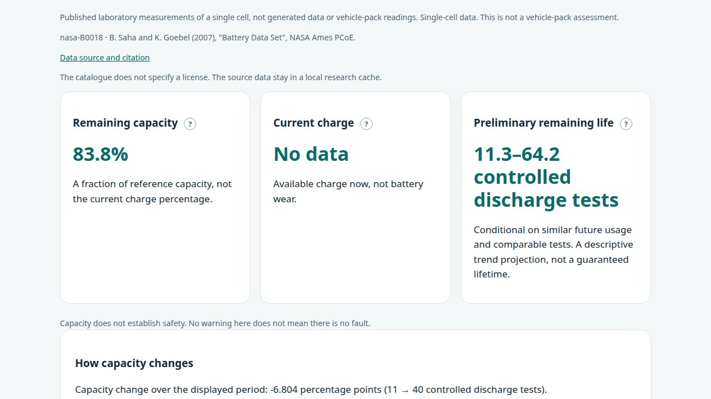
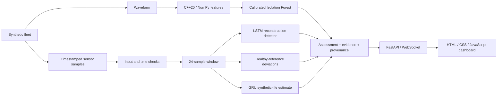

# ARGUS-NEURO

**Battery-health analysis and power-electronics diagnostics: C++20, Python, ML/DL and a working web interface.**

> **Portfolio signal:** Industrial AI / predictive maintenance / edge-oriented ML engineering. Equipment-fleet evaluation uses synthetic data; measured NASA cell histories are available separately. Neither route establishes field-validated EV-pack life or real-equipment failure-prediction accuracy. Battery forecasts are backtested on 108 laboratory cells and the limits of that evidence are published.

## Engineering evidence at a glance

- Native **C++20 + pybind11** signal core with 11 statistical/spectral features and explicit NumPy parity contracts.
- Calibrated spectral baseline, **LSTM autoencoder**, healthy-reference deviation channel, and **GRU RUL** model.
- Training separates trajectories before scaling/window generation and records model/data provenance in generated reports.
- **ONNX export/parity validation** plus checksums and bundle metadata before model activation.
- Explicit `warming_up`, `ready`, `invalid_data`, and `degraded` states instead of silently inventing predictions.
- FastAPI/WebSocket fleet monitor with bounded slow-client behaviour and transport health separated from model availability.
- CI verifies Python lint/formatting, C++ Release tests, native and NumPy execution paths, dashboard contracts, retraining, and ONNX parity.
- Battery remaining-life intervals were backtested on **108 laboratory cells** (NASA, CALB, HUST) and conformally calibrated, **but those figures came from a length-dependent thinning stride and are superseded** ([audit](docs/SAMPLING_AUDIT.md)); the backtest is being re-run at a fixed stride.
- **C++20 voltage-curve indicators** (dQ/dV peak, voltage rise time, step resistance) with NumPy parity. The earlier 24% gain is superseded; on the repaired pipeline a first, unregistered check shows a smaller and less certain gain (see the audit).
- An optional learned **second opinion** that refuses requests outside the chemistry, scope, threshold and sampling it was trained on.
- Reliability documentation states what is computationally tested, what remains heuristic, and what would be required before field deployment.

## What a reviewer should inspect first

1. [Reliability contract](docs/RELIABILITY.md) — guarantees, abstention behaviour, artifact integrity, and deployment boundaries.
2. [C++ signal core](cpp_core/src/signal_features.cpp) and [pybind11 seam](cpp_core/src/bindings.cpp).
3. [Inference engine](python/argus/inference/engine.py) — evidence, provenance, quality gates, and synthetic RUL semantics.
4. [Training pipeline](python/argus/training/) and generated reports under [artifacts](artifacts/).
5. [Reproducibility experiment](experiments/2026-09-30_reliability/).
6. [Backtest](docs/BACKTEST.md), [methodology](docs/METHODOLOGY.md) and [battery assessment code](python/argus/battery/assessment.py) — how the remaining-life interval is produced, calibrated and where it fails.
7. [Voltage-curve indicators](docs/CURVES.md) and the [experiments log](experiments/LOG.md) — each experiment has a configuration, metrics and a conclusion.

---

**English** · [Русский](README.md) · [中文](README.zh.md) · [हिन्दी](README.hi.md) · [Español](README.es.md) · [Français](README.fr.md) · [Deutsch](README.de.md) · [日本語](README.ja.md) · [Italiano](README.it.md)

[Diagnostic contract](docs/RELIABILITY.md) · [Evaluation notes](experiments/2026-09-30_reliability/notes.md)

ARGUS-NEURO combines battery-capacity analysis with power-electronics diagnostic research. The landing page accepts controlled battery tests and published NASA cell measurements; `/equipment.html` monitors a nine-asset synthetic fleet. Battery life is a conditional trend projection, while equipment diagnostics require separate validation before field use.

## Battery analysis: measurements to an explainable report

- Capacity-based SOH and present SOC are separate. An unknown SOC stays unknown.
- Import full controlled capacity tests in Ah through CSV with comparable test conditions. Save reports locally or export JSON.
- Start without personal data using four measured NASA cells: B0005, B0006, B0007 and B0018, with 636 discharge tests in total. Source files stay in a local cache after one-time preparation.
- Life to a configurable capacity threshold is a conditional range. Short histories, unstable trends and active BMS alerts can withhold the numerical forecast.
- Care recommendations use supplied manufacturer limits and reported charging/storage conditions. There is no OBD/CAN connection or charging control.

[Battery method and API](docs/BATTERY.md) · [NASA source, checksums and setup](docs/PUBLIC_BATTERY_DATA.md) · [Small C++/NumPy example](docs/SIGNAL_DEMO.md).

[Backtest on 108 cells](docs/BACKTEST.md) · [Voltage-curve indicators in C++](docs/CURVES.md) · [Methodology](docs/METHODOLOGY.md)

### Research results on 108 laboratory cells

> **Notice (30 October 2026).** The capacity-history numbers in this section were obtained with a thinning stride of ceil(N/600) cycles that depends on how long a cell lives and leaks the answer into the models. They are superseded and are being re-measured at a fixed physical stride; see [SAMPLING_AUDIT.md](docs/SAMPLING_AUDIT.md). Do not quote the calibrated coverage, the learned-model comparison or the curve-indicator gain until then.

Data: NASA PCoE (4 cells), CALB (28 NCM cells) and HUST (77 LFP cells), 3,723 forecast points. Every forecast sees only its observed past. Details and reproduction commands: [BACKTEST.md](docs/BACKTEST.md).

- **The plain interval was over-confident.** The bootstrap 5–95% interval covered the true remaining life in only **12%** of forecasts against a nominal 90%.
- **The calibrated interval holds on unseen data.** A conformal radius with equal weight per source dataset covers **97%** of forecasts on cells it did not see and **96%** when a whole dataset is held out (CALB 90%, HUST 100%, **NASA 67%**). The price is width: the median interval is about 1.6 times the remaining life. A new chemistry or protocol may be under-covered.
- **Curved fits did not help,** so the straight-line trend remains the default.
- **Learned models halve the error of a straight line** on two chemistries (CALB 47 vs 96 cycles, HUST 77 vs 156). They are offered only as an optional second opinion with domain checks; trained weights are never committed.
- **Voltage-curve indicators lower the error by 24%** (68.6 → 52.4 cycles on HUST, better in 5 of 5 splits) but need a recorded charge curve, so they are not yet part of the report.
- All of this concerns laboratory cells, not EV packs. Pack reports keep the uncalibrated interval and say so.

## Use cases

Five situations ask the same question about wear, each with its own priorities. [Details and validation status](docs/USE_CASES.md).

- **Electric vehicles:** capacity trend, calibrated range for laboratory cells, care advice from the manufacturer limits you supply.
- **Charging stations:** a DC fast-charging cabinet is a monitored asset on the equipment page (simulated; no real charger data or OCPP adapter yet).
- **Rescue and medical drones:** a conservative threshold preset and a *review before assigning to time-critical missions* advisory. Decision support, not an airworthiness assessment.
- **Shared e-scooters and rental power banks:** **Fleet triage** ranks hundreds of packs from one CSV: service now, plan service, monitor, not enough data.
- None of these use cases has field data behind it; thresholds are operator choices.

## Quick start: battery page

For a new Ubuntu installation, from the repository root:

```bash
bash scripts/setup_env.sh
PYTHONPATH="$PWD/python" .venv/bin/python -m argus.battery.public_data --download
bash scripts/run_dashboard.sh
```

Open [http://127.0.0.1:8000](http://127.0.0.1:8000), choose **B0018**, keep **40** observations and select **Load measured NASA history**. English is the default; the language selector is at the top. This route needs no model training. For model-backed equipment diagnostics, separately run `bash scripts/train_all.sh` and open `/equipment.html`.

## Run in Docker on any machine

Docker Engine or Docker Desktop with Compose v2 is all you need; the image builds the C++ core and its tests itself, runs on the CPU and takes about 2 GB on disk. Tested on Linux x86-64; the same Dockerfile builds for arm64 (for example Apple Silicon), which has not been tested here.

```bash
docker compose up --build -d
docker compose exec argus bash scripts/train_all.sh
docker compose exec argus python -m argus.battery.public_data --download
docker compose restart argus
bash scripts/docker_smoke.sh
```

1. The first command builds the image (several minutes) and starts the server.
2. The second trains the equipment models once (about one minute). Without it the equipment page runs in baseline mode and says the models are unavailable; the battery page does not need it.
3. The third downloads the four public NASA cells (about 200 MB) once. They are not baked into the image, because the catalog states no licence and the data is not redistributed.
4. The fourth restarts the server so it loads the trained models; the fifth checks the running container (health, three pages, example report).

Open [http://127.0.0.1:8000](http://127.0.0.1:8000). The port is bound to localhost only, because the API has no authentication; set `ARGUS_PORT` to change it. The volume `argus-data` keeps models, NASA data and saved reports: `docker compose down` keeps it, `docker compose down -v` deletes it. The container runs as a non-root user with a read-only root filesystem.

## How the project works

ARGUS-NEURO turns measurements into a report that says what is known, what is estimated and what is withheld.

1. **Input.** Capacity checks from a CSV (Ah per equivalent cycle, same test conditions) or one of four published NASA cells (636 controlled discharges). If the history is too short or inconsistent, the program says so instead of forecasting.
2. **State now.** SOH is the measured capacity divided by the reference capacity. SOC is shown only when you supply it.
3. **Trend and range.** A linear trend over the latest comparable checks gives a conditional number of further controlled discharges to your threshold; a bootstrap and, for laboratory cells, a calibrated conformal radius turn it into a range. The forecast is withheld when the history is short, the trend is unstable or a BMS alarm is reported.
4. **Advice.** Recommendations use only the manufacturer limits and the charging and storage conditions you enter. There is no OBD/CAN connection and no charging control.
5. **Fleet triage.** One CSV with many batteries is ranked as service now, plan service, monitor or insufficient data, with a preset for the use case (e-scooters, power banks, rescue drones, EV).
6. **Equipment diagnostics.** 11 statistical and spectral features computed in C++ (the NumPy fallback gives the same result) feed a spectral baseline, an LSTM autoencoder, a healthy-reference deviation channel and a GRU life model; the page states that its data source is a simulation.

### Where the evidence stands (30 October 2026)

- An audit found that the earlier thinning stride depended on how long a cell lived and hinted the answer to the models. All earlier accuracy figures on capacity histories were withdrawn ([sampling audit](docs/SAMPLING_AUDIT.md)); the interval calibration shipped with the program is marked as awaiting a re-run.
- At a fixed stride on 77 HUST LFP cells the strongest capacity-only baseline (a Gaussian process) is off by about 92–113 cycles on average. An ensemble with charge-curve indicators is 11–15 % better, but on 15 locked cells the difference is not statistically established ([experiment](experiments/2026-10-30_method_hust/notes.md)).
- Refusing to forecast when two models disagree did not reduce the error, so the program does not claim that. No use case is backed by field data.

## Screenshots from the running application

Captured on 30 October 2026 from the locally running program, once per interface language. The battery pages use NASA cell B0018 (first 40 controlled discharges, 70 % threshold), the fleet page the built-in 13-battery example with the e-scooter preset, and the equipment page the server simulation. This is a laboratory cell and synthetic data, not a vehicle.

### 1. Start without your own data


**What is happening:** The page offers four published NASA cells and the number of observed tests. Only the chosen beginning of the series is sent for calculation, never later measurements.

**What it means for you:** You can try the whole flow without any files. The result describes a laboratory cell, not your vehicle.

### 2. Report for the measured cell B0018



**What is happening:** From the first 40 discharges the program shows SOH 83.8 %, SOC unknown (none was supplied) and a conditional estimate of 11.3–64.2 more controlled discharges before the 70 % threshold. The data source and licence note sit above the cards.

**What it means for you:** The cell has kept about 84 % of its capacity. The range is wide because the history is short; read it as a scenario, not a guarantee. An unknown SOC is shown as unknown, and capacity alone does not tell whether the battery is safe.

### 3. Capacity history and uncertainty


**What is happening:** The solid line is measured capacity for tests 1–40, the dashed line the 70 % threshold, the dotted line the projection and the shaded area the uncertainty range. The caption reports a change of −6.8 points over tests 11–40, the span used by the current trend.

**What it means for you:** Plan with the whole shaded range, not the single dotted line: the threshold may be reached much earlier or later. A falling line is a trend of this cell, and SOH is not a safety verdict.

### 4. Fleet triage


**What is happening:** The built-in example of 13 batteries is ranked with the e-scooter preset: 2 to service now, 3 to plan, 8 to monitor, none with insufficient data. The table gives SOH, the margin to the threshold in points, the remaining-cycle range and the reason; an asterisk marks a pack-level range that is not calibrated.

**What it means for you:** Start from the top rows: SCOOTER-09 and SCOOTER-08 are already below the service limit (63.3 % and 63.8 %). Ranges with an asterisk are rough guides. The sample is synthetic, so it shows how the page works, not the state of a real fleet.

### 5. Equipment diagnostics


**What is happening:** Nine simulated assets (ship converters, UAV power units, DC fast-charger cabinets) are scored by ML and DL models: health index, vibration and spectrum features, an anomaly log. The banner states that the source is a server simulation and no equipment is connected.

**What it means for you:** This shows the diagnostic flow, not the condition of real equipment. The remaining-life figures are on a synthetic scale. For real use, feed your own telemetry through the API and check that the banner names a real source.


## Start with a small reproducible example

**[When the dominant frequency misses a signal change](docs/SIGNAL_DEMO.md)** — two synthetic windows, 11 features, and C++/NumPy parity checks. No training or server required. The walkthrough is in Russian; commands, JSON output, and the figure are language-independent.

[](docs/SIGNAL_DEMO.md)

## Implemented capabilities

- **Decision passports.** Assessments include a content-derived ID, a model-bundle fingerprint, sensor evidence, and explanations. These identify the evaluated content and models; they are not digital signatures or proof of a fault's cause.
- **Explicit abstention.** Missing/non-finite readings, invalid waveforms, time discontinuities, incompatible models, and insufficient history produce explicit statuses instead of fabricated predictions.
- **Sensor-reference diagnostics.** Equipment-specific healthy training references detect persistent and alternating deviations. References remain fixed during inference, so a degrading asset is not silently learned as normal.
- **Detector disagreement.** The dashboard shows when spectral, reconstruction, and reference-based detectors disagree. A positive detector can raise an alert without requiring a majority vote.
- **Consistent native and NumPy features.** The 11 statistical/spectral features use a shared zero-padded FFT contract. The pybind11 extension supports strided/reversed arrays and releases the GIL after copying its input.
- **Connection-aware monitoring.** The dashboard marks disconnected or stale feeds, retains the last snapshot, and retries the connection. Browser-generated telemetry starts only through an explicit demo action and has a separate source label.
- **Calibrated, auditable forecasts.** Every forecast parameter lives in one configuration object; reports state whether the interval is calibrated (laboratory cells) or not (packs), and refuse to give a number when history is short, unstable or contradictory.
- **Report history.** Saved reports form a timeline; `GET /api/battery/history/{id}/changes` shows how capacity and remaining life moved between the two newest reports. Heavy routes are rate-limited.
- **Nine-language interface.** English (primary), Russian (second), Chinese, Hindi, Spanish, French, German, Japanese and Italian; both pages remember the same language preference. Sensor and asset names, decimal separators and dates follow the selected language.

These are implemented product choices, not claims of worldwide novelty or validated industrial performance.

## Architecture



The six sensor channels are `voltage_v`, `current_a`, `temperature_c`, `vibration_g`, `frequency_hz`, and `load_factor`, in that order. The simulator supports overheating, bearing wear, voltage sag, frequency drift, and insulation degradation. The live fleet demonstrates four fault scenarios and two healthy assets.

## Requirements

The project has been exercised on Ubuntu/Linux with CPython 3.12, GCC 13, CMake 3.28, and Node.js 22. Building the native extension requires a C++20 compiler and Python development headers. Python must support creating virtual environments. Node is needed only for dashboard tests, not for serving the application.

Direct Python dependency versions are pinned in [python/requirements.txt](python/requirements.txt); [python/requirements-dev.txt](python/requirements-dev.txt) additionally installs Ruff, pytest-cov, Hypothesis and openpyxl. This is not a complete transitive dependency lock. Training records the versions of its main numerical libraries in the bundle reports.

## First setup on Ubuntu

The full setup below also trains the equipment models. For the battery workflow alone, use the quick start above.

Run from the repository root:

```bash
bash scripts/setup_env.sh
bash scripts/train_all.sh
bash scripts/run_dashboard.sh
```

1. Setup creates `.venv` when needed, installs dependencies, and builds the native extension.
2. Training creates and validates a new model bundle before activating it.
3. The launcher uses the project's `.venv` when available and starts Uvicorn on loopback.

Open [http://127.0.0.1:8000](http://127.0.0.1:8000). Keep the terminal open; stop the server with **Ctrl+C**. The launcher changes to the repository directory, so an absolute script path also works from another directory.

For an already configured checkout, only the launcher is needed:

```bash
bash scripts/run_dashboard.sh
```

There is no need to retrain on every startup. After updating from the historical demo weights, run training once: those weights lack the current bundle metadata and are not accepted by the new loader.

### What appears after startup

The server advances simulated telemetry approximately every **1.5 seconds plus computation time**. Each simulated sample represents **5 seconds** of equipment time. Models need 24 consecutive samples; starting from an empty buffer, warmup takes roughly 35–40 wall-clock seconds on the tested machine, depending on processing time.

The first waveform alarm can appear before warmup finishes. Trend health and life estimates remain unavailable until there is sufficient history. Each scenario repeats after 400 samples; its history is reset at that boundary.

### Configuration

| Variable | Default | Purpose |
|---|---|---|
| `ARGUS_HOST` | `127.0.0.1` | Uvicorn bind address |
| `ARGUS_PORT` | `8000` | HTTP and WebSocket port |
| `ARGUS_ARTIFACTS_DIR` | Active local bundle, otherwise `artifacts/` | Explicitly select a trusted model directory; an absolute path is recommended |
| `ARGUS_PYTHON` | Project `.venv/bin/python`, otherwise `python3` | Interpreter used by build/train/run scripts; use an executable path for an override. During initial setup, the default venv creator is `python3`. |
| `OMP_NUM_THREADS`, `MKL_NUM_THREADS` | `1` in train/run launchers | CPU thread limits; existing values are preserved |

For example, to use another local port:

```bash
ARGUS_PORT=8001 bash scripts/run_dashboard.sh
```

The demo has no authentication or tenant isolation. Changing its bind address does not make it suitable for public deployment.

## Diagnostic contract

| Assessment status | Meaning |
|---|---|
| `warming_up` | Valid inputs, but fewer than 24 samples are available |
| `ready` | The full diagnostic path ran with a matching sensor reference |
| `invalid_data` | Sensor values, waveform, or measurement timing failed validation |
| `degraded` | Models/reference data are unavailable or a model returned invalid output |

`ready` describes execution readiness, not proven accuracy on real equipment. `is_anomaly` may be `null`, which means unknown rather than normal. During warmup, a spectral alarm may already set it to `true`.

Invalid sensor input or a discontinuity in supplied timestamps clears the asset's history. The next valid acquisition must rebuild its window. Timestamp checks require callers to pass `sample_time_s`; the demo does so.

Each assessment also includes:

- `data_quality`: issues and the collected/required sample counts;
- `evidence`: the three largest sensor deviations, latest readings, and healthy reference means;
- `explanation` and `detector_disagreement`: diagnostic reasons and conflicting detector decisions;
- `assessment_id` and `model_version`: content and bundle fingerprints;
- `source` and `rul_basis`: measurement and life-estimate provenance.

The reference channel measures window RMS standardized deviation from healthy training data. Its threshold of 6 standard deviations is an explicit heuristic requiring field calibration. It preserves alternating deviations that would cancel in an arithmetic mean. Sensor evidence is not a causal diagnosis.

The health index is a heuristic display score, not a failure probability. The dashboard shows life remaining as a **percentage of a synthetic horizon**. API `rul_hours` uses the horizon recorded during training and is available only for simulation sources; it is not an estimate of real service hours. `rul_interval_normalized` is based on held-out validation residuals and has no guaranteed real-world coverage.

## HTTP and WebSocket API

| Endpoint | Behavior |
|---|---|
| `GET /` | Battery landing page; equipment: `/equipment.html`. Nine languages, EN default. |
| `GET /api/health` | Producer state, snapshot age, loaded-model flag, client count, and producer error |
| `GET /api/fleet` | Last completed fleet snapshot; returns 503 before the first snapshot |
| `WS /ws/telemetry` | Initial snapshot when available, followed by fleet updates |
| `GET /docs` | FastAPI's generated HTTP API documentation |
| `/api/battery/*` | Battery analysis, public datasets, CSV import, local report history and comparison; see [BATTERY.md](docs/BATTERY.md) |

`/api/health` returns 200 when the producer is running and its last snapshot is at most 10 seconds old; otherwise it returns 503. **Inspect `model_backed` separately:** a healthy transport can still deliver assessments with unavailable models. `/api/fleet` can return an old snapshot after a producer failure, so clients should inspect timestamps and health rather than interpreting HTTP 200 as fresh telemetry.

Inference runs in a worker thread with one sequential producer. Each WebSocket client has an independent sender, a three-second send timeout, and a queue containing at most one pending snapshot. Intermediate snapshots can be dropped for slow clients: this is a monitoring feed, not a durable event log.

## Training, artifacts, and ONNX

Whole synthetic trajectories are stratified by asset type and fault **before** scaling or creating overlapping windows. Autoencoder and RUL models have separate scalers fitted on healthy training runs. Calibration uses validation data; final metrics use independent test data. The spectral detector similarly uses separate training, calibration, and test waveform seeds.

`bash scripts/train_all.sh` performs the following steps:

1. Create a fresh `artifacts/run-*` directory.
2. Train the spectral baseline and LSTM autoencoder, including sensor references.
3. Train the GRU and record its synthetic time scale and residual interval.
4. Export both deep models to ONNX, structurally validate them, and compare their outputs against PyTorch.
5. Validate loading the new bundle and atomically update `artifacts/active.json`.

A failed training or validation leaves the previous active pointer intact. Existing weights and failed-run directories are preserved. Restart a running server to load a newly activated bundle. An explicit `ARGUS_ARTIFACTS_DIR` takes precedence over the active pointer; unset it to follow newly activated bundles.

Bundles contain model weights, both scalers, healthy references, metadata, training reports, ONNX files, and an ONNX validation report. The loader checks schema version, sensor order, window length, sampling interval, checksums, and sklearn deserialization compatibility. Use only trusted bundles: joblib is not a safe interchange format for untrusted model files.

The fixed ONNX input is `(1, 24, 6)`. Numerical verification uses **ONNX ReferenceEvaluator** at three input scales. A C++ ONNX Runtime inference bridge and validation on target edge hardware are not implemented.

Generated bundles and `active.json` are ignored by Git. They are local outputs; a fresh checkout needs its own training run or an explicitly supplied compatible bundle.

## Build and tests

After setup, run from the repository root:

```bash
source .venv/bin/activate
bash scripts/build_cpp_core.sh
ctest --test-dir build --output-on-failure

# Native extension and Python contracts
PYTHONPATH="$PWD/python:$PWD/build/cpp_core" OMP_NUM_THREADS=1 MKL_NUM_THREADS=1 \
  python -m pytest python/tests -q

# Fallback without the build directory on Python's module path
PYTHONPATH="$PWD/python" OMP_NUM_THREADS=1 MKL_NUM_THREADS=1 \
  python -m pytest python/tests -q

ruff check python
ruff format --check python
node --check web/dashboard/app.js
node --test web/dashboard/tests/*.test.cjs
```

Native tests remain active in Release. Python tests cover feature parity and edge cases, models, independent run splitting, provenance and abstention, and WebSocket failure behavior. Native-only tests skip when the extension is unavailable. The fallback check assumes `argus_core` has not also been installed into the Python environment.

[CI](.github/workflows/ci.yml) uses Python 3.12 and Node 22, builds the extension with compiler warnings as errors, runs both CTest executables and `clang-tidy`, runs both Python modes with a 70% coverage floor, checks formatting, dashboard logic and README/documentation consistency, and validates the complete staged training/export workflow.

Current local result (30 October 2026): 2 of 2 CTest executables, 171 Python tests with the native extension (150 passed and 21 native-only skips with the NumPy fallback), 70% line coverage, 18 dashboard tests. Tests that need the downloaded NASA, CALB or HUST data skip when it is absent.

### Recorded evaluation

The [2026-09-30 experiment](experiments/2026-09-30_reliability/notes.md) records:

| Check or metric | Recorded result |
|---|---|
| Native CTest | 1 test executable passed |
| Python with native extension | 65 passed |
| Python with NumPy fallback | 50 passed, 15 native-only skips |
| Dashboard logic | 3 Node tests passed |
| Autoencoder F1 / recall | 0.6690 / 0.5851 on held-out synthetic runs |
| RUL normalized test MAE | 0.1875; median-target baseline 0.2880 on the same test set |
| ONNX maximum absolute difference | Below 0.000001 for both models in the recorded parity checks |
| 401-step demo | All four faulty assets flagged and both healthy assets unflagged at the final scenario step; the next cycle returned to warmup |

These are dated results, not promised outcomes for other environments or real equipment. The final-step demo check is not a sensitivity/false-alarm study. Original and revised ML metrics use different partitions and should not be interpreted as a controlled accuracy improvement. The recorded visual browser check was unavailable; DOM logic and HTTP/WebSocket transport were checked programmatically.

## Troubleshooting

- **`GET /favicon.ico 404`:** no favicon is supplied. It does not affect diagnostics or telemetry.
- **Life/health values show a dash:** inspect the status. Warmup and unavailable models intentionally withhold predictions.
- **`models_unavailable`:** run the training workflow, verify the selected bundle, and restart. Historical root-level demo weights do not satisfy the new schema.
- **Address already in use:** stop the server you started with Ctrl+C, or choose another `ARGUS_PORT`.
- **Disconnected/stale feed:** the UI preserves the last snapshot and retries. The explicit browser-demo button generates illustrations without using trained models; it does not reconnect real telemetry.
- **Opening `index.html` directly:** the page can run the explicit browser demo, but use the server URL for model-backed diagnostics.
- **Battery `429 rate_limited`:** the analysis routes allow 60 requests per minute per client; wait for `Retry-After` or raise `ARGUS_BATTERY_RATE_LIMIT`.
- **Battery `503 public_dataset_unavailable`:** the NASA cache is not prepared; follow [PUBLIC_BATTERY_DATA.md](docs/PUBLIC_BATTERY_DATA.md).
- **`second_opinion: not_installed` or `out_of_domain`:** expected unless a model was trained locally for the same chemistry and protocol.
- **Dependency or serialization mismatch:** use the project's virtual environment and retrain with its pinned dependencies. Do not silently reuse an incompatible bundle.

## Repository layout

| Path | Contents |
|---|---|
| `cpp_core/` | Feature extraction, radix-2 FFT, battery voltage-curve indicators, pybind11 bindings, native tests |
| `python/argus/simulator/` | Synthetic telemetry and waveform generation |
| `python/argus/features/`, `models/` | Native/NumPy interface and model definitions |
| `python/argus/training/` | Run splitting, scalers, training, reproducibility helpers |
| `python/argus/inference/`, `python/argus/artifacts.py` | Assessments and active-bundle resolution |
| `python/argus/api/`, `python/argus/export/` | FastAPI service and verified ONNX export |
| `python/argus/battery/` | Capacity assessment, calibration, backtest, curve indicators, dataset loaders, learned second opinion, report storage |
| `python/tests/` | Python regression tests |
| `web/dashboard/` | Multilingual HTML/CSS/JS console and Node tests; no frontend build system |
| `artifacts/` | Historical demo files and locally generated bundles |
| `scripts/` | Environment setup, build, staged training, local launch |
| `experiments/` | Configurations, metrics, change snapshots, and evaluation notes |
| `docs/RELIABILITY.md` | Diagnostic decisions, failure behavior, and deployment boundaries |
| `docs/BATTERY.md`, `METHODOLOGY.md`, `BACKTEST.md`, `CURVES.md` | Battery method and API, formulas and assumptions, backtest evidence, voltage-curve indicators |

## Current boundaries and next steps

For batteries: no result here is validated on EV packs or in the field; calibration transfers unevenly between sources (NASA 67%); the interval is wide; voltage-curve indicators need recorded charge curves and are not yet used by reports; the learned second opinion covers only the chemistry and protocol it was trained on. More cells with voltage and temperature records, and pack-level data, are the next step.

Real telemetry adapters, durable equipment telemetry history, authentication, tenant isolation, and a C++ ONNX Runtime inference bridge remain future work. Priorities for field validation are timestamped acquisition, engineering-labelled faults, independent physical assets for testing, acceptable false-alarm rates, and warning-time measurements. Drift monitoring and long-duration network/device failure tests are also needed before industrial operation.

## Author and license

Сергеев Антон Валентинович (Anton Valentinovich Sergeev). Licensed under MIT; see [LICENSE](LICENSE).
