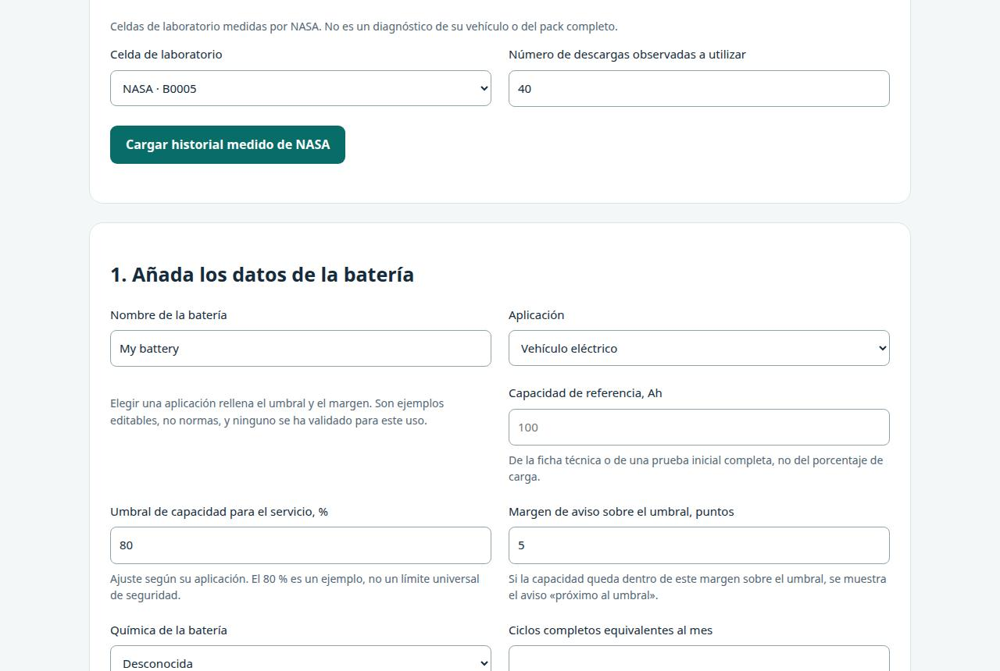
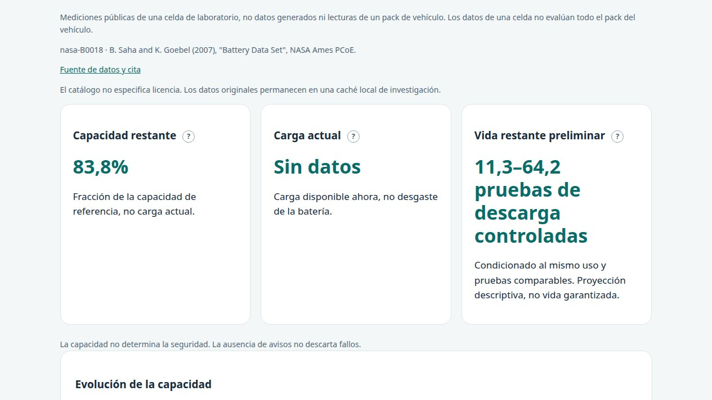
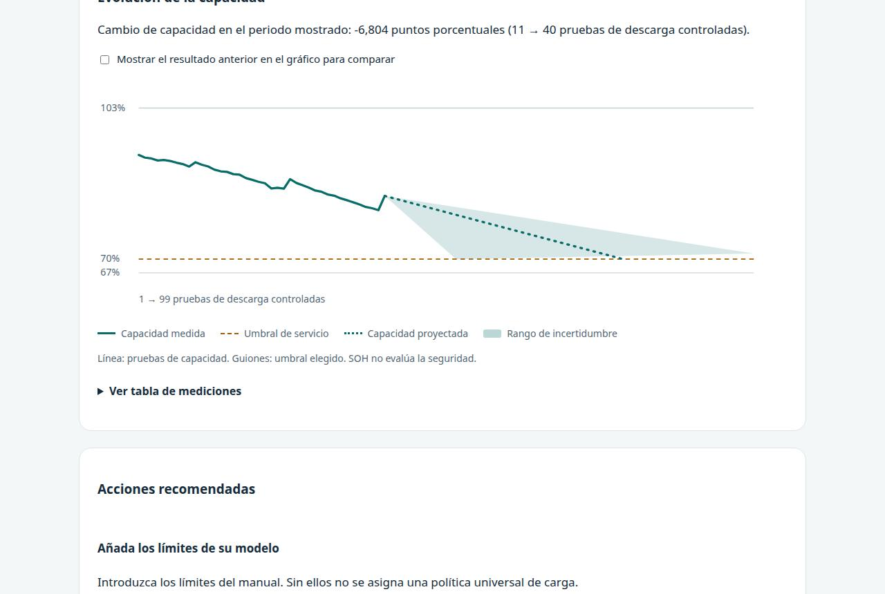
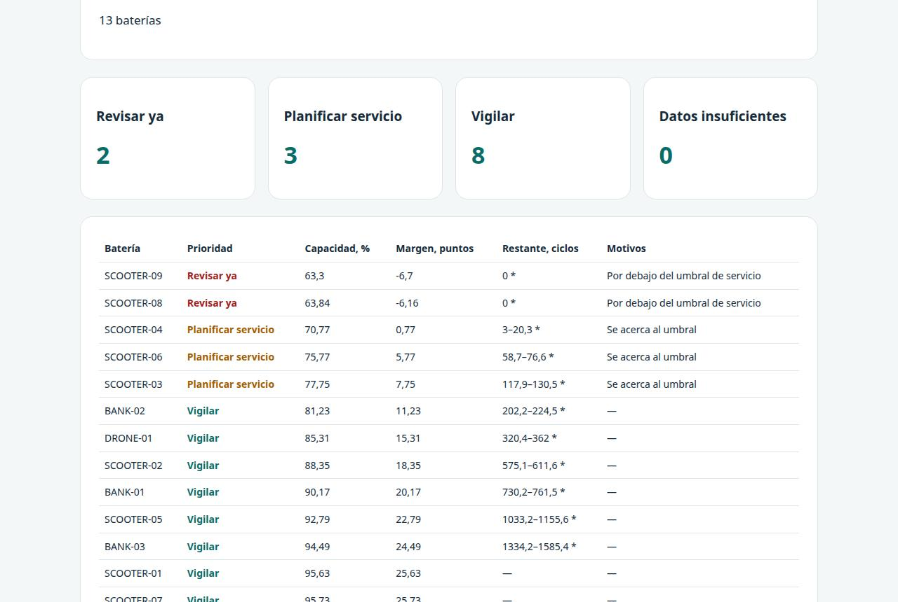
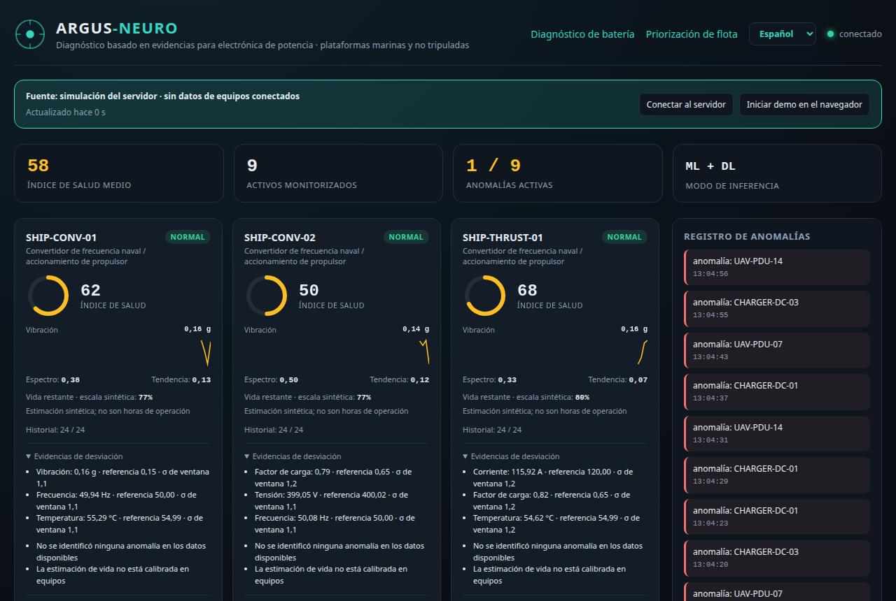
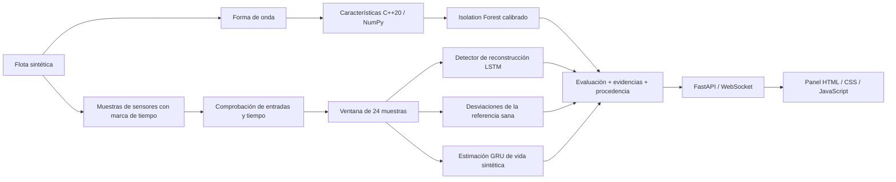

# ARGUS-NEURO

**Estado de baterías y diagnóstico de electrónica de potencia: C++20, Python, ML/DL e interfaz web funcional.**

[English](README.en.md) · [Русский](README.md) · [中文](README.zh.md) · [हिन्दी](README.hi.md) · **Español** · [Français](README.fr.md) · [Deutsch](README.de.md) · [日本語](README.ja.md) · [Italiano](README.it.md)

[Contrato de diagnóstico (en inglés)](docs/RELIABILITY.md) · [Notas de evaluación (en inglés)](experiments/2026-09-30_reliability/notes.md)

ARGUS-NEURO combina el análisis de capacidad de baterías con la investigación de diagnóstico de electrónica de potencia. La página principal admite pruebas controladas y mediciones publicadas de celdas NASA; `/equipment.html` supervisa una flota sintética de nueve activos. La vida de la batería es una proyección condicional de tendencia y el uso en campo requiere validación independiente.

## Análisis de batería e informes explicables

- SOH basado en capacidad y SOC actual se muestran por separado. El SOC desconocido no se inventa.
- Importe pruebas completas de capacidad en Ah mediante CSV con condiciones comparables. Guarde informes localmente o exporte JSON.
- Sin datos propios: cuatro celdas medidas de NASA, B0005, B0006, B0007 y B0018, con 636 pruebas de descarga. Los archivos originales quedan en una caché local.
- La vida hasta un umbral configurable es un intervalo condicional. Un historial corto, una tendencia inestable o una alarma BMS pueden impedir la predicción numérica.
- Las recomendaciones usan límites del fabricante y condiciones comunicadas de carga y almacenamiento. No hay conexión OBD/CAN ni control de carga.

[Método y API, inglés](docs/BATTERY.md) · [Fuente NASA, comprobación y preparación, inglés](docs/PUBLIC_BATTERY_DATA.md) · [Ejemplo C++/NumPy, ruso](docs/SIGNAL_DEMO.md).

[Backtest en 108 celdas, inglés](docs/BACKTEST.md) · [Indicadores de curvas de tensión en C++, inglés](docs/CURVES.md) · [Metodología, inglés](docs/METHODOLOGY.md)

### Resultados de investigación con 108 celdas de laboratorio

> **Aviso (30 de octubre de 2026).** La versión anterior de esta sección usaba un paso de submuestreo de ceil(N/600) ciclos que depende de lo que dura la celda y filtra la respuesta. El backtest de intervalos de abajo se **repitió con un paso físico fijo de 5 ciclos**. Las ganancias anteriores de los modelos aprendidos y de los indicadores de curva se retiran; véase [SAMPLING_AUDIT.md](docs/SAMPLING_AUDIT.md) y la sección de evidencia más abajo.

Datos: NASA PCoE (4 celdas), CALB (28 celdas NCM) y HUST (77 celdas LFP), 3 713 puntos de predicción. Cada predicción solo ve su pasado observado. Detalles y comandos de reproducción: [BACKTEST.md](docs/BACKTEST.md) (inglés).

- **El intervalo simple era demasiado optimista.** El intervalo bootstrap 5–95 % cubrió la vida restante real solo en el **9 %** de las predicciones frente a un 90 % nominal.
- **El intervalo calibrado se sostiene de media, no en cada fuente.** Un radio conformal de 0,65 con el mismo peso por conjunto de datos cubre el **96 %** de las predicciones en celdas no vistas y el **95 %** al excluir un conjunto entero, pero solo el **83 %** en CALB y el **73 %** en NASA (HUST 100 %). El intervalo mediano es unas 1,6 veces la vida restante. Una química o un protocolo nuevos pueden quedar infracubiertos.
- **Con el paso fijo, las curvas ahora superan a la recta** (error medio 61 frente a 83 ciclos). El valor por defecto sigue siendo la recta hasta confirmar la elección en un protocolo fijado de antemano.
- **Las ganancias anteriores de los modelos aprendidos y de los indicadores de curva se retiran.** En el flujo corregido, el conjunto con indicadores de curva es entre un 11 y un 15 % más preciso que la mejor referencia solo de capacidad en las celdas de desarrollo de HUST, pero en 15 celdas reservadas la diferencia no está confirmada estadísticamente (véase la sección de evidencia).
- Todo esto se refiere a celdas de laboratorio, no a paquetes de vehículos. Los informes de paquete mantienen el intervalo sin calibrar y lo indican.
- **Verificación:** la CI compila C++ con advertencias como errores, ejecuta `clang-tidy`, las pruebas Python con un mínimo de cobertura del 70 % y la coherencia de los README. En local (30 de octubre de 2026): 214 pruebas Python (193 superadas y 21 omitidas sin la extensión nativa), 18 pruebas de interfaz, cobertura 73 %.

## Casos de uso

Cinco situaciones plantean la misma pregunta sobre el desgaste, con prioridades distintas. [Detalles y estado de validación](docs/USE_CASES.md) (inglés).

- **Vehículos eléctricos:** tendencia de capacidad, rango calibrado para celdas de laboratorio y consejos según los límites del fabricante que usted aporte.
- **Estaciones de carga:** un armario de carga rápida DC es un activo monitorizado en la página de equipos (simulado; aún sin datos reales ni adaptador OCPP).
- **Drones de rescate y médicos:** un umbral prudente y un aviso «revise antes de asignarla a misiones urgentes». Apoyo a la decisión, no evaluación de aeronavegabilidad.
- **Patinetes compartidos y baterías externas de alquiler:** **Priorización de flota** ordena cientos de baterías desde un CSV: revisar ya, planificar, vigilar, datos insuficientes.
- Ningún caso cuenta con datos de campo; los umbrales los decide el operador.

## Inicio rápido: pantalla de batería

Instalación nueva en Ubuntu, desde la raíz del repositorio:

```bash
bash scripts/setup_env.sh
PYTHONPATH="$PWD/python" .venv/bin/python -m argus.battery.public_data --download
bash scripts/run_dashboard.sh
```

Abra [http://127.0.0.1:8000](http://127.0.0.1:8000), elija **B0018**, mantenga **40** observaciones y pulse **Load measured NASA history**. El idioma inicial es inglés; puede elegir español arriba. Esta ruta no necesita entrenar modelos. Para el diagnóstico ML/DL de equipos, ejecute además `bash scripts/train_all.sh` y abra `/equipment.html`.

## Ejecutar en Docker en cualquier máquina

Solo hace falta Docker Engine o Docker Desktop con Compose v2: la imagen compila sola el núcleo C++ y sus pruebas, funciona en CPU y ocupa unos 2 GB en disco. Probado en Linux x86-64; el mismo Dockerfile se construye para arm64 (por ejemplo Apple Silicon), algo que aquí no se ha probado.

```bash
docker compose up --build -d
docker compose exec argus bash scripts/train_all.sh
docker compose exec argus python -m argus.battery.public_data --download
docker compose restart argus
bash scripts/docker_smoke.sh
```

1. El primer comando construye la imagen (varios minutos) e inicia el servidor.
2. El segundo entrena una vez los modelos de equipos (cerca de un minuto). Sin él, la página de equipos funciona en modo base e indica que los modelos no están disponibles; la página de batería no lo necesita.
3. El tercero descarga una vez las cuatro celdas NASA publicadas (unos 200 MB). No están incluidas en la imagen porque el catálogo no indica licencia y los datos no se redistribuyen.
4. El cuarto reinicia el servidor para que cargue los modelos entrenados; el quinto comprueba el contenedor en marcha (estado, tres páginas, informe de ejemplo).

Abra [http://127.0.0.1:8000](http://127.0.0.1:8000). El puerto solo escucha en localhost porque la API no tiene autenticación; cámbielo con `ARGUS_PORT`. El volumen `argus-data` guarda modelos, datos NASA e informes guardados: `docker compose down` lo conserva, `docker compose down -v` lo borra. El contenedor se ejecuta como usuario sin privilegios con el sistema de archivos raíz de solo lectura.

Requisitos de hardware para producción (qué se midió, qué es solo una recomendación y qué hay que añadir fuera del software): [docs/HARDWARE_REQUIREMENTS.md](docs/HARDWARE_REQUIREMENTS.md) (en inglés).

## Cómo funciona el proyecto

ARGUS-NEURO convierte mediciones en un informe que dice qué se sabe, qué se estima y qué se rechaza afirmar.

1. **Entrada.** Controles de capacidad de un CSV (Ah por ciclo equivalente, mismas condiciones de prueba) o una de las cuatro celdas NASA publicadas (636 descargas controladas). Si el historial es demasiado corto o incoherente, el programa lo indica en lugar de pronosticar.
2. **Estado actual.** El SOH es la capacidad medida dividida por la capacidad de referencia. El SOC solo se muestra si usted lo aporta.
3. **Tendencia y rango.** Una tendencia lineal sobre los últimos controles comparables da un número condicional de descargas controladas hasta su umbral; un bootstrap y, para celdas de laboratorio, un radio conformal calibrado lo convierten en un rango. El pronóstico se retiene si el historial es corto, la tendencia es inestable o hay una alarma del BMS.
4. **Consejos.** Las recomendaciones usan solo los límites del fabricante y las condiciones de carga y almacenamiento que usted introduce. No hay conexión OBD/CAN ni control de la carga.
5. **Triaje de flota.** Un CSV con muchas baterías se ordena en revisar ya, planificar revisión, vigilar o datos insuficientes, con un preajuste por caso de uso (patinetes, baterías externas, drones de rescate, EV).
6. **Diagnóstico de equipos.** 11 características estadísticas y espectrales calculadas en C++ (la alternativa NumPy da el mismo resultado) alimentan una línea base espectral, un autoencoder LSTM, un canal de desviación respecto a la referencia sana y un modelo de vida GRU; la página indica que su fuente de datos es una simulación.

### Dónde están las pruebas (30 de octubre de 2026)

- Una auditoría encontró que el paso de submuestreo anterior dependía de lo que duraba la celda y daba pistas a los modelos. Todas las cifras de precisión anteriores sobre historiales de capacidad se retiraron ([auditoría de muestreo](docs/SAMPLING_AUDIT.md)); la calibración de intervalos incluida en el programa se recalculó con paso fijo el 30 de octubre de 2026 (radio 0,65; cobertura 96 % y 95 %, pero 83 % para CALB y 73 % para NASA al excluirlos).
- Con paso fijo en 77 celdas LFP de HUST, la mejor línea base solo con capacidad (un proceso gaussiano) se equivoca de media en unos 92–113 ciclos. Un conjunto con indicadores de la curva de carga mejora un 11–15 %, pero en 15 celdas reservadas la diferencia no está establecida estadísticamente ([experimento](experiments/2026-10-30_method_hust/notes.md)).
- Negarse a pronosticar cuando dos modelos discrepan no redujo el error, así que el programa no lo afirma. Ningún caso de uso cuenta con datos de campo.

## Capturas de la aplicación en funcionamiento

Tomadas el 30 de octubre de 2026 del programa ejecutándose en local, una serie por idioma de la interfaz. Las páginas de batería usan la celda NASA B0018 (primeras 40 descargas controladas, umbral del 70 %), la de flota el ejemplo integrado de 13 baterías con el preajuste de patinete y la de equipos la simulación del servidor. Es una celda de laboratorio y datos sintéticos, no un vehículo.

### 1. Empezar sin datos propios



**Qué ocurre:** La página ofrece cuatro celdas NASA publicadas y el número de pruebas observadas. Solo se envía al cálculo el comienzo elegido de la serie, nunca mediciones posteriores.

**Conclusión para el usuario:** Puede probar todo el flujo sin ningún archivo. El resultado describe una celda de laboratorio, no su vehículo.

### 2. Informe de la celda medida B0018



**Qué ocurre:** Con las primeras 40 descargas el programa muestra SOH 83,8 %, SOC desconocido (nadie lo aportó) y una estimación condicional de 11,3–64,2 descargas controladas más antes del umbral del 70 %. La fuente de datos y la nota de licencia están sobre las tarjetas.

**Conclusión para el usuario:** La celda conserva cerca del 84 % de su capacidad. El rango es amplio porque el historial es corto; léalo como un escenario, no como una garantía. Un SOC desconocido se muestra como desconocido, y la capacidad por sí sola no dice si la batería es segura.

### 3. Historial de capacidad e incertidumbre



**Qué ocurre:** La línea continua es la capacidad medida en las pruebas 1–40, la discontinua el umbral del 70 %, la de puntos la proyección y el área sombreada el rango de incertidumbre. El pie indica un cambio de −6,8 puntos en las pruebas 11–40, el tramo que usa la tendencia actual.

**Conclusión para el usuario:** Planifique con todo el rango sombreado, no con la única línea de puntos: el umbral puede alcanzarse bastante antes o después. Una línea descendente es la tendencia de esta celda, y el SOH no es un veredicto de seguridad.

### 4. Triaje de flota



**Qué ocurre:** El ejemplo integrado de 13 baterías se ordena con el preajuste de patinete: 2 para revisar ya, 3 para planificar, 8 para vigilar y ninguna con datos insuficientes. La tabla da el SOH, el margen hasta el umbral en puntos, el rango de ciclos restantes y el motivo; un asterisco marca un rango a nivel de paquete que no está calibrado.

**Conclusión para el usuario:** Empiece por las primeras filas: SCOOTER-09 y SCOOTER-08 ya están por debajo del límite de servicio (63,3 % y 63,8 %). Los rangos con asterisco son una guía aproximada. La muestra es sintética: enseña cómo funciona la página, no el estado de una flota real.

### 5. Diagnóstico de equipos



**Qué ocurre:** Nueve activos simulados (convertidores navales, unidades de potencia de UAV, armarios de carga rápida DC) son evaluados por modelos ML y DL: índice de salud, características de vibración y espectro, registro de anomalías. El aviso indica que la fuente es una simulación del servidor y que no hay equipos conectados.

**Conclusión para el usuario:** Esto muestra el flujo de diagnóstico, no el estado de equipos reales. Las cifras de vida restante están en una escala sintética. Para uso real, envíe su propia telemetría por la API y compruebe que el aviso nombra una fuente real.


## Funcionalidades implementadas

- **Pasaportes de decisión.** Cada evaluación incluye un ID derivado del contenido, una huella del paquete de modelos, evidencias de sensores y explicaciones. Identifican el contenido y los modelos evaluados; no son firmas digitales ni prueba de la causa de una avería.
- **Abstención explícita.** Lecturas ausentes o no finitas, formas de onda no válidas, discontinuidades temporales, modelos incompatibles e historial insuficiente producen estados explícitos en lugar de predicciones inventadas.
- **Diagnóstico respecto a referencias de sensores.** Las referencias sanas de entrenamiento, específicas de cada tipo de equipo, detectan desviaciones persistentes y alternas. Las referencias permanecen fijas durante la inferencia, de modo que un activo que se degrada no se aprende silenciosamente como normal.
- **Discrepancia entre detectores.** El panel muestra cuándo discrepan los detectores espectral, de reconstrucción y de referencia. Un solo detector positivo puede generar una alerta sin necesidad de votación por mayoría.
- **Características coherentes en C++ y NumPy.** Las 11 características estadísticas y espectrales usan un contrato común de FFT con relleno de ceros. La extensión pybind11 admite arreglos con paso e invertidos y libera el GIL tras copiar la entrada.
- **Monitorización consciente de la conexión.** El panel marca los flujos desconectados u obsoletos, conserva la última instantánea y reintenta la conexión. La telemetría generada en el navegador solo se inicia mediante una acción de demostración explícita y tiene una etiqueta de origen propia.
- **Interfaz en nueve idiomas.** Inglés (principal), ruso (segundo), chino, hindi, español, francés, alemán, japonés e italiano; la selección se guarda.

Son decisiones de producto implementadas, no afirmaciones de novedad mundial ni de rendimiento industrial validado.

## Arquitectura



Los seis canales de sensores son `voltage_v`, `current_a`, `temperature_c`, `vibration_g`, `frequency_hz` y `load_factor`, en ese orden. El simulador admite sobrecalentamiento, desgaste de rodamientos, caída de tensión, deriva de frecuencia y degradación del aislamiento. La flota en vivo muestra cuatro escenarios de avería y dos activos sanos.

## Requisitos

El proyecto se ha probado en Ubuntu/Linux con CPython 3.12, GCC 13, CMake 3.28 y Node.js 22. Compilar la extensión nativa requiere un compilador C++20 y las cabeceras de desarrollo de Python. Python debe poder crear entornos virtuales. Node solo se necesita para las pruebas del panel, no para servir la aplicación.

Las versiones de las dependencias directas de Python están fijadas en [python/requirements.txt](python/requirements.txt); [python/requirements-dev.txt](python/requirements-dev.txt) instala además Ruff. No es un bloqueo completo de dependencias transitivas. El entrenamiento registra las versiones de sus principales bibliotecas numéricas en los informes del paquete.

## Primera instalación en Ubuntu

La instalación completa siguiente también entrena los modelos de equipos. Para analizar solo baterías, utilice el inicio rápido anterior.

Ejecute desde la raíz del repositorio:

```bash
bash scripts/setup_env.sh
bash scripts/train_all.sh
bash scripts/run_dashboard.sh
```

1. La instalación crea `.venv` si hace falta, instala las dependencias y compila la extensión nativa.
2. El entrenamiento crea y valida un nuevo paquete de modelos antes de activarlo.
3. El lanzador usa el `.venv` del proyecto si existe e inicia Uvicorn en la dirección local.

Abra [http://127.0.0.1:8000](http://127.0.0.1:8000). Mantenga la terminal abierta; detenga el servidor con **Ctrl+C**. El lanzador cambia al directorio del repositorio, así que también funciona con una ruta absoluta desde otro directorio.

Para una copia ya configurada solo se necesita el lanzador:

```bash
bash scripts/run_dashboard.sh
```

No hace falta reentrenar en cada inicio. Tras actualizar desde los pesos de demostración históricos, ejecute el entrenamiento una vez: esos pesos carecen de los metadatos del paquete actual y el nuevo cargador no los acepta.

### Qué aparece tras el inicio

El servidor avanza la telemetría simulada aproximadamente cada **1,5 segundos más el tiempo de cálculo**. Cada muestra simulada representa **5 segundos** de funcionamiento del equipo. Los modelos necesitan 24 muestras consecutivas; partiendo de un búfer vacío, el calentamiento tarda unos 35–40 segundos en la máquina probada, según el tiempo de procesamiento.

La primera alarma de forma de onda puede aparecer antes de que termine el calentamiento. La salud por tendencia y la estimación de vida no están disponibles hasta que haya historial suficiente. Cada escenario se repite tras 400 muestras; en ese límite su historial se reinicia.

### Configuración

| Variable | Valor predeterminado | Propósito |
|---|---|---|
| `ARGUS_HOST` | `127.0.0.1` | Dirección en la que escucha Uvicorn |
| `ARGUS_PORT` | `8000` | Puerto HTTP y WebSocket |
| `ARGUS_ARTIFACTS_DIR` | Paquete local activo; si no, `artifacts/` | Selecciona explícitamente un directorio de modelos de confianza; se recomienda una ruta absoluta |
| `ARGUS_PYTHON` | `.venv/bin/python` del proyecto; si no, `python3` | Intérprete usado por los scripts de compilación, entrenamiento y ejecución; para sustituirlo, indique la ruta de un ejecutable. En la instalación inicial, el entorno virtual se crea por defecto con `python3`. |
| `OMP_NUM_THREADS`, `MKL_NUM_THREADS` | `1` en los lanzadores de entrenamiento y ejecución | Límites de hilos de CPU; los valores ya definidos se conservan |

Por ejemplo, para usar otro puerto local:

```bash
ARGUS_PORT=8001 bash scripts/run_dashboard.sh
```

La demostración no tiene autenticación ni aislamiento entre inquilinos. Cambiar la dirección de escucha no la hace apta para un despliegue público.

## Contrato de diagnóstico

| Estado de la evaluación | Significado |
|---|---|
| `warming_up` | Entradas válidas, pero hay menos de 24 muestras |
| `ready` | Se ejecutó la ruta de diagnóstico completa con una referencia de sensores adecuada |
| `invalid_data` | Los valores de los sensores, la forma de onda o el momento de medición no superaron la validación |
| `degraded` | Los modelos o los datos de referencia no están disponibles, o un modelo devolvió una salida no válida |

`ready` indica que se puede ejecutar, no una precisión demostrada en equipos reales. `is_anomaly` puede ser `null`, lo que significa desconocido y no normal. Durante el calentamiento, una alarma espectral ya puede ponerlo a `true`.

Una entrada de sensor no válida o una discontinuidad en las marcas de tiempo suministradas borra el historial del activo. La siguiente adquisición válida debe reconstruir la ventana. Las comprobaciones de tiempo requieren que quien llama pase `sample_time_s`; la demostración lo hace.

Cada evaluación incluye además:

- `data_quality`: problemas detectados y número de muestras recogidas/requeridas;
- `evidence`: las tres mayores desviaciones de sensores, las últimas lecturas y las medias de la referencia sana;
- `explanation` y `detector_disagreement`: motivos del diagnóstico y decisiones contradictorias de los detectores;
- `assessment_id` y `model_version`: huellas del contenido y del paquete;
- `source` y `rul_basis`: procedencia de las mediciones y de la estimación de vida.

El canal de referencia mide la desviación estandarizada RMS de la ventana respecto a los datos sanos de entrenamiento. Su umbral de 6 desviaciones estándar es una heurística explícita que requiere calibración en campo. Conserva las desviaciones alternas que se cancelarían en una media aritmética. Las evidencias de sensores no son un diagnóstico causal.

El índice de salud es una puntuación heurística de visualización, no una probabilidad de fallo. El panel muestra la vida restante como **porcentaje de un horizonte sintético**. El campo de la API `rul_hours` usa el horizonte registrado durante el entrenamiento y solo está disponible para fuentes simuladas; no es una estimación de horas de servicio reales. `rul_interval_normalized` se basa en los residuos de validación reservados y no tiene cobertura garantizada en el mundo real.

## API HTTP y WebSocket

| Punto de acceso | Comportamiento |
|---|---|
| `GET /` | Página de batería; equipos: `/equipment.html`. Nueve idiomas, EN predeterminado. |
| `GET /api/health` | Estado del generador, antigüedad de la instantánea, indicador de modelos cargados, número de clientes y error del generador |
| `GET /api/fleet` | Última instantánea completa de la flota; devuelve 503 antes de la primera instantánea |
| `WS /ws/telemetry` | Instantánea inicial si existe, seguida de actualizaciones de la flota |
| `GET /docs` | Documentación de la API HTTP generada por FastAPI |

`/api/health` devuelve 200 cuando el generador está en marcha y su última instantánea tiene como máximo 10 segundos; en otro caso devuelve 503. **Compruebe `model_backed` por separado:** un transporte sano puede seguir entregando evaluaciones con los modelos no disponibles. `/api/fleet` puede devolver una instantánea antigua tras un fallo del generador, por lo que los clientes deben revisar las marcas de tiempo y el estado en lugar de interpretar un HTTP 200 como telemetría reciente.

La inferencia se ejecuta en un hilo de trabajo con un único generador secuencial. Cada cliente WebSocket tiene su propio emisor, un tiempo límite de envío de tres segundos y una cola con como máximo una instantánea pendiente. Los clientes lentos pueden perder instantáneas intermedias: es un flujo de monitorización, no un registro de eventos duradero.

## Entrenamiento, artefactos y ONNX

Las trayectorias sintéticas completas se estratifican por tipo de activo y avería **antes** de escalar o crear ventanas solapadas. El autoencoder y el modelo de RUL tienen escaladores propios ajustados en ejecuciones de entrenamiento sanas. La calibración usa datos de validación; las métricas finales, datos de prueba independientes. El detector espectral usa igualmente semillas de forma de onda distintas para entrenamiento, calibración y prueba.

`bash scripts/train_all.sh` realiza los siguientes pasos:

1. Crea un directorio nuevo `artifacts/run-*`.
2. Entrena el detector espectral de referencia y el autoencoder LSTM, incluidas las referencias de sensores.
3. Entrena la GRU y registra su escala temporal sintética y su intervalo de residuos.
4. Exporta ambos modelos profundos a ONNX, valida su estructura y compara sus salidas con PyTorch.
5. Verifica la carga del nuevo paquete y actualiza `artifacts/active.json` de forma atómica.

Un entrenamiento o una validación fallidos dejan intacto el puntero activo anterior. Se conservan los pesos existentes y los directorios de ejecuciones fallidas. Reinicie el servidor en marcha para cargar un paquete recién activado. Un `ARGUS_ARTIFACTS_DIR` explícito tiene prioridad sobre el puntero activo; elimínelo para seguir los paquetes recién activados.

Los paquetes contienen los pesos de los modelos, ambos escaladores, las referencias sanas, metadatos, informes de entrenamiento, archivos ONNX y un informe de validación ONNX. El cargador comprueba la versión del esquema, el orden de los sensores, la longitud de ventana, el intervalo de muestreo, las sumas de comprobación y la compatibilidad de deserialización de sklearn. Use solo paquetes de confianza: joblib no es un formato de intercambio seguro para archivos de modelos no fiables.

La entrada ONNX fija es `(1, 24, 6)`. La verificación numérica usa **ONNX ReferenceEvaluator** con tres escalas de entrada. No están implementados un puente de inferencia ONNX Runtime en C++ ni la validación en el hardware embarcado de destino.

Git ignora los paquetes generados y `active.json`. Son resultados locales; una copia nueva necesita su propio entrenamiento o un paquete compatible suministrado explícitamente.

## Compilación y pruebas

Tras la instalación, ejecute desde la raíz del repositorio:

```bash
source .venv/bin/activate
bash scripts/build_cpp_core.sh
ctest --test-dir build --output-on-failure

# Extensión nativa y contratos de Python
PYTHONPATH="$PWD/python:$PWD/build/cpp_core" OMP_NUM_THREADS=1 MKL_NUM_THREADS=1 \
  python -m pytest python/tests -q

# Modo alternativo sin el directorio de compilación en la ruta de módulos de Python
PYTHONPATH="$PWD/python" OMP_NUM_THREADS=1 MKL_NUM_THREADS=1 \
  python -m pytest python/tests -q

ruff check python
ruff format --check python
node --check web/dashboard/app.js
node --test web/dashboard/tests/*.test.cjs
```

Las pruebas nativas siguen activas en la compilación Release. Las pruebas de Python cubren la paridad de características y casos límite, los modelos, la división independiente de ejecuciones, la procedencia y la abstención, y el comportamiento de WebSocket ante fallos. Las pruebas exclusivas de la extensión nativa se omiten si esta no está disponible. La comprobación del modo alternativo supone que `argus_core` no se ha instalado además en el entorno de Python.

[CI](.github/workflows/ci.yml) usa Python 3.12 y Node 22, compila la extensión, ejecuta ambos modos de Python, comprueba el formato y la lógica del panel y valida todo el flujo escalonado de entrenamiento y exportación.

### Evaluación registrada

El [experimento del 30-09-2026](experiments/2026-09-30_reliability/notes.md) registra:

| Comprobación o métrica | Resultado registrado |
|---|---|
| CTest nativo | 1 ejecutable de prueba superado |
| Python con extensión nativa | 65 superadas |
| Python con alternativa NumPy | 50 superadas, 15 exclusivas nativas omitidas |
| Lógica del panel | 3 pruebas de Node superadas |
| F1 / exhaustividad del autoencoder | 0,6690 / 0,5851 en ejecuciones sintéticas reservadas |
| MAE normalizado de RUL en prueba | 0,1875; referencia por mediana 0,2880 en el mismo conjunto |
| Diferencia absoluta máxima de ONNX | Inferior a 0,000001 en ambos modelos en las comprobaciones registradas |
| Demostración de 401 pasos | En el último paso del escenario se marcaron los cuatro activos averiados y ninguno de los dos sanos; el ciclo siguiente volvió al calentamiento |

Son resultados fechados, no resultados prometidos para otros entornos ni para equipos reales. La comprobación del último paso de la demostración no es un estudio de sensibilidad ni de falsas alarmas. Las métricas de ML originales y revisadas usan particiones distintas y no deben interpretarse como una mejora controlada de la precisión. La comprobación visual en el navegador no estaba disponible; la lógica del DOM y el transporte HTTP/WebSocket se verificaron por programa.

## Resolución de problemas

- **`GET /favicon.ico 404`:** no se incluye favicon. No afecta al diagnóstico ni a la telemetría.
- **Los valores de vida/salud muestran un guion:** revise el estado. Durante el calentamiento y con modelos no disponibles las predicciones se retienen a propósito.
- **`models_unavailable`:** ejecute el entrenamiento, verifique el paquete seleccionado y reinicie. Los pesos de demostración históricos de la raíz no cumplen el nuevo esquema.
- **Dirección ya en uso:** detenga con Ctrl+C el servidor que inició o elija otro `ARGUS_PORT`.
- **Flujo desconectado/obsoleto:** la interfaz conserva la última instantánea y reintenta. El botón de demostración en el navegador genera ilustraciones sin usar modelos entrenados; no reconecta la telemetría real.
- **Abrir `index.html` directamente:** la página puede ejecutar la demostración en el navegador, pero use la URL del servidor para obtener diagnósticos con modelos.
- **Discrepancia de dependencias o de serialización:** use el entorno virtual del proyecto y vuelva a entrenar con sus dependencias fijadas. No reutilice en silencio un paquete incompatible.

## Estructura del repositorio

| Ruta | Contenido |
|---|---|
| `cpp_core/` | Extracción de características, FFT radix-2, enlaces pybind11, pruebas nativas |
| `python/argus/simulator/` | Generación de telemetría sintética y formas de onda |
| `python/argus/features/`, `models/` | Interfaz nativa/NumPy y definiciones de modelos |
| `python/argus/training/` | División de ejecuciones, escaladores, entrenamiento, utilidades de reproducibilidad |
| `python/argus/inference/`, `python/argus/artifacts.py` | Evaluaciones y resolución del paquete activo |
| `python/argus/api/`, `python/argus/export/` | Servicio FastAPI y exportación ONNX verificada |
| `python/argus/battery/` | Evaluación de capacidad, calibración, backtest, indicadores de curva, cargadores de datos, segunda opinión aprendida, almacenamiento de informes |
| `python/tests/` | Pruebas de regresión de Python |
| `web/dashboard/` | Consola multilingüe HTML/CSS/JS y pruebas de Node; sin sistema de compilación de frontend |
| `artifacts/` | Archivos de demostración históricos y paquetes generados localmente |
| `scripts/` | Configuración del entorno, compilación, entrenamiento escalonado, arranque local |
| `experiments/` | Configuraciones, métricas, instantáneas de cambios y notas de evaluación |
| `docs/RELIABILITY.md` | Decisiones de diagnóstico, comportamiento ante fallos y límites de despliegue |
| `docs/BATTERY.md`, `METHODOLOGY.md`, `BACKTEST.md`, `CURVES.md` | Método y API de batería, fórmulas y supuestos, evidencia del backtest, indicadores de la curva de tensión |

## Límites actuales y próximos pasos

Para baterías: ningún resultado está validado en paquetes de vehículos ni en campo; la calibración se transfiere de forma desigual entre fuentes (NASA 73 %, CALB 83 %); el intervalo es ancho; los indicadores de la curva de tensión necesitan curvas de carga registradas y aún no se usan en los informes; la segunda opinión aprendida solo cubre la química y el protocolo con los que se entrenó. El siguiente paso son más celdas con registros de tensión y temperatura y datos a nivel de paquete.

Los adaptadores de telemetría real, el historial persistente de telemetría de equipos, la autenticación, el aislamiento entre inquilinos y un puente de inferencia ONNX Runtime en C++ siguen siendo trabajo futuro. Las prioridades para la validación en campo son la adquisición con marcas de tiempo, averías etiquetadas por ingeniería, activos físicos independientes para las pruebas, tasas de falsas alarmas aceptables y la medición del tiempo de anticipación. Antes de la operación industrial también se necesitan monitorización de la deriva y pruebas de larga duración de fallos de red y de dispositivos.

## Autor y licencia

Serguéyev Antón Valentínovich (Сергеев Антон Валентинович, Anton Valentinovich Sergeev). Licencia MIT; véase [LICENSE](LICENSE).
