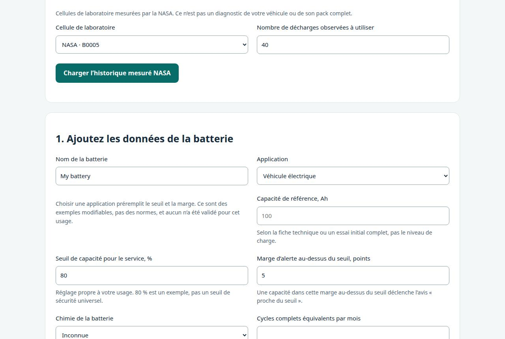
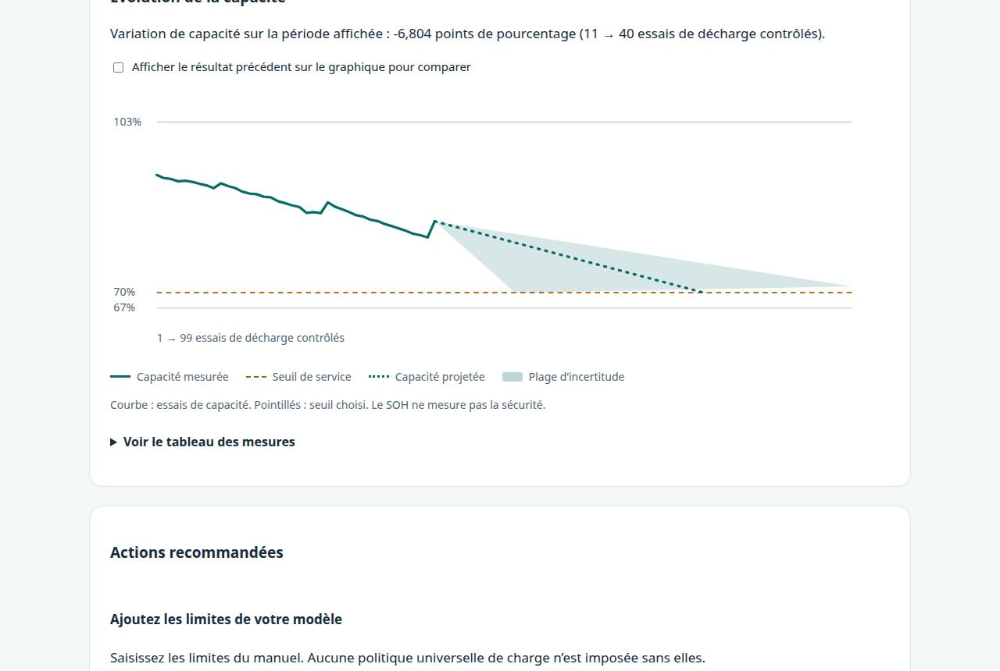
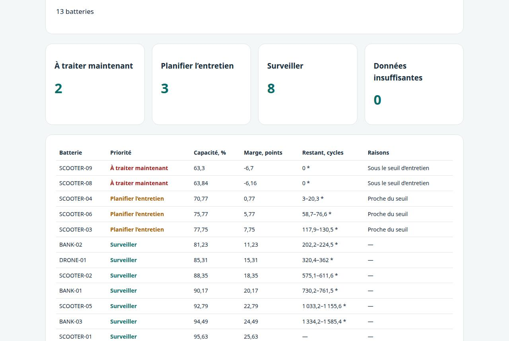
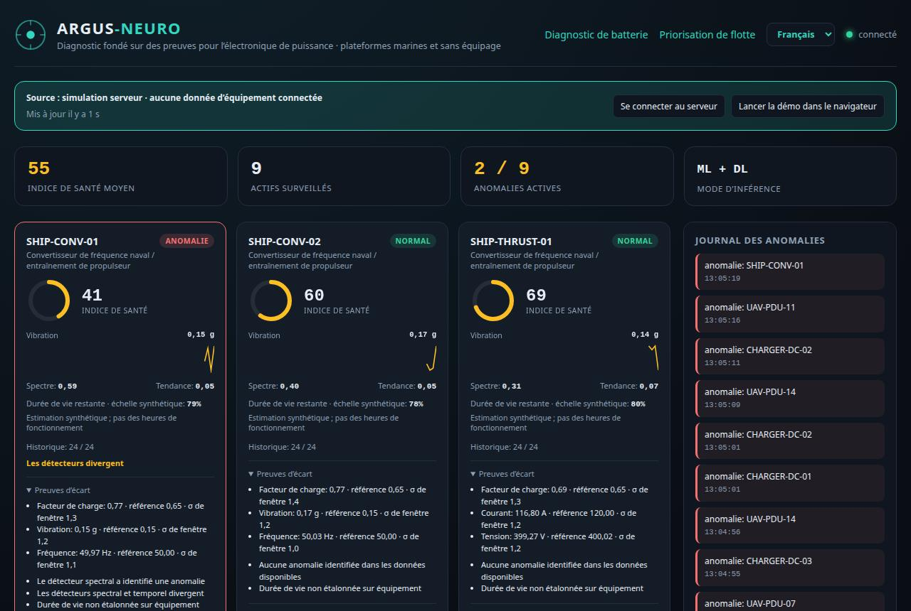
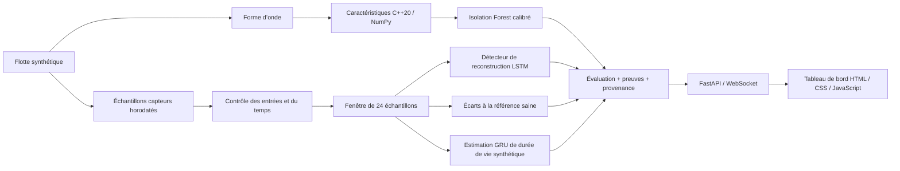

# ARGUS-NEURO

**État des batteries et diagnostic d’électronique de puissance : C++20, Python, ML/DL et interface web fonctionnelle.**

[English](README.en.md) · [Русский](README.md) · [中文](README.zh.md) · [हिन्दी](README.hi.md) · [Español](README.es.md) · **Français** · [Deutsch](README.de.md) · [日本語](README.ja.md) · [Italiano](README.it.md)

[Contrat de diagnostic (en anglais)](docs/RELIABILITY.md) · [Notes d’évaluation (en anglais)](experiments/2026-09-30_reliability/notes.md)

ARGUS-NEURO associe l’analyse de capacité des batteries à la recherche sur le diagnostic de l’électronique de puissance. L’accueil traite des essais contrôlés et les mesures publiées de cellules NASA ; `/equipment.html` surveille neuf équipements synthétiques. La durée de vie est une projection conditionnelle de tendance ; l’usage sur le terrain exige une validation distincte.

## Analyse de batterie et rapport explicable

- SOH de capacité et SOC actuel sont séparés. Un SOC inconnu reste inconnu.
- Import CSV d’essais complets en Ah dans des conditions comparables, rapports locaux et export JSON.
- Sans mesures personnelles : quatre cellules NASA, B0005, B0006, B0007 et B0018, totalisant 636 essais de décharge. Les sources restent en cache local après préparation.
- Projection conditionnelle jusqu’à un seuil réglable. Historique court, tendance instable ou alerte BMS peuvent empêcher tout résultat numérique.
- Conseils fondés sur les limites constructeur et les conditions déclarées de charge et de stockage. Aucune connexion OBD/CAN ni commande de charge.

[Méthode et API, anglais](docs/BATTERY.md) · [Source NASA et préparation, anglais](docs/PUBLIC_BATTERY_DATA.md) · [Exemple C++/NumPy, russe](docs/SIGNAL_DEMO.md).

[Backtest sur 108 cellules, anglais](docs/BACKTEST.md) · [Indicateurs des courbes de tension en C++, anglais](docs/CURVES.md) · [Méthodologie, anglais](docs/METHODOLOGY.md)

### Résultats de recherche sur 108 cellules de laboratoire

> **Avis (30 octobre 2026).** La version précédente de cette section utilisait un pas d’échantillonnage de ceil(N/600) cycles, qui dépend de la durée de vie de la cellule et dévoile la réponse. Le backtest des intervalles ci-dessous a été **refait avec un pas physique fixe de 5 cycles**. Les gains antérieurs des modèles appris et des indicateurs de courbe sont retirés ; voir [SAMPLING_AUDIT.md](docs/SAMPLING_AUDIT.md) et la section sur les preuves plus bas.

Données : NASA PCoE (4 cellules), CALB (28 cellules NCM) et HUST (77 cellules LFP), 3 713 points de prévision. Chaque prévision ne voit que son passé observé. Détails et commandes de reproduction : [BACKTEST.md](docs/BACKTEST.md) (anglais).

- **L’intervalle simple était trop optimiste.** L’intervalle bootstrap 5–95 % n’a couvert la durée de vie restante réelle que dans **9 %** des prévisions, contre 90 % annoncés.
- **L’intervalle calibré tient en moyenne, pas sur chaque source.** Un rayon conforme de 0,65 à poids égal par jeu de données couvre **96 %** des prévisions sur des cellules inconnues et **95 %** quand un jeu entier est exclu, mais seulement **83 %** pour CALB et **73 %** pour NASA (HUST 100 %). L’intervalle médian vaut environ 1,6 fois la durée restante. Une nouvelle chimie ou un nouveau protocole peut être sous-couvert.
- **Les courbes battent la droite sur HUST, pas partout.** En appariant par cellule sur des prévisions communes, l’erreur moyenne est de 53 contre 82 cycles et l’intervalle à 95 % du gain est de 23–35 cycles sur 108 cellules, mais 75 des 77 cellules HUST s’améliorent, CALB se dégrade de 5 cycles et NASA ne change pas. L’analyse n’était pas préenregistrée ; la droite reste donc le choix par défaut.
- **Les gains antérieurs des modèles appris et des indicateurs de courbe sont retirés.** Sur le pipeline corrigé, l’ensemble avec indicateurs de courbe est de 11 à 15 % plus précis que la meilleure référence fondée sur la seule capacité sur les cellules de développement HUST, mais sur 15 cellules verrouillées la différence n’est pas confirmée statistiquement (voir la section sur les preuves).
- Tout cela concerne des cellules de laboratoire, pas des packs de véhicules. Les rapports de pack gardent l’intervalle non calibré et le signalent.
- **Vérification :** la CI compile le C++ avec les avertissements en erreurs, lance `clang-tidy`, les tests Python avec un plancher de couverture de 70 % et la cohérence des README. En local (30 octobre 2026) : 217 tests Python (196 réussis et 21 ignorés sans l’extension native), 18 tests d’interface, couverture 73 %.

## Cas d’usage

Cinq situations posent la même question sur l’usure, avec des priorités différentes. [Détails et état de validation](docs/USE_CASES.md) (anglais).

- **Véhicules électriques :** tendance de capacité, plage calibrée pour cellules de laboratoire et conseils selon les limites constructeur que vous fournissez.
- **Bornes de recharge :** une armoire de recharge rapide DC est un actif surveillé sur la page équipements (simulé ; pas encore de données réelles ni d’adaptateur OCPP).
- **Drones de secours et médicaux :** un seuil prudent et un avis « à examiner avant une mission urgente ». Aide à la décision, pas évaluation de navigabilité.
- **Trottinettes partagées et batteries externes de location :** **Priorisation de flotte** classe des centaines de batteries à partir d’un CSV : à traiter maintenant, planifier, surveiller, données insuffisantes.
- Aucun cas n’a de données de terrain ; les seuils sont choisis par l’exploitant.

## Démarrage rapide : batterie

Nouvelle installation Ubuntu, depuis la racine du dépôt :

```bash
bash scripts/setup_env.sh
PYTHONPATH="$PWD/python" .venv/bin/python -m argus.battery.public_data --download
bash scripts/run_dashboard.sh
```

Ouvrez [http://127.0.0.1:8000](http://127.0.0.1:8000), choisissez **B0018**, **40** observations et **Load measured NASA history**. L’anglais est la langue initiale ; sélectionnez le français en haut. Aucun entraînement n’est requis ici. Pour le diagnostic ML/DL des équipements, exécutez séparément `bash scripts/train_all.sh`, puis ouvrez `/equipment.html`.

## Exécuter dans Docker sur n’importe quelle machine

Il suffit de Docker Engine ou de Docker Desktop avec Compose v2 : l’image compile elle-même le cœur C++ et ses tests, tourne sur CPU et occupe environ 2 Go sur disque. La CI construit et teste l’image nativement sous Linux x86-64 et arm64 (par exemple Apple Silicon et serveurs ARM), pile de production comprise. Sous Windows et macOS, Docker Desktop exécute la même image Linux ; les commandes `docker compose` fonctionnent dans PowerShell, seuls les scripts auxiliaires `bash scripts/...` demandent WSL2 ou Git Bash. Il faut un processeur 64 bits et environ 4 Go de mémoire pour la construction ; les processeurs 32 bits ne sont pas pris en charge.

```bash
docker compose up --build -d
docker compose exec argus bash scripts/train_all.sh
docker compose exec argus python -m argus.battery.public_data --download
docker compose restart argus
bash scripts/docker_smoke.sh
```

1. La première commande construit l’image (quelques minutes) et démarre le serveur.
2. La deuxième entraîne une fois les modèles d’équipements (environ une minute). Sans elle, la page équipements fonctionne en mode de base et indique que les modèles sont indisponibles ; la page batterie n’en a pas besoin.
3. La troisième télécharge une fois les quatre cellules NASA publiées (environ 200 Mo). Elles ne sont pas intégrées à l’image : le catalogue n’indique aucune licence et les données ne sont pas redistribuées.
4. La quatrième redémarre le serveur pour qu’il charge les modèles entraînés ; la cinquième vérifie le conteneur en marche (état, trois pages, rapport d’exemple).

Ouvrez [http://127.0.0.1:8000](http://127.0.0.1:8000). Le port n’écoute que sur localhost, car l’API n’a pas d’authentification ; changez-le avec `ARGUS_PORT`. Le volume `argus-data` conserve modèles, données NASA et rapports enregistrés : `docker compose down` le garde, `docker compose down -v` le supprime. Le conteneur s’exécute en utilisateur non root, avec un système de fichiers racine en lecture seule.

Matériel requis en production (ce qui a été mesuré, ce qui n’est qu’une recommandation et ce qu’il faut ajouter en dehors du logiciel) : [docs/HARDWARE_REQUIREMENTS.md](docs/HARDWARE_REQUIREMENTS.md) (en anglais).

Déploiement de production avec TLS, connexion, supervision et sauvegardes, et limites d’usage : [docs/PRODUCTION.md](docs/PRODUCTION.md) (en anglais).

## Comment fonctionne le projet

ARGUS-NEURO transforme des mesures en un rapport qui dit ce qui est connu, ce qui est estimé et ce qui est refusé.

1. **Entrée.** Contrôles de capacité issus d’un CSV (Ah par cycle équivalent, mêmes conditions d’essai) ou l’une des quatre cellules NASA publiées (636 décharges contrôlées). Si l’historique est trop court ou incohérent, le programme le dit au lieu de prévoir.
2. **État actuel.** Le SOH est la capacité mesurée divisée par la capacité de référence. Le SOC n’est affiché que si vous le fournissez.
3. **Tendance et plage.** Une tendance linéaire sur les derniers contrôles comparables donne un nombre conditionnel de décharges contrôlées jusqu’à votre seuil ; un bootstrap et, pour les cellules de laboratoire, un rayon conformal calibré en font une plage. La prévision est retenue si l’historique est court, la tendance instable ou une alarme BMS signalée.
4. **Conseils.** Les recommandations n’utilisent que les limites du fabricant et les conditions de charge et de stockage que vous saisissez. Pas de connexion OBD/CAN, pas de pilotage de la charge.
5. **Triage de flotte.** Un CSV de nombreuses batteries est classé en à réviser maintenant, à planifier, à surveiller ou données insuffisantes, avec un préréglage par cas d’usage (trottinettes, batteries externes, drones de secours, VE).
6. **Diagnostic d’équipements.** 11 caractéristiques statistiques et spectrales calculées en C++ (le repli NumPy donne le même résultat) alimentent une base spectrale, un autoencodeur LSTM, un canal d’écart à la référence saine et un modèle de durée de vie GRU ; la page indique que sa source de données est une simulation.

### Où en sont les preuves (30 octobre 2026)

- Un audit a montré que l’ancien pas d’échantillonnage dépendait de la durée de vie de la cellule et soufflait la réponse aux modèles. Tous les chiffres de précision antérieurs sur les historiques de capacité sont retirés ([audit d’échantillonnage](docs/SAMPLING_AUDIT.md)) ; la calibration des intervalles livrée avec le programme a été recalculée à pas fixe le 30 octobre 2026 (rayon 0,65 ; couverture 96 % et 95 %, mais 83 % pour CALB et 73 % pour NASA en cas d’exclusion).
- À pas fixe sur 77 cellules LFP de HUST, la meilleure référence fondée sur la seule capacité (un processus gaussien) se trompe en moyenne d’environ 92 à 113 cycles. Un ensemble avec des indicateurs de la courbe de charge fait 11 à 15 % mieux, mais sur 15 cellules réservées la différence n’est pas établie statistiquement ([expérience](experiments/2026-10-30_method_hust/notes.md)).
- Refuser de prévoir quand deux modèles divergent n’a pas réduit l’erreur ; le programme ne l’affirme donc pas. Aucun cas d’usage n’est appuyé par des données de terrain.

## Captures de l’application en fonctionnement

Prises le 30 octobre 2026 depuis le programme exécuté en local, une série par langue d’interface. Les pages batterie utilisent la cellule NASA B0018 (40 premières décharges contrôlées, seuil de 70 %), la page flotte l’exemple intégré de 13 batteries avec le préréglage trottinette, et la page équipements la simulation du serveur. C’est une cellule de laboratoire et des données synthétiques, pas un véhicule.

### 1. Commencer sans données personnelles



**Ce qui se passe :** La page propose quatre cellules NASA publiées et le nombre d’essais observés. Seul le début choisi de la série est envoyé au calcul, jamais les mesures ultérieures.

**Conclusion pour l’utilisateur :** Vous pouvez essayer tout le parcours sans aucun fichier. Le résultat décrit une cellule de laboratoire, pas votre véhicule.

### 2. Rapport de la cellule mesurée B0018


**Ce qui se passe :** À partir des 40 premières décharges, le programme affiche un SOH de 83,8 %, un SOC inconnu (personne ne l’a fourni) et une estimation conditionnelle de 11,3 à 64,2 décharges contrôlées supplémentaires avant le seuil de 70 %. La source des données et la note de licence se trouvent au-dessus des cartes.

**Conclusion pour l’utilisateur :** La cellule a conservé environ 84 % de sa capacité. La plage est large parce que l’historique est court ; lisez-la comme un scénario, pas comme une garantie. Un SOC inconnu est affiché comme inconnu, et la capacité seule ne dit pas si la batterie est sûre.

### 3. Historique de capacité et incertitude



**Ce qui se passe :** Le trait plein est la capacité mesurée des essais 1 à 40, le tireté le seuil de 70 %, le pointillé la projection et la zone grisée la plage d’incertitude. La légende indique une variation de −6,8 points sur les essais 11 à 40, l’intervalle utilisé par la tendance actuelle.

**Conclusion pour l’utilisateur :** Planifiez avec toute la zone grisée, pas avec le seul pointillé : le seuil peut être atteint nettement plus tôt ou plus tard. Une courbe descendante est la tendance de cette cellule, et le SOH n’est pas un verdict de sécurité.

### 4. Triage de flotte



**Ce qui se passe :** L’exemple intégré de 13 batteries est classé avec le préréglage trottinette : 2 à réviser maintenant, 3 à planifier, 8 à surveiller, aucune avec données insuffisantes. Le tableau donne le SOH, la marge au seuil en points, la plage de cycles restants et le motif ; un astérisque marque une plage au niveau du pack qui n’est pas calibrée.

**Conclusion pour l’utilisateur :** Commencez par les premières lignes : SCOOTER-09 et SCOOTER-08 sont déjà sous la limite de service (63,3 % et 63,8 %). Les plages avec astérisque sont des repères grossiers. L’échantillon est synthétique : il montre le fonctionnement de la page, pas l’état d’une vraie flotte.

### 5. Diagnostic d’équipements



**Ce qui se passe :** Neuf actifs simulés (convertisseurs navals, blocs de puissance de drones, armoires de charge rapide DC) sont évalués par des modèles ML et DL : indice de santé, caractéristiques de vibration et de spectre, journal d’anomalies. Le bandeau précise que la source est une simulation du serveur et qu’aucun équipement n’est connecté.

**Conclusion pour l’utilisateur :** Ceci montre le parcours de diagnostic, pas l’état d’équipements réels. Les durées de vie restantes sont sur une échelle synthétique. En usage réel, envoyez votre propre télémétrie via l’API et vérifiez que le bandeau nomme une source réelle.


## Fonctionnalités implémentées

- **Passeports de décision.** Chaque évaluation comprend un identifiant dérivé du contenu, une empreinte du lot de modèles, des preuves issues des capteurs et des explications. Ils identifient le contenu et les modèles évalués ; ce ne sont ni des signatures numériques ni la preuve de la cause d’une panne.
- **Abstention explicite.** Les mesures absentes ou non finies, les formes d’onde invalides, les discontinuités temporelles, les modèles incompatibles et un historique insuffisant produisent des statuts explicites au lieu de prédictions inventées.
- **Diagnostic par rapport aux références capteurs.** Des références saines d’entraînement propres à chaque type d’équipement détectent les écarts persistants et alternés. Les références restent figées pendant l’inférence, si bien qu’un actif qui se dégrade n’est pas appris silencieusement comme normal.
- **Désaccord entre détecteurs.** Le tableau de bord indique lorsque les détecteurs spectral, de reconstruction et par référence divergent. Un seul détecteur positif peut déclencher une alerte, sans vote majoritaire.
- **Caractéristiques cohérentes en natif et en NumPy.** Les 11 caractéristiques statistiques et spectrales utilisent un contrat FFT commun avec remplissage par zéros. L’extension pybind11 prend en charge les tableaux à pas et inversés et libère le GIL après la copie de l’entrée.
- **Surveillance tenant compte de la connexion.** Le tableau de bord signale les flux déconnectés ou obsolètes, conserve le dernier instantané et retente la connexion. La télémétrie générée dans le navigateur ne démarre que par une action de démonstration explicite et porte une étiquette de source distincte.
- **Interface en neuf langues.** Anglais (principal), russe (deuxième), chinois, hindi, espagnol, français, allemand, japonais et italien ; le choix est mémorisé.

Il s’agit de choix produit implémentés, et non de revendications de nouveauté mondiale ou de performances industrielles validées.

## Architecture



Les six canaux capteurs sont `voltage_v`, `current_a`, `temperature_c`, `vibration_g`, `frequency_hz` et `load_factor`, dans cet ordre. Le simulateur prend en charge la surchauffe, l’usure des roulements, le creux de tension, la dérive de fréquence et la dégradation de l’isolation. La flotte en direct présente quatre scénarios de panne et deux actifs sains.

## Prérequis

Le projet a été éprouvé sous Ubuntu/Linux avec CPython 3.12, GCC 13, CMake 3.28 et Node.js 22. La compilation de l’extension native nécessite un compilateur C++20 et les en-têtes de développement Python. Python doit pouvoir créer des environnements virtuels. Node n’est nécessaire que pour les tests du tableau de bord, pas pour servir l’application.

Les versions des dépendances Python directes sont figées dans [python/requirements.txt](python/requirements.txt) ; [python/requirements-dev.txt](python/requirements-dev.txt) installe en plus Ruff. Ce n’est pas un verrouillage complet des dépendances transitives. L’entraînement enregistre les versions de ses principales bibliothèques numériques dans les rapports du lot.

## Première installation sous Ubuntu

L’installation complète ci-dessous entraîne aussi les modèles des équipements. Pour les batteries seules, utilisez le démarrage rapide ci-dessus.

Exécutez depuis la racine du dépôt :

```bash
bash scripts/setup_env.sh
bash scripts/train_all.sh
bash scripts/run_dashboard.sh
```

1. L’installation crée `.venv` si nécessaire, installe les dépendances et compile l’extension native.
2. L’entraînement crée et valide un nouveau lot de modèles avant de l’activer.
3. Le lanceur utilise le `.venv` du projet s’il existe et démarre Uvicorn sur l’adresse locale.

Ouvrez [http://127.0.0.1:8000](http://127.0.0.1:8000). Laissez le terminal ouvert ; arrêtez le serveur avec **Ctrl+C**. Le lanceur se place dans le répertoire du dépôt, si bien qu’un chemin absolu fonctionne aussi depuis un autre répertoire.

Pour une copie déjà configurée, seul le lanceur est nécessaire :

```bash
bash scripts/run_dashboard.sh
```

Inutile de réentraîner à chaque démarrage. Après une mise à jour depuis les poids de démonstration historiques, lancez l’entraînement une fois : ces poids n’ont pas les métadonnées du lot actuel et le nouveau chargeur les refuse.

### Ce qui apparaît après le démarrage

Le serveur fait avancer la télémétrie simulée environ toutes les **1,5 seconde plus le temps de calcul**. Chaque échantillon simulé représente **5 secondes** de fonctionnement de l’équipement. Les modèles ont besoin de 24 échantillons consécutifs ; à partir d’un tampon vide, la mise en route prend environ 35 à 40 secondes sur la machine testée, selon le temps de traitement.

La première alarme de forme d’onde peut apparaître avant la fin de la mise en route. La santé par tendance et l’estimation de durée de vie restent indisponibles tant que l’historique est insuffisant. Chaque scénario se répète après 400 échantillons ; son historique est réinitialisé à cette limite.

### Configuration

| Variable | Valeur par défaut | Rôle |
|---|---|---|
| `ARGUS_HOST` | `127.0.0.1` | Adresse d’écoute d’Uvicorn |
| `ARGUS_PORT` | `8000` | Port HTTP et WebSocket |
| `ARGUS_ARTIFACTS_DIR` | Lot local actif, sinon `artifacts/` | Sélectionne explicitement un répertoire de modèles de confiance ; un chemin absolu est recommandé |
| `ARGUS_PYTHON` | `.venv/bin/python` du projet, sinon `python3` | Interpréteur utilisé par les scripts de compilation, d’entraînement et d’exécution ; pour le remplacer, indiquez le chemin d’un exécutable. Lors de l’installation initiale, l’environnement virtuel est créé par défaut avec `python3`. |
| `OMP_NUM_THREADS`, `MKL_NUM_THREADS` | `1` dans les lanceurs d’entraînement et d’exécution | Limites de threads CPU ; les valeurs existantes sont conservées |

Par exemple, pour utiliser un autre port local :

```bash
ARGUS_PORT=8001 bash scripts/run_dashboard.sh
```

La démonstration n’a ni authentification ni isolation entre locataires. Changer l’adresse d’écoute ne la rend pas adaptée à un déploiement public.

## Contrat de diagnostic

| Statut de l’évaluation | Signification |
|---|---|
| `warming_up` | Entrées valides, mais moins de 24 échantillons disponibles |
| `ready` | Le chemin de diagnostic complet a été exécuté avec une référence capteurs correspondante |
| `invalid_data` | Les valeurs des capteurs, la forme d’onde ou l’horodatage des mesures n’ont pas passé la validation |
| `degraded` | Les modèles ou les données de référence sont indisponibles, ou un modèle a renvoyé une sortie invalide |

`ready` décrit la capacité d’exécution, pas une précision prouvée sur un équipement réel. `is_anomaly` peut valoir `null`, ce qui signifie inconnu et non normal. Pendant la mise en route, une alarme spectrale peut déjà le mettre à `true`.

Une entrée capteur invalide ou une discontinuité dans les horodatages fournis efface l’historique de l’actif. L’acquisition valide suivante doit reconstruire la fenêtre. Les contrôles d’horodatage exigent que l’appelant transmette `sample_time_s` ; la démonstration le fait.

Chaque évaluation comprend également :

- `data_quality` : problèmes détectés et nombre d’échantillons collectés/requis ;
- `evidence` : les trois plus grands écarts capteurs, les dernières mesures et les moyennes de la référence saine ;
- `explanation` et `detector_disagreement` : motifs du diagnostic et décisions contradictoires des détecteurs ;
- `assessment_id` et `model_version` : empreintes du contenu et du lot ;
- `source` et `rul_basis` : provenance des mesures et de l’estimation de durée de vie.

Le canal de référence mesure l’écart standardisé RMS de la fenêtre par rapport aux données d’entraînement saines. Son seuil de 6 écarts-types est une heuristique explicite nécessitant un étalonnage sur le terrain. Il préserve les écarts alternés qui s’annuleraient dans une moyenne arithmétique. Les preuves capteurs ne constituent pas un diagnostic causal.

L’indice de santé est un score heuristique d’affichage, pas une probabilité de défaillance. Le tableau de bord affiche la durée de vie restante en **pourcentage d’un horizon synthétique**. Le champ d’API `rul_hours` utilise l’horizon enregistré pendant l’entraînement et n’est disponible que pour les sources simulées ; ce n’est pas une estimation des heures de service réelles. `rul_interval_normalized` repose sur les résidus de validation mis de côté et n’offre aucune couverture garantie en conditions réelles.

## API HTTP et WebSocket

| Point d’accès | Comportement |
|---|---|
| `GET /` | Accueil batterie ; équipements : `/equipment.html`. Neuf langues, EN par défaut. |
| `GET /api/health` | État du générateur, âge de l’instantané, indicateur de modèles chargés, nombre de clients et erreur du générateur |
| `GET /api/fleet` | Dernier instantané complet de la flotte ; renvoie 503 avant le premier instantané |
| `WS /ws/telemetry` | Instantané initial s’il existe, puis mises à jour de la flotte |
| `GET /docs` | Documentation de l’API HTTP générée par FastAPI |

`/api/health` renvoie 200 lorsque le générateur fonctionne et que son dernier instantané date d’au plus 10 secondes ; sinon il renvoie 503. **Vérifiez `model_backed` séparément :** un transport sain peut encore livrer des évaluations alors que les modèles sont indisponibles. `/api/fleet` peut renvoyer un ancien instantané après une défaillance du générateur ; les clients doivent donc examiner les horodatages et l’état plutôt que d’interpréter un HTTP 200 comme une télémétrie récente.

L’inférence s’exécute dans un thread de travail avec un seul générateur séquentiel. Chaque client WebSocket dispose de son propre émetteur, d’un délai d’envoi de trois secondes et d’une file contenant au plus un instantané en attente. Les clients lents peuvent perdre des instantanés intermédiaires : il s’agit d’un flux de surveillance, pas d’un journal d’événements durable.

## Entraînement, artefacts et ONNX

Les trajectoires synthétiques complètes sont stratifiées par type d’actif et par panne **avant** la mise à l’échelle ou la création de fenêtres chevauchantes. L’autoencodeur et le modèle de RUL ont chacun leur normaliseur, ajusté sur des exécutions d’entraînement saines. L’étalonnage utilise les données de validation ; les métriques finales, des données de test indépendantes. Le détecteur spectral utilise de même des graines de forme d’onde distinctes pour l’entraînement, l’étalonnage et le test.

`bash scripts/train_all.sh` effectue les étapes suivantes :

1. Crée un nouveau répertoire `artifacts/run-*`.
2. Entraîne le détecteur spectral de référence et l’autoencodeur LSTM, y compris les références capteurs.
3. Entraîne le GRU et enregistre son échelle de temps synthétique et son intervalle de résidus.
4. Exporte les deux modèles profonds en ONNX, valide leur structure et compare leurs sorties à PyTorch.
5. Vérifie le chargement du nouveau lot et met à jour `artifacts/active.json` de façon atomique.

Un entraînement ou une validation en échec laisse intact le pointeur actif précédent. Les poids existants et les répertoires des exécutions échouées sont conservés. Redémarrez le serveur en cours d’exécution pour charger un lot nouvellement activé. Un `ARGUS_ARTIFACTS_DIR` explicite a priorité sur le pointeur actif ; supprimez-le pour suivre les lots nouvellement activés.

Les lots contiennent les poids des modèles, les deux normaliseurs, les références saines, des métadonnées, les rapports d’entraînement, les fichiers ONNX et un rapport de validation ONNX. Le chargeur vérifie la version du schéma, l’ordre des capteurs, la longueur de fenêtre, l’intervalle d’échantillonnage, les sommes de contrôle et la compatibilité de désérialisation sklearn. N’utilisez que des lots de confiance : joblib n’est pas un format d’échange sûr pour des fichiers de modèles non fiables.

L’entrée ONNX fixe est `(1, 24, 6)`. La vérification numérique utilise **ONNX ReferenceEvaluator** à trois échelles d’entrée. Un pont d’inférence ONNX Runtime en C++ et la validation sur le matériel embarqué cible ne sont pas implémentés.

Les lots générés et `active.json` sont ignorés par Git. Ce sont des sorties locales ; une copie neuve nécessite son propre entraînement ou un lot compatible fourni explicitement.

## Compilation et tests

Après l’installation, exécutez depuis la racine du dépôt :

```bash
source .venv/bin/activate
bash scripts/build_cpp_core.sh
ctest --test-dir build --output-on-failure

# Extension native et contrats Python
PYTHONPATH="$PWD/python:$PWD/build/cpp_core" OMP_NUM_THREADS=1 MKL_NUM_THREADS=1 \
  python -m pytest python/tests -q

# Mode de repli sans le répertoire de compilation dans le chemin des modules Python
PYTHONPATH="$PWD/python" OMP_NUM_THREADS=1 MKL_NUM_THREADS=1 \
  python -m pytest python/tests -q

ruff check python
ruff format --check python
node --check web/dashboard/app.js
node --test web/dashboard/tests/*.test.cjs
```

Les tests natifs restent actifs en compilation Release. Les tests Python couvrent la parité des caractéristiques et les cas limites, les modèles, le découpage indépendant des exécutions, la provenance et l’abstention, ainsi que le comportement WebSocket en cas de défaillance. Les tests propres à l’extension native sont ignorés lorsqu’elle est indisponible. La vérification du mode de repli suppose que `argus_core` n’a pas aussi été installé dans l’environnement Python.

La [CI](.github/workflows/ci.yml) utilise Python 3.12 et Node 22, compile l’extension, exécute les deux modes Python, vérifie la mise en forme et la logique du tableau de bord et valide l’ensemble du processus échelonné d’entraînement et d’export.

### Évaluation enregistrée

L’[expérience du 30/09/2026](experiments/2026-09-30_reliability/notes.md) enregistre :

| Vérification ou métrique | Résultat enregistré |
|---|---|
| CTest natif | 1 exécutable de test réussi |
| Python avec extension native | 65 réussis |
| Python avec repli NumPy | 50 réussis, 15 tests natifs ignorés |
| Logique du tableau de bord | 3 tests Node réussis |
| F1 / rappel de l’autoencodeur | 0,6690 / 0,5851 sur des exécutions synthétiques mises de côté |
| MAE normalisée de RUL en test | 0,1875 ; référence par médiane 0,2880 sur le même jeu de test |
| Différence absolue maximale ONNX | Inférieure à 0,000001 pour les deux modèles dans les contrôles enregistrés |
| Démonstration de 401 pas | Au dernier pas du scénario, les quatre actifs en panne étaient signalés et les deux actifs sains ne l’étaient pas ; le cycle suivant est revenu à la mise en route |

Ce sont des résultats datés, pas des résultats promis pour d’autres environnements ou des équipements réels. Le contrôle du dernier pas de la démonstration n’est pas une étude de sensibilité ou de fausses alarmes. Les métriques de ML d’origine et révisées utilisent des partitions différentes et ne doivent pas être interprétées comme une amélioration contrôlée de la précision. La vérification visuelle dans le navigateur n’était pas disponible ; la logique du DOM et le transport HTTP/WebSocket ont été vérifiés par programme.

## Dépannage

- **`GET /favicon.ico 404` :** aucune favicon n’est fournie. Cela n’affecte ni le diagnostic ni la télémétrie.
- **Les valeurs de durée de vie/santé affichent un tiret :** consultez le statut. Pendant la mise en route et lorsque les modèles sont indisponibles, les prédictions sont volontairement retenues.
- **`models_unavailable` :** lancez l’entraînement, vérifiez le lot sélectionné et redémarrez. Les anciens poids de démonstration à la racine ne respectent pas le nouveau schéma.
- **Adresse déjà utilisée :** arrêtez avec Ctrl+C le serveur que vous avez lancé ou choisissez un autre `ARGUS_PORT`.
- **Flux déconnecté/obsolète :** l’interface conserve le dernier instantané et retente. Le bouton de démonstration dans le navigateur génère des illustrations sans modèles entraînés ; il ne reconnecte pas la télémétrie réelle.
- **Ouverture directe de `index.html` :** la page peut lancer la démonstration dans le navigateur, mais utilisez l’URL du serveur pour un diagnostic fondé sur les modèles.
- **Incompatibilité de dépendances ou de sérialisation :** utilisez l’environnement virtuel du projet et réentraînez avec ses dépendances figées. Ne réutilisez pas silencieusement un lot incompatible.

## Organisation du dépôt

| Chemin | Contenu |
|---|---|
| `cpp_core/` | Extraction de caractéristiques, FFT radix-2, liaisons pybind11, tests natifs |
| `python/argus/simulator/` | Génération de télémétrie synthétique et de formes d’onde |
| `python/argus/features/`, `models/` | Interface native/NumPy et définitions des modèles |
| `python/argus/training/` | Découpage des exécutions, normaliseurs, entraînement, outils de reproductibilité |
| `python/argus/inference/`, `python/argus/artifacts.py` | Évaluations et résolution du lot actif |
| `python/argus/api/`, `python/argus/export/` | Service FastAPI et export ONNX vérifié |
| `python/argus/battery/` | Évaluation de capacité, calibration, backtest, indicateurs de courbe, chargeurs de jeux de données, second avis appris, stockage des rapports |
| `python/tests/` | Tests de régression Python |
| `web/dashboard/` | Console multilingue HTML/CSS/JS et tests Node ; aucun outil de build frontend |
| `artifacts/` | Fichiers de démonstration historiques et lots générés localement |
| `scripts/` | Configuration de l’environnement, compilation, entraînement échelonné, lancement local |
| `experiments/` | Configurations, métriques, instantanés des modifications et notes d’évaluation |
| `docs/RELIABILITY.md` | Décisions de diagnostic, comportement en cas de défaillance et limites de déploiement |
| `docs/BATTERY.md`, `METHODOLOGY.md`, `BACKTEST.md`, `CURVES.md` | Méthode et API batterie, formules et hypothèses, preuves du backtest, indicateurs de la courbe de tension |

## Limites actuelles et prochaines étapes

Pour les batteries : aucun résultat n’est validé sur des packs de véhicules ni sur le terrain ; la calibration se transfère de façon inégale entre sources (NASA 73 %, CALB 83 %) ; l’intervalle est large ; les indicateurs de la courbe de tension exigent des courbes de charge enregistrées et ne sont pas encore utilisés par les rapports ; le second avis appris ne couvre que la chimie et le protocole d’entraînement. L’étape suivante : plus de cellules avec enregistrements de tension et de température, et des données au niveau du pack.

Les adaptateurs de télémétrie réelle, l’historique persistant de télémétrie des équipements, l’authentification, l’isolation entre locataires et un pont d’inférence ONNX Runtime en C++ restent des travaux à venir. Les priorités de la validation sur le terrain sont l’acquisition horodatée, des pannes étiquetées par l’ingénierie, des actifs physiques indépendants pour les tests, des taux de fausses alarmes acceptables et la mesure du délai d’alerte. Une surveillance de la dérive et des essais de longue durée sur les défaillances réseau et matérielles sont également nécessaires avant une exploitation industrielle.

## Auteur et licence

Sergueïev Anton Valentinovitch (Сергеев Антон Валентинович, Anton Valentinovich Sergeev). Sous licence MIT ; voir [LICENSE](LICENSE).
