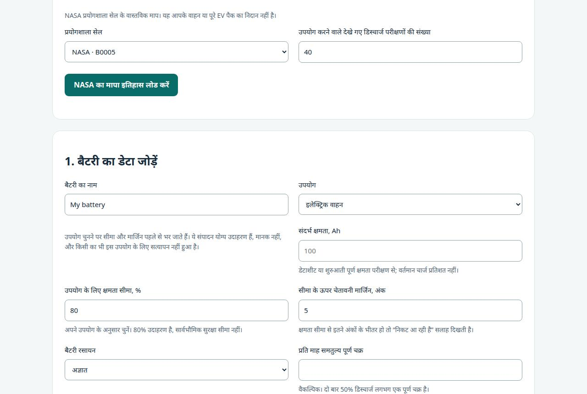
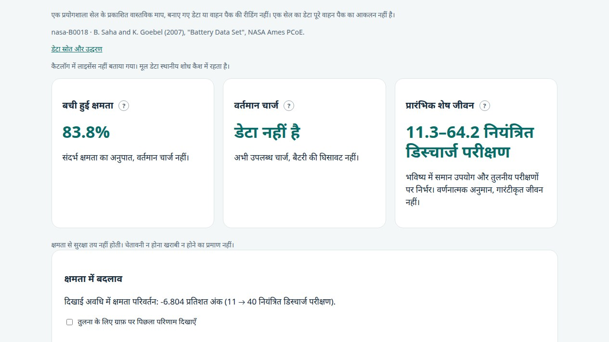
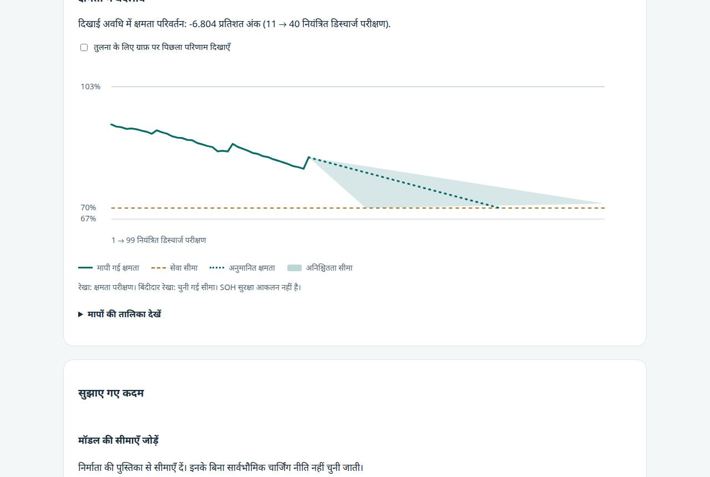
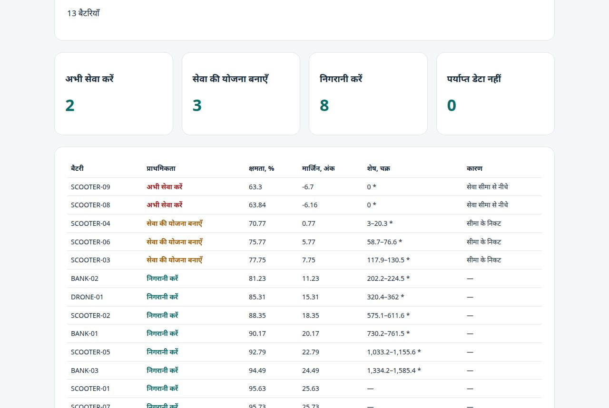
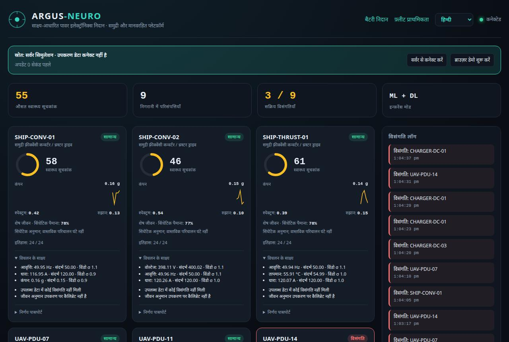
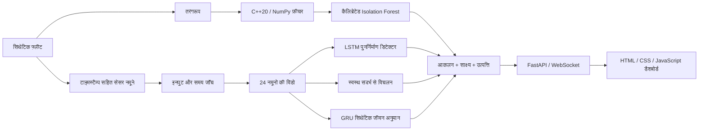

# ARGUS-NEURO

**बैटरी स्थिति और पावर इलेक्ट्रॉनिक्स निदान: C++20, Python, ML/DL और कार्यशील वेब इंटरफ़ेस।**

[English](README.en.md) · [Русский](README.md) · [中文](README.zh.md) · **हिन्दी** · [Español](README.es.md) · [Français](README.fr.md) · [Deutsch](README.de.md) · [日本語](README.ja.md) · [Italiano](README.it.md)

[निदान अनुबंध (अंग्रेज़ी)](docs/RELIABILITY.md) · [मूल्यांकन नोट्स (अंग्रेज़ी)](experiments/2026-09-30_reliability/notes.md)

ARGUS-NEURO बैटरी क्षमता विश्लेषण और पावर इलेक्ट्रॉनिक्स निदान अनुसंधान को जोड़ता है। मुख्य पृष्ठ नियंत्रित क्षमता परीक्षण और NASA सेल के प्रकाशित वास्तविक माप लेता है; `/equipment.html` नौ सिंथेटिक उपकरणों की निगरानी करता है। बैटरी जीवन प्रवृत्ति का सशर्त अनुमान है; वास्तविक उपकरणों पर उपयोग के लिए अलग सत्यापन चाहिए।

## माप से समझने योग्य बैटरी रिपोर्ट तक

- क्षमता का SOH और वर्तमान चार्ज SOC अलग हैं। अज्ञात SOC का मान नहीं गढ़ा जाता।
- समान परिस्थितियों में पूर्ण क्षमता परीक्षण Ah में CSV से आयात करें। स्थानीय रिपोर्ट और JSON निर्यात उपलब्ध हैं।
- अपने डेटा के बिना चार NASA सेल: B0005, B0006, B0007 और B0018, कुल 636 डिस्चार्ज परीक्षण। एक बार तैयारी के बाद मूल फाइलें स्थानीय कैश में रहती हैं।
- चुनी क्षमता सीमा तक जीवन सशर्त अंतराल है। छोटा इतिहास, अस्थिर प्रवृत्ति या BMS चेतावनी पर संख्यात्मक अनुमान रोका जा सकता है।
- सुझाव निर्माता की दी गई सीमाओं और बताई गई चार्जिंग तथा भंडारण स्थितियों पर आधारित हैं। OBD/CAN संपर्क या चार्जिंग नियंत्रण नहीं है।

[विधि और API, अंग्रेज़ी](docs/BATTERY.md) · [NASA स्रोत, हैश और तैयारी, अंग्रेज़ी](docs/PUBLIC_BATTERY_DATA.md) · [C++/NumPy उदाहरण, रूसी](docs/SIGNAL_DEMO.md)।

[108 सेल पर बैकटेस्ट, अंग्रेज़ी](docs/BACKTEST.md) · [C++ में वोल्टेज-वक्र संकेतक, अंग्रेज़ी](docs/CURVES.md) · [कार्यप्रणाली, अंग्रेज़ी](docs/METHODOLOGY.md)

### 108 प्रयोगशाला सेल पर शोध परिणाम

> **सूचना (30 अक्टूबर 2026)।** इस खंड की क्षमता-इतिहास संख्याएँ ceil(N/600) चक्रों के नमूना-चरण से मिली थीं, जो सेल के जीवन की लंबाई पर निर्भर है और उत्तर को मॉडल तक पहुँचा देता है। वे रद्द हैं और निश्चित भौतिक चरण पर दोबारा मापी जा रही हैं; देखें [SAMPLING_AUDIT.md](docs/SAMPLING_AUDIT.md) (अंग्रेज़ी)। तब तक अंशांकित कवरेज, सीखे मॉडलों की तुलना और वक्र संकेतकों का लाभ उद्धृत न करें।

डेटा: NASA PCoE (4 सेल), CALB (28 NCM सेल) और HUST (77 LFP सेल), कुल 3,723 पूर्वानुमान बिंदु। हर पूर्वानुमान केवल अपना देखा हुआ अतीत देखता है। विवरण और पुनरुत्पादन के आदेश: [BACKTEST.md](docs/BACKTEST.md) (अंग्रेज़ी)।

- **साधारण अंतराल अति-आत्मविश्वासी था।** बूटस्ट्रैप 5–95% अंतराल नाममात्र 90% के मुक़ाबले केवल **12%** पूर्वानुमानों में वास्तविक शेष जीवन को कवर करता था।
- **अंशांकित अंतराल अनदेखे डेटा पर टिकता है।** हर स्रोत को समान भार देने वाली conformal त्रिज्या अनदेखे सेल पर **97%** और पूरा डेटासेट बाहर रखने पर **96%** कवर करती है (CALB 90%, HUST 100%, **NASA 67%**)। क़ीमत चौड़ाई है: मध्य अंतराल शेष जीवन का लगभग 1.6 गुना है। नई रसायन या प्रोटोकॉल पर कवरेज कम हो सकता है।
- **वक्र फ़िट से लाभ नहीं हुआ,** इसलिए डिफ़ॉल्ट सीधी रेखा का रुझान ही है।
- **सीखे हुए मॉडल सीधी रेखा की त्रुटि आधी कर देते हैं** (दो रसायनों पर: CALB 47 बनाम 96 चक्र, HUST 77 बनाम 156)। वे केवल उपयोग-क्षेत्र जाँच वाली वैकल्पिक “दूसरी राय” के रूप में हैं; प्रशिक्षित भार रिपॉज़िटरी में नहीं जोड़े जाते।
- **वोल्टेज-वक्र संकेतक त्रुटि 24% घटाते हैं** (HUST पर 68.6 → 52.4 चक्र, 5 में से 5 विभाजनों में बेहतर), पर उन्हें दर्ज चार्ज वक्र चाहिए, इसलिए अभी रिपोर्ट का हिस्सा नहीं हैं।
- यह सब प्रयोगशाला सेल के लिए है, EV पैक के लिए नहीं। पैक रिपोर्ट में अंशांकित नहीं किया गया अंतराल रहता है और रिपोर्ट यह बताती है।
- **सत्यापन:** CI C++ चेतावनियों को त्रुटि मानता है, `clang-tidy` चलाता है, 70% कवरेज सीमा के साथ Python परीक्षण और README संगति जाँच चलाता है। स्थानीय (30 अक्टूबर 2026): 171 Python परीक्षण (नेटिव एक्सटेंशन के बिना 150 पास, 21 छोड़े गए), 18 इंटरफ़ेस परीक्षण, 70% कवरेज।

## उपयोग के मामले

पाँच स्थितियाँ घिसावट का एक ही सवाल पूछती हैं, पर प्राथमिकताएँ अलग हैं। [विवरण और सत्यापन स्थिति](docs/USE_CASES.md) (अंग्रेज़ी)।

- **इलेक्ट्रिक वाहन:** क्षमता रुझान, प्रयोगशाला सेल के लिए अंशांकित दायरा, और आपके दिए निर्माता सीमाओं पर आधारित देखभाल सलाह।
- **चार्जिंग स्टेशन:** डीसी फ़ास्ट-चार्जिंग कैबिनेट उपकरण पेज पर निगरानी वाली संपत्ति है (सिम्युलेटेड; अभी वास्तविक चार्जर डेटा या OCPP एडाप्टर नहीं)।
- **बचाव और चिकित्सा ड्रोन:** सावधान सीमा-पूर्वनिर्धारण और “तत्काल मिशन देने से पहले समीक्षा करें” सलाह। यह निर्णय में सहायता है, उड़ान-योग्यता आकलन नहीं।
- **साझा ई-स्कूटर और किराये के पावर बैंक:** **फ़्लीट प्राथमिकता** एक CSV से सैकड़ों बैटरियों को क्रम देती है: अभी सेवा, योजना, निगरानी, पर्याप्त डेटा नहीं।
- इन किसी भी मामले के पीछे क्षेत्र का डेटा नहीं है; सीमाएँ संचालक चुनता है।

## बैटरी पृष्ठ का त्वरित आरंभ

नीचे दिया गया पूर्ण सेटअप उपकरण मॉडलों को भी प्रशिक्षित करता है। केवल बैटरी विश्लेषण के लिए ऊपर दिए गए त्वरित आरंभ का उपयोग करें।

Ubuntu की नई स्थापना पर रिपॉज़िटरी के मूल से:

```bash
bash scripts/setup_env.sh
PYTHONPATH="$PWD/python" .venv/bin/python -m argus.battery.public_data --download
bash scripts/run_dashboard.sh
```

[http://127.0.0.1:8000](http://127.0.0.1:8000) खोलें, **B0018**, **40** अवलोकन और **Load measured NASA history** चुनें। अंग्रेज़ी मुख्य भाषा है; ऊपर हिन्दी चुन सकते हैं। इस मार्ग को मॉडल प्रशिक्षण नहीं चाहिए। उपकरणों के ML/DL निदान के लिए अलग से `bash scripts/train_all.sh` चलाएँ और `/equipment.html` खोलें।

## किसी भी मशीन पर Docker में चलाएँ

सिर्फ़ Docker Engine या Compose v2 वाला Docker Desktop चाहिए: इमेज खुद C++ कोर और उसके परीक्षण बनाती है, CPU पर चलती है और डिस्क पर लगभग 2 GB लेती है। Linux x86-64 पर परखा गया; वही Dockerfile arm64 (जैसे Apple Silicon) के लिए भी बनता है, जिसे यहाँ परखा नहीं गया।

```bash
docker compose up --build -d
docker compose exec argus bash scripts/train_all.sh
docker compose exec argus python -m argus.battery.public_data --download
docker compose restart argus
bash scripts/docker_smoke.sh
```

1. पहला कमांड इमेज बनाता है (कुछ मिनट) और सर्वर शुरू करता है।
2. दूसरा उपकरण के मॉडल एक बार प्रशिक्षित करता है (लगभग एक मिनट)। इसके बिना उपकरण पृष्ठ बेसलाइन मोड में चलता है और बताता है कि मॉडल उपलब्ध नहीं हैं; बैटरी पृष्ठ को इसकी ज़रूरत नहीं।
3. तीसरा चार प्रकाशित NASA सेल (लगभग 200 MB) एक बार डाउनलोड करता है। वे इमेज में शामिल नहीं हैं, क्योंकि कैटलॉग में लाइसेंस नहीं बताया गया और डेटा वितरित नहीं किया जाता।
4. चौथा सर्वर पुनः आरंभ करता है ताकि वह प्रशिक्षित मॉडल लोड करे; पाँचवाँ चलते कंटेनर की जाँच करता है (स्थिति, तीन पृष्ठ, उदाहरण रिपोर्ट)।

[http://127.0.0.1:8000](http://127.0.0.1:8000) खोलें। पोर्ट केवल localhost से बँधा है, क्योंकि API में प्रमाणीकरण नहीं है; बदलने के लिए `ARGUS_PORT` सेट करें। वॉल्यूम `argus-data` मॉडल, NASA डेटा और सहेजी रिपोर्टें रखता है: `docker compose down` उसे रखता है, `docker compose down -v` हटा देता है। कंटेनर non-root उपयोगकर्ता के रूप में, केवल-पठन रूट फ़ाइल सिस्टम के साथ चलता है।

प्रोडक्शन के लिए हार्डवेयर आवश्यकताएँ (क्या मापा गया, क्या केवल सुझाव है, और सॉफ़्टवेयर के बाहर क्या जोड़ना होगा): [docs/HARDWARE_REQUIREMENTS.md](docs/HARDWARE_REQUIREMENTS.md) (अंग्रेज़ी)।

## परियोजना कैसे काम करती है

ARGUS-NEURO माप को ऐसी रिपोर्ट में बदलता है जो बताती है कि क्या ज्ञात है, क्या अनुमानित है और किससे इनकार किया गया है।

1. **इनपुट।** CSV से क्षमता जाँच (प्रति समतुल्य चक्र Ah, समान परीक्षण शर्तें) या चार प्रकाशित NASA सेल में से एक (636 नियंत्रित डिस्चार्ज)। इतिहास बहुत छोटा या असंगत हो तो प्रोग्राम पूर्वानुमान देने के बजाय यह बता देता है।
2. **अभी की स्थिति।** SOH मापी गई क्षमता को संदर्भ क्षमता से भाग देने पर मिलता है। SOC तभी दिखता है जब आप उसे दें।
3. **रुझान और सीमा।** हाल की तुलनीय जाँचों पर रैखिक रुझान आपकी सीमा तक शेष नियंत्रित डिस्चार्ज की सशर्त संख्या देता है; बूटस्ट्रैप और प्रयोगशाला सेल के लिए अंशांकित conformal त्रिज्या इसे एक सीमा में बदलते हैं। इतिहास छोटा हो, रुझान अस्थिर हो या BMS अलार्म हो तो पूर्वानुमान रोक दिया जाता है।
4. **सलाह।** सलाह केवल आपके दिए निर्माता-सीमाओं और चार्जिंग व भंडारण शर्तों पर आधारित है। OBD/CAN से कोई कनेक्शन या चार्जिंग नियंत्रण नहीं है।
5. **बेड़े की प्राथमिकता।** कई बैटरियों वाली एक CSV को अभी सेवा करें, सेवा की योजना बनाएँ, निगरानी करें या पर्याप्त डेटा नहीं में क्रमबद्ध किया जाता है; उपयोग-परिदृश्य के प्रीसेट (ई-स्कूटर, पावर बैंक, बचाव ड्रोन, EV) उपलब्ध हैं।
6. **उपकरण निदान।** C++ में गणना किए गए 11 सांख्यिकीय व स्पेक्ट्रल फ़ीचर (NumPy विकल्प वही परिणाम देता है) स्पेक्ट्रल आधार-रेखा, LSTM ऑटोएन्कोडर, स्वस्थ-संदर्भ विचलन चैनल और GRU जीवन-मॉडल को खिलाते हैं; पृष्ठ स्पष्ट बताता है कि उसका डेटा स्रोत सिमुलेशन है।

### प्रमाण कहाँ तक पहुँचे हैं (30 अक्टूबर 2026)

- ऑडिट में पाया गया कि पहले का पतला करने का चरण इस पर निर्भर था कि सेल कितना जिया, और इससे मॉडलों को उत्तर का संकेत मिल गया। क्षमता-इतिहास पर पहले के सभी सटीकता आँकड़े वापस ले लिए गए हैं ([नमूनाकरण ऑडिट](docs/SAMPLING_AUDIT.md)); प्रोग्राम के साथ आने वाला अंतराल-अंशांकन पुनः-गणना की प्रतीक्षा में चिह्नित है।
- 77 HUST LFP सेल पर निश्चित चरण के साथ, केवल क्षमता वाली सबसे मज़बूत आधार-रेखा (गाउसियन प्रोसेस) औसतन लगभग 92–113 चक्र से चूकती है। चार्ज-वक्र संकेतकों वाला एन्सेम्बल 11–15 % बेहतर है, पर 15 लॉक किए गए सेल पर अंतर सांख्यिकीय रूप से स्थापित नहीं है ([प्रयोग](experiments/2026-10-30_method_hust/notes.md))।
- दो मॉडलों में असहमति होने पर पूर्वानुमान से इनकार करने से त्रुटि कम नहीं हुई, इसलिए प्रोग्राम यह दावा नहीं करता। कोई भी उपयोग-परिदृश्य क्षेत्र-डेटा से समर्थित नहीं है।

## चलते एप्लिकेशन के स्क्रीनशॉट

30 अक्टूबर 2026 को स्थानीय रूप से चल रहे प्रोग्राम से लिए गए, प्रत्येक इंटरफ़ेस भाषा के लिए एक सेट। बैटरी पृष्ठ NASA सेल B0018 (पहले 40 नियंत्रित डिस्चार्ज, 70 % सीमा) दिखाते हैं, बेड़ा पृष्ठ ई-स्कूटर प्रीसेट के साथ अंतर्निहित 13 बैटरियों का उदाहरण, और उपकरण पृष्ठ सर्वर सिमुलेशन। यह प्रयोगशाला सेल और कृत्रिम डेटा है, वाहन नहीं।

### 1. अपने डेटा के बिना शुरुआत



**क्या हो रहा है:** पृष्ठ चार प्रकाशित NASA सेल और देखे गए परीक्षणों की संख्या देता है। गणना के लिए श्रृंखला का केवल चुना हुआ आरंभिक भाग भेजा जाता है, बाद के माप कभी नहीं।

**उपयोगकर्ता के लिए निष्कर्ष:** आप बिना किसी फ़ाइल के पूरा प्रवाह आज़मा सकते हैं। परिणाम एक प्रयोगशाला सेल का वर्णन करता है, आपके वाहन का नहीं।

### 2. मापे गए सेल B0018 की रिपोर्ट



**क्या हो रहा है:** पहले 40 डिस्चार्ज से प्रोग्राम SOH 83.8 %, SOC अज्ञात (किसी ने नहीं दिया) और 70 % सीमा तक 11.3–64.2 और नियंत्रित डिस्चार्ज का सशर्त अनुमान दिखाता है। डेटा स्रोत और लाइसेंस की टिप्पणी कार्डों के ऊपर है।

**उपयोगकर्ता के लिए निष्कर्ष:** सेल ने अपनी लगभग 84 % क्षमता बनाए रखी है। इतिहास छोटा होने से सीमा चौड़ी है; इसे गारंटी नहीं, एक परिदृश्य समझें। अज्ञात SOC को अज्ञात ही दिखाया गया है, और केवल क्षमता से यह नहीं पता चलता कि बैटरी सुरक्षित है या नहीं।

### 3. क्षमता का इतिहास और अनिश्चितता



**क्या हो रहा है:** ठोस रेखा परीक्षण 1–40 की मापी क्षमता है, टूटी रेखा 70 % सीमा, बिंदुदार रेखा प्रक्षेपण और छायांकित क्षेत्र अनिश्चितता सीमा। शीर्षक परीक्षण 11–40 में, यानी वर्तमान रुझान द्वारा उपयोग किए गए अंतराल में, −6.8 अंकों का परिवर्तन बताता है।

**उपयोगकर्ता के लिए निष्कर्ष:** योजना पूरे छायांकित क्षेत्र के आधार पर बनाएँ, केवल एक बिंदुदार रेखा पर नहीं: सीमा काफ़ी पहले या बाद में आ सकती है। गिरती रेखा इसी सेल का रुझान है, और SOH सुरक्षा का निर्णय नहीं है।

### 4. बेड़े की प्राथमिकता



**क्या हो रहा है:** अंतर्निहित 13 बैटरियों का उदाहरण ई-स्कूटर प्रीसेट के साथ क्रमबद्ध है: 2 अभी सेवा करें, 3 योजना बनाएँ, 8 निगरानी करें, पर्याप्त डेटा नहीं वाली कोई नहीं। तालिका में SOH, सीमा तक अंकों में मार्जिन, शेष चक्रों की सीमा और कारण हैं; तारांकन उस पैक-स्तर की सीमा को दर्शाता है जो अंशांकित नहीं है।

**उपयोगकर्ता के लिए निष्कर्ष:** ऊपरी पंक्तियों से शुरू करें: SCOOTER-09 और SCOOTER-08 पहले ही सेवा-सीमा से नीचे हैं (63.3 % और 63.8 %)। तारांकन वाली सीमाएँ मोटा मार्गदर्शन हैं। नमूना कृत्रिम है, इसलिए यह पृष्ठ का काम दिखाता है, असली बेड़े की स्थिति नहीं।

### 5. उपकरण निदान



**क्या हो रहा है:** नौ सिमुलेटेड परिसंपत्तियाँ (जहाज़ के कन्वर्टर, UAV पावर इकाइयाँ, DC फ़ास्ट-चार्जर कैबिनेट) ML और DL मॉडलों से आँकी जाती हैं: स्वास्थ्य सूचकांक, कंपन व स्पेक्ट्रम फ़ीचर, विसंगति लॉग। बैनर बताता है कि स्रोत सर्वर सिमुलेशन है और कोई उपकरण जुड़ा नहीं है।

**उपयोगकर्ता के लिए निष्कर्ष:** यह निदान का प्रवाह दिखाता है, असली उपकरण की स्थिति नहीं। शेष-जीवन के आँकड़े कृत्रिम पैमाने पर हैं। वास्तविक उपयोग के लिए अपनी टेलीमेट्री API से दें और जाँचें कि बैनर किसी वास्तविक स्रोत का नाम बताता है।


## लागू की गई क्षमताएँ

- **निर्णय पासपोर्ट।** प्रत्येक आकलन में सामग्री से निकाला गया ID, मॉडल-बंडल फ़िंगरप्रिंट, सेंसर साक्ष्य और स्पष्टीकरण होते हैं। ये आकलित सामग्री और मॉडलों की पहचान करते हैं; ये डिजिटल हस्ताक्षर या दोष के कारण का प्रमाण नहीं हैं।
- **स्पष्ट रूप से पूर्वानुमान से इनकार।** अनुपस्थित या अपरिमित रीडिंग, अमान्य तरंगरूप, समय में विच्छेद, असंगत मॉडल और अपर्याप्त इतिहास गढ़े हुए पूर्वानुमानों के बजाय स्पष्ट स्थितियाँ देते हैं।
- **सेंसर-संदर्भ आधारित निदान।** उपकरण-विशिष्ट स्वस्थ प्रशिक्षण संदर्भ स्थायी और प्रत्यावर्ती विचलनों का पता लगाते हैं। इन्फ़रेंस के दौरान संदर्भ स्थिर रहते हैं, इसलिए क्षीण होती परिसंपत्ति चुपचाप "सामान्य" नहीं मान ली जाती।
- **डिटेक्टरों की असहमति।** डैशबोर्ड दिखाता है कि कब स्पेक्ट्रल, पुनर्निर्माण और संदर्भ-आधारित डिटेक्टर असहमत हैं। कोई एक सकारात्मक डिटेक्टर बहुमत मतदान के बिना भी अलर्ट उठा सकता है।
- **नेटिव और NumPy में एकसमान फ़ीचर।** 11 सांख्यिकीय/स्पेक्ट्रल फ़ीचर शून्य-पैडेड FFT के साझा अनुबंध का उपयोग करते हैं। pybind11 एक्सटेंशन स्ट्राइडेड/उलटे ऐरे का समर्थन करता है और इनपुट की प्रतिलिपि बनाने के बाद GIL मुक्त कर देता है।
- **कनेक्शन-सजग निगरानी।** डैशबोर्ड डिस्कनेक्ट या पुराने फ़ीड को चिह्नित करता है, अंतिम स्नैपशॉट बनाए रखता है और कनेक्शन का पुनः प्रयास करता है। ब्राउज़र में बनी टेलीमेट्री केवल स्पष्ट डेमो कार्रवाई से शुरू होती है और उसका स्रोत लेबल अलग होता है।
- **नौ भाषाओं का इंटरफ़ेस।** अंग्रेज़ी (मुख्य), रूसी (दूसरी), चीनी, हिन्दी, स्पेनिश, फ़्रेंच, जर्मन, जापानी और इतालवी; चयन ब्राउज़र में सहेजा जाता है।

ये लागू किए गए उत्पाद निर्णय हैं, न कि विश्वव्यापी नवीनता या प्रमाणित औद्योगिक प्रदर्शन के दावे।

## आर्किटेक्चर



छह सेंसर चैनल इसी क्रम में हैं: `voltage_v`, `current_a`, `temperature_c`, `vibration_g`, `frequency_hz` और `load_factor`। सिम्युलेटर अधिक गर्मी, बेयरिंग घिसाव, वोल्टेज गिरावट, आवृत्ति विचलन और इन्सुलेशन क्षरण का समर्थन करता है। लाइव फ़्लीट चार दोष परिदृश्य और दो स्वस्थ परिसंपत्तियाँ दिखाता है।

## आवश्यकताएँ

परियोजना को Ubuntu/Linux पर CPython 3.12, GCC 13, CMake 3.28 और Node.js 22 के साथ परखा गया है। नेटिव एक्सटेंशन बनाने के लिए C++20 कंपाइलर और Python डेवलपमेंट हेडर आवश्यक हैं। Python को वर्चुअल एनवायरनमेंट बनाने में सक्षम होना चाहिए। Node केवल डैशबोर्ड परीक्षणों के लिए आवश्यक है, एप्लिकेशन चलाने के लिए नहीं।

प्रत्यक्ष Python निर्भरताओं के संस्करण [python/requirements.txt](python/requirements.txt) में तय हैं; [python/requirements-dev.txt](python/requirements-dev.txt) अतिरिक्त रूप से Ruff इंस्टॉल करता है। यह सभी अप्रत्यक्ष निर्भरताओं का पूर्ण लॉक नहीं है। प्रशिक्षण अपनी मुख्य संख्यात्मक लाइब्रेरियों के संस्करण बंडल रिपोर्टों में दर्ज करता है।

## Ubuntu पर पहली बार सेटअप

रिपॉज़िटरी के मूल फ़ोल्डर से चलाएँ:

```bash
bash scripts/setup_env.sh
bash scripts/train_all.sh
bash scripts/run_dashboard.sh
```

1. सेटअप आवश्यकता होने पर `.venv` बनाता है, निर्भरताएँ इंस्टॉल करता है और नेटिव एक्सटेंशन बनाता है।
2. प्रशिक्षण एक नया मॉडल बंडल बनाता और सत्यापित करता है, उसके बाद ही उसे सक्रिय करता है।
3. लॉन्चर उपलब्ध होने पर परियोजना का `.venv` उपयोग करता है और लूपबैक पते पर Uvicorn शुरू करता है।

[http://127.0.0.1:8000](http://127.0.0.1:8000) खोलें। टर्मिनल खुला रखें; सर्वर को **Ctrl+C** से रोकें। लॉन्चर स्वयं रिपॉज़िटरी फ़ोल्डर में चला जाता है, इसलिए किसी अन्य फ़ोल्डर से पूर्ण पथ द्वारा भी चलाया जा सकता है।

पहले से कॉन्फ़िगर की गई प्रति के लिए केवल लॉन्चर चाहिए:

```bash
bash scripts/run_dashboard.sh
```

हर बार शुरू करने पर दोबारा प्रशिक्षण आवश्यक नहीं है। पुराने डेमो वेट्स से अपडेट करने के बाद एक बार प्रशिक्षण चलाएँ: उन वेट्स में वर्तमान बंडल मेटाडेटा नहीं है और नया लोडर उन्हें स्वीकार नहीं करता।

### शुरू होने के बाद क्या दिखता है

सर्वर सिम्युलेटेड टेलीमेट्री को लगभग हर **1.5 सेकंड और गणना समय** में आगे बढ़ाता है। प्रत्येक सिम्युलेटेड नमूना उपकरण के **5 सेकंड** को दर्शाता है। मॉडलों को 24 लगातार नमूने चाहिए; खाली बफ़र से शुरू करने पर परखी गई मशीन पर वार्मअप में लगभग 35–40 सेकंड लगते हैं, जो प्रोसेसिंग समय पर निर्भर करता है।

पहला तरंगरूप अलार्म वार्मअप समाप्त होने से पहले भी दिख सकता है। पर्याप्त इतिहास होने तक रुझान स्वास्थ्य और जीवन अनुमान उपलब्ध नहीं रहते। प्रत्येक परिदृश्य 400 नमूनों के बाद दोहराया जाता है; उस सीमा पर उसका इतिहास रीसेट हो जाता है।

### कॉन्फ़िगरेशन

| वेरिएबल | डिफ़ॉल्ट | उद्देश्य |
|---|---|---|
| `ARGUS_HOST` | `127.0.0.1` | Uvicorn का बाइंड पता |
| `ARGUS_PORT` | `8000` | HTTP और WebSocket पोर्ट |
| `ARGUS_ARTIFACTS_DIR` | सक्रिय स्थानीय बंडल, अन्यथा `artifacts/` | विश्वसनीय मॉडल फ़ोल्डर स्पष्ट रूप से चुनें; पूर्ण पथ की अनुशंसा है |
| `ARGUS_PYTHON` | परियोजना का `.venv/bin/python`, अन्यथा `python3` | build/train/run स्क्रिप्टों द्वारा प्रयुक्त इंटरप्रेटर; बदलने के लिए निष्पादन योग्य फ़ाइल का पथ दें। प्रारंभिक सेटअप में वर्चुअल एनवायरनमेंट डिफ़ॉल्ट रूप से `python3` से बनता है। |
| `OMP_NUM_THREADS`, `MKL_NUM_THREADS` | train/run लॉन्चरों में `1` | CPU थ्रेड सीमाएँ; पहले से सेट मान सुरक्षित रहते हैं |

उदाहरण के लिए, दूसरा स्थानीय पोर्ट उपयोग करने हेतु:

```bash
ARGUS_PORT=8001 bash scripts/run_dashboard.sh
```

डेमो में प्रमाणीकरण या टेनेंट पृथक्करण नहीं है। बाइंड पता बदलने से यह सार्वजनिक परिनियोजन के योग्य नहीं बनता।

## निदान अनुबंध

| आकलन स्थिति | अर्थ |
|---|---|
| `warming_up` | इनपुट मान्य हैं, पर 24 से कम नमूने उपलब्ध हैं |
| `ready` | पूर्ण निदान प्रक्रिया मेल खाते सेंसर संदर्भ के साथ चली |
| `invalid_data` | सेंसर मान, तरंगरूप या माप का समय सत्यापन में विफल रहा |
| `degraded` | मॉडल/संदर्भ डेटा उपलब्ध नहीं हैं या किसी मॉडल ने अमान्य आउटपुट दिया |

`ready` निष्पादन की तत्परता बताता है, वास्तविक उपकरण पर सिद्ध सटीकता नहीं। `is_anomaly` का मान `null` हो सकता है, जिसका अर्थ "अज्ञात" है, "सामान्य" नहीं। वार्मअप के दौरान स्पेक्ट्रल अलार्म इसे पहले ही `true` कर सकता है।

अमान्य सेंसर इनपुट या दिए गए टाइमस्टैम्प में विच्छेद परिसंपत्ति का इतिहास साफ़ कर देता है। अगला मान्य माप विंडो को फिर से बनाना शुरू करता है। टाइमस्टैम्प जाँच के लिए कॉल करने वाले को `sample_time_s` भेजना होता है; डेमो ऐसा करता है।

प्रत्येक आकलन में यह भी शामिल है:

- `data_quality`: समस्याएँ और एकत्रित/आवश्यक नमूनों की संख्या;
- `evidence`: तीन सबसे बड़े सेंसर विचलन, नवीनतम रीडिंग और स्वस्थ संदर्भ के माध्य;
- `explanation` और `detector_disagreement`: निदान के कारण और परस्पर विरोधी डिटेक्टर निर्णय;
- `assessment_id` और `model_version`: सामग्री और बंडल के फ़िंगरप्रिंट;
- `source` और `rul_basis`: माप और जीवन अनुमान की उत्पत्ति।

संदर्भ चैनल स्वस्थ प्रशिक्षण डेटा से विंडो के RMS मानकीकृत विचलन को मापता है। 6 मानक विचलनों की सीमा एक स्पष्ट अनुमानी मान है जिसे क्षेत्र में कैलिब्रेट करना आवश्यक है। यह उन प्रत्यावर्ती विचलनों को सुरक्षित रखता है जो अंकगणितीय माध्य में एक-दूसरे को निरस्त कर देते। सेंसर साक्ष्य कारणात्मक निदान नहीं है।

स्वास्थ्य सूचकांक प्रदर्शन के लिए एक अनुमानी स्कोर है, विफलता की संभावना नहीं। डैशबोर्ड शेष जीवन को **सिंथेटिक समय-सीमा के प्रतिशत** के रूप में दिखाता है। API का `rul_hours` प्रशिक्षण के दौरान दर्ज समय-सीमा का उपयोग करता है और केवल सिमुलेशन स्रोतों के लिए उपलब्ध है; यह वास्तविक सेवा घंटों का अनुमान नहीं है। `rul_interval_normalized` अलग रखे गए सत्यापन अवशेषों पर आधारित है और वास्तविक दुनिया में कवरेज की गारंटी नहीं देता।

## HTTP और WebSocket API

| एंडपॉइंट | व्यवहार |
|---|---|
| `GET /` | बैटरी मुख्य पृष्ठ; उपकरण: `/equipment.html`। नौ भाषाएँ, अंग्रेज़ी मुख्य। |
| `GET /api/health` | जनरेटर की स्थिति, स्नैपशॉट की आयु, मॉडल लोड होने का संकेत, क्लाइंट संख्या और जनरेटर त्रुटि |
| `GET /api/fleet` | अंतिम पूर्ण फ़्लीट स्नैपशॉट; पहले स्नैपशॉट से पहले 503 लौटाता है |
| `WS /ws/telemetry` | उपलब्ध होने पर प्रारंभिक स्नैपशॉट, फिर फ़्लीट अपडेट |
| `GET /docs` | FastAPI द्वारा स्वतः बनाया गया HTTP API दस्तावेज़ |

जब जनरेटर चल रहा हो और उसका अंतिम स्नैपशॉट अधिकतम 10 सेकंड पुराना हो, तब `/api/health` 200 लौटाता है; अन्यथा 503। **`model_backed` को अलग से जाँचें:** स्वस्थ ट्रांसपोर्ट भी अनुपलब्ध मॉडलों के साथ आकलन भेज सकता है। जनरेटर विफल होने के बाद `/api/fleet` पुराना स्नैपशॉट लौटा सकता है, इसलिए क्लाइंट को HTTP 200 को ताज़ा टेलीमेट्री मानने के बजाय टाइमस्टैम्प और स्वास्थ्य स्थिति जाँचनी चाहिए।

इन्फ़रेंस एक वर्कर थ्रेड में एक क्रमिक जनरेटर के साथ चलता है। हर WebSocket क्लाइंट का अपना प्रेषक, तीन सेकंड का प्रेषण टाइमआउट और अधिकतम एक लंबित स्नैपशॉट वाली कतार होती है। धीमे क्लाइंटों के लिए बीच के स्नैपशॉट छूट सकते हैं: यह निगरानी फ़ीड है, स्थायी इवेंट लॉग नहीं।

## प्रशिक्षण, आर्टिफ़ैक्ट और ONNX

पूरे सिंथेटिक प्रक्षेप-पथों को स्केलिंग या ओवरलैपिंग विंडो बनाने से **पहले** परिसंपत्ति प्रकार और दोष के अनुसार स्तरीकृत किया जाता है। ऑटोएनकोडर और RUL मॉडलों के अलग-अलग स्केलर हैं जो स्वस्थ प्रशिक्षण रन पर फ़िट किए जाते हैं। कैलिब्रेशन सत्यापन डेटा का उपयोग करता है; अंतिम मेट्रिक्स स्वतंत्र परीक्षण डेटा का। स्पेक्ट्रल डिटेक्टर भी प्रशिक्षण, कैलिब्रेशन और परीक्षण के लिए अलग तरंगरूप सीड का उपयोग करता है।

`bash scripts/train_all.sh` निम्न चरण करता है:

1. एक नया `artifacts/run-*` फ़ोल्डर बनाता है।
2. स्पेक्ट्रल बेसलाइन और LSTM ऑटोएनकोडर को सेंसर संदर्भों सहित प्रशिक्षित करता है।
3. GRU को प्रशिक्षित करता है और उसका सिंथेटिक समय-पैमाना तथा अवशेष अंतराल दर्ज करता है।
4. दोनों डीप मॉडलों को ONNX में निर्यात करता है, उनकी संरचना सत्यापित करता है और आउटपुट की तुलना PyTorch से करता है।
5. नए बंडल के लोड होने की पुष्टि करता है और `artifacts/active.json` को परमाणु रूप से अपडेट करता है।

विफल प्रशिक्षण या सत्यापन पिछले सक्रिय पॉइंटर को अपरिवर्तित छोड़ देता है। मौजूदा वेट्स और विफल रन के फ़ोल्डर सुरक्षित रहते हैं। नया सक्रिय बंडल लोड करने के लिए चल रहे सर्वर को पुनः आरंभ करें। स्पष्ट रूप से सेट `ARGUS_ARTIFACTS_DIR` सक्रिय पॉइंटर पर प्राथमिकता रखता है; नए सक्रिय बंडलों का अनुसरण करने के लिए इसे हटा दें।

बंडल में मॉडल वेट्स, दोनों स्केलर, स्वस्थ संदर्भ, मेटाडेटा, प्रशिक्षण रिपोर्ट, ONNX फ़ाइलें और ONNX सत्यापन रिपोर्ट होती है। लोडर स्कीमा संस्करण, सेंसर क्रम, विंडो लंबाई, नमूना अंतराल, चेकसम और sklearn डिसीरियलाइज़ेशन संगतता की जाँच करता है। केवल विश्वसनीय बंडलों का उपयोग करें: अविश्वसनीय मॉडल फ़ाइलों के आदान-प्रदान के लिए joblib सुरक्षित प्रारूप नहीं है।

निश्चित ONNX इनपुट `(1, 24, 6)` है। संख्यात्मक सत्यापन तीन इनपुट पैमानों पर **ONNX ReferenceEvaluator** का उपयोग करता है। C++ ONNX Runtime इन्फ़रेंस ब्रिज और लक्षित एज हार्डवेयर पर सत्यापन लागू नहीं किए गए हैं।

बनाए गए बंडल और `active.json` को Git अनदेखा करता है। ये स्थानीय आउटपुट हैं; नई प्रति को अपना प्रशिक्षण रन या स्पष्ट रूप से दिया गया संगत बंडल चाहिए।

## बिल्ड और परीक्षण

सेटअप के बाद रिपॉज़िटरी के मूल फ़ोल्डर से चलाएँ:

```bash
source .venv/bin/activate
bash scripts/build_cpp_core.sh
ctest --test-dir build --output-on-failure

# नेटिव एक्सटेंशन और Python अनुबंध
PYTHONPATH="$PWD/python:$PWD/build/cpp_core" OMP_NUM_THREADS=1 MKL_NUM_THREADS=1 \
  python -m pytest python/tests -q

# Python मॉड्यूल पथ में build फ़ोल्डर के बिना वैकल्पिक मोड
PYTHONPATH="$PWD/python" OMP_NUM_THREADS=1 MKL_NUM_THREADS=1 \
  python -m pytest python/tests -q

ruff check python
ruff format --check python
node --check web/dashboard/app.js
node --test web/dashboard/tests/*.test.cjs
```

नेटिव परीक्षण Release बिल्ड में भी सक्रिय रहते हैं। Python परीक्षण फ़ीचर समानता और सीमांत मामलों, मॉडलों, स्वतंत्र रन विभाजन, उत्पत्ति और पूर्वानुमान से इनकार, तथा WebSocket विफलता व्यवहार को कवर करते हैं। केवल-नेटिव परीक्षण एक्सटेंशन अनुपलब्ध होने पर छोड़ दिए जाते हैं। वैकल्पिक मोड की जाँच मानती है कि `argus_core` Python एनवायरनमेंट में अलग से इंस्टॉल नहीं है।

[CI](.github/workflows/ci.yml) Python 3.12 और Node 22 का उपयोग करता है, एक्सटेंशन बनाता है, दोनों Python मोड चलाता है, फ़ॉर्मेटिंग/डैशबोर्ड तर्क जाँचता है और पूरी चरणबद्ध प्रशिक्षण/निर्यात प्रक्रिया को सत्यापित करता है।

### दर्ज किया गया मूल्यांकन

[2026-09-30 का प्रयोग](experiments/2026-09-30_reliability/notes.md) यह दर्ज करता है:

| जाँच या मेट्रिक | दर्ज परिणाम |
|---|---|
| नेटिव CTest | 1 परीक्षण प्रोग्राम सफल |
| नेटिव एक्सटेंशन के साथ Python | 65 सफल |
| NumPy वैकल्पिक मोड के साथ Python | 50 सफल, 15 केवल-नेटिव छोड़े गए |
| डैशबोर्ड तर्क | 3 Node परीक्षण सफल |
| ऑटोएनकोडर F1 / रिकॉल | अलग रखे गए सिंथेटिक रन पर 0.6690 / 0.5851 |
| RUL सामान्यीकृत परीक्षण MAE | 0.1875; उसी परीक्षण सेट पर माध्यिका बेसलाइन 0.2880 |
| ONNX अधिकतम निरपेक्ष अंतर | दर्ज समानता जाँचों में दोनों मॉडलों के लिए 0.000001 से कम |
| 401-चरण डेमो | परिदृश्य के अंतिम चरण पर चारों दोषपूर्ण परिसंपत्तियाँ चिह्नित और दोनों स्वस्थ परिसंपत्तियाँ अचिह्नित; अगला चक्र वार्मअप पर लौटा |

ये दिनांकित परिणाम हैं, अन्य परिवेशों या वास्तविक उपकरणों के लिए वादा किए गए परिणाम नहीं। डेमो के अंतिम चरण की जाँच संवेदनशीलता/झूठे अलार्म का अध्ययन नहीं है। मूल और संशोधित ML मेट्रिक्स अलग-अलग विभाजनों पर आधारित हैं और इन्हें नियंत्रित सटीकता सुधार नहीं समझना चाहिए। उस समय दृश्य ब्राउज़र जाँच उपलब्ध नहीं थी; DOM तर्क और HTTP/WebSocket ट्रांसपोर्ट को प्रोग्रामेटिक रूप से जाँचा गया।

## समस्या निवारण

- **`GET /favicon.ico 404`:** कोई फ़ेविकॉन नहीं दिया गया है। इसका निदान या टेलीमेट्री पर कोई प्रभाव नहीं है।
- **जीवन/स्वास्थ्य मान के स्थान पर डैश:** स्थिति देखें। वार्मअप और अनुपलब्ध मॉडलों की स्थिति में पूर्वानुमान जानबूझकर रोके जाते हैं।
- **`models_unavailable`:** प्रशिक्षण प्रक्रिया चलाएँ, चुने गए बंडल की जाँच करें और पुनः आरंभ करें। मूल फ़ोल्डर के पुराने डेमो वेट्स नई स्कीमा को पूरा नहीं करते।
- **पता पहले से उपयोग में है:** पहले शुरू किए सर्वर को Ctrl+C से रोकें या दूसरा `ARGUS_PORT` चुनें।
- **कनेक्शन टूटा/डेटा पुराना:** इंटरफ़ेस अंतिम स्नैपशॉट बनाए रखता है और पुनः प्रयास करता है। ब्राउज़र-डेमो बटन प्रशिक्षित मॉडलों के बिना उदाहरण बनाता है; यह वास्तविक टेलीमेट्री को पुनः कनेक्ट नहीं करता।
- **`index.html` को सीधे खोलना:** पृष्ठ ब्राउज़र डेमो चला सकता है, पर मॉडल-आधारित निदान के लिए सर्वर URL का उपयोग करें।
- **निर्भरता या सीरियलाइज़ेशन बेमेल:** परियोजना के वर्चुअल एनवायरनमेंट का उपयोग करें और तय निर्भरताओं के साथ पुनः प्रशिक्षण करें। असंगत बंडल का चुपचाप पुनः उपयोग न करें।

## रिपॉज़िटरी संरचना

| पथ | सामग्री |
|---|---|
| `cpp_core/` | फ़ीचर निष्कर्षण, radix-2 FFT, pybind11 बाइंडिंग, नेटिव परीक्षण |
| `python/argus/simulator/` | सिंथेटिक टेलीमेट्री और तरंगरूप निर्माण |
| `python/argus/features/`, `models/` | नेटिव/NumPy इंटरफ़ेस और मॉडल परिभाषाएँ |
| `python/argus/training/` | रन विभाजन, स्केलर, प्रशिक्षण, पुनरुत्पादनीयता सहायक |
| `python/argus/inference/`, `python/argus/artifacts.py` | आकलन और सक्रिय बंडल का चयन |
| `python/argus/api/`, `python/argus/export/` | FastAPI सेवा और सत्यापित ONNX निर्यात |
| `python/argus/battery/` | क्षमता आकलन, अंशांकन, बैकटेस्ट, वक्र संकेतक, डेटासेट लोडर, सीखे मॉडल की दूसरी राय, रिपोर्ट भंडारण |
| `python/tests/` | Python प्रतिगमन परीक्षण |
| `web/dashboard/` | बहुभाषी HTML/CSS/JS कंसोल और Node परीक्षण; कोई फ़्रंटएंड बिल्ड सिस्टम नहीं |
| `artifacts/` | पुरानी डेमो फ़ाइलें और स्थानीय रूप से बने बंडल |
| `scripts/` | एनवायरनमेंट सेटअप, बिल्ड, चरणबद्ध प्रशिक्षण, स्थानीय लॉन्च |
| `experiments/` | कॉन्फ़िगरेशन, मेट्रिक्स, परिवर्तन स्नैपशॉट और मूल्यांकन नोट्स |
| `docs/RELIABILITY.md` | निदान निर्णय, विफलता व्यवहार और परिनियोजन सीमाएँ |
| `docs/BATTERY.md`, `METHODOLOGY.md`, `BACKTEST.md`, `CURVES.md` | बैटरी विधि और API, सूत्र व मान्यताएँ, बैकटेस्ट प्रमाण, वोल्टेज-वक्र संकेतक |

## वर्तमान सीमाएँ और अगले कदम

बैटरी के लिए: कोई परिणाम EV पैक या क्षेत्र में सत्यापित नहीं है; अंशांकन स्रोतों के बीच असमान रूप से स्थानांतरित होता है (NASA 67%); अंतराल चौड़ा है; वोल्टेज-वक्र संकेतकों को दर्ज चार्ज वक्र चाहिए और वे अभी रिपोर्ट में उपयोग नहीं होते; सीखी हुई दूसरी राय केवल उसी रसायन और प्रोटोकॉल को कवर करती है जिस पर वह प्रशिक्षित है। अगला क़दम वोल्टेज और तापमान रिकॉर्ड वाले अधिक सेल तथा पैक-स्तर का डेटा है।

वास्तविक टेलीमेट्री एडेप्टर, उपकरण टेलीमेट्री का स्थायी इतिहास, प्रमाणीकरण, टेनेंट पृथक्करण और C++ ONNX Runtime इन्फ़रेंस ब्रिज भविष्य के कार्य हैं। क्षेत्र सत्यापन की प्राथमिकताएँ हैं: टाइमस्टैम्प सहित डेटा संग्रह, इंजीनियरिंग द्वारा लेबल किए गए दोष, परीक्षण के लिए स्वतंत्र भौतिक परिसंपत्तियाँ, स्वीकार्य झूठे अलार्म दर और चेतावनी-समय का मापन। औद्योगिक संचालन से पहले ड्रिफ़्ट निगरानी और लंबी अवधि के नेटवर्क/उपकरण विफलता परीक्षण भी आवश्यक हैं।

## लेखक और लाइसेंस

सेर्गेयेव अंतोन वालेंतिनोविच (Сергеев Антон Валентинович, Anton Valentinovich Sergeev)। MIT लाइसेंस के अंतर्गत; देखें [LICENSE](LICENSE)।
