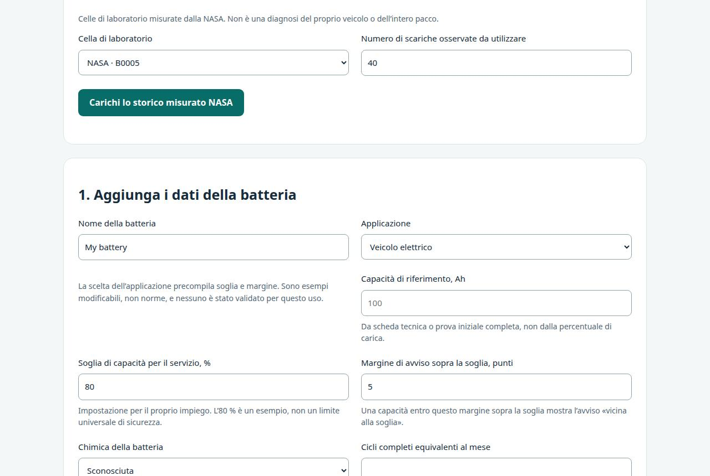
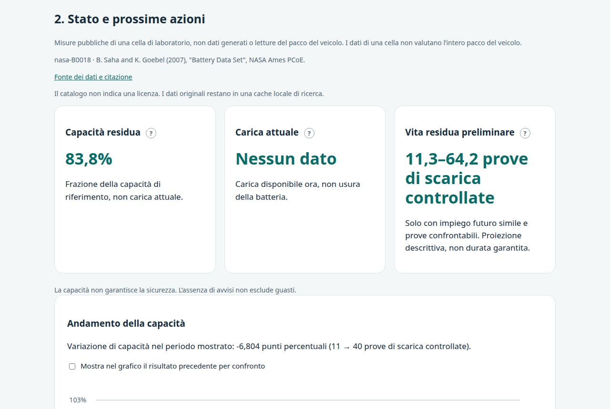
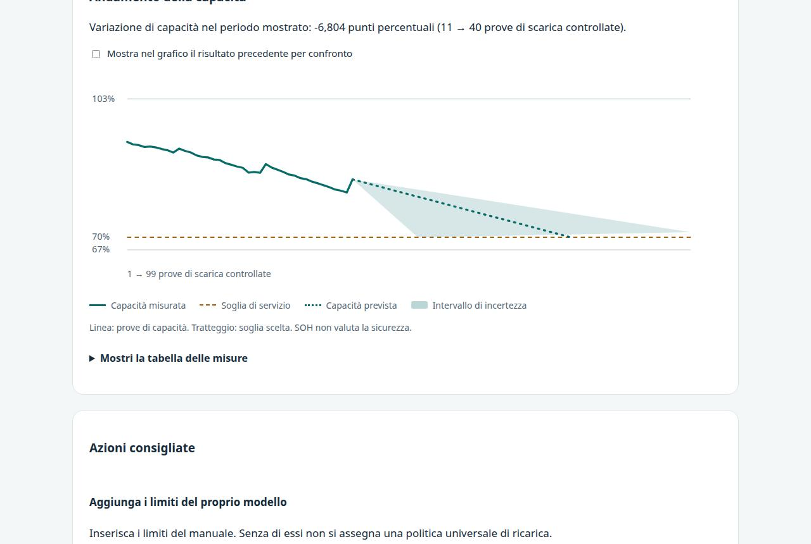
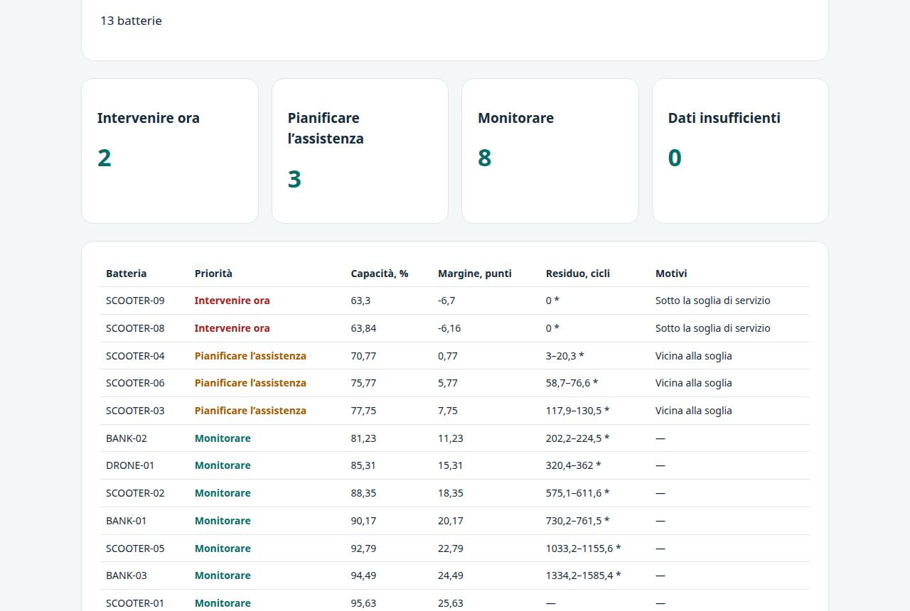
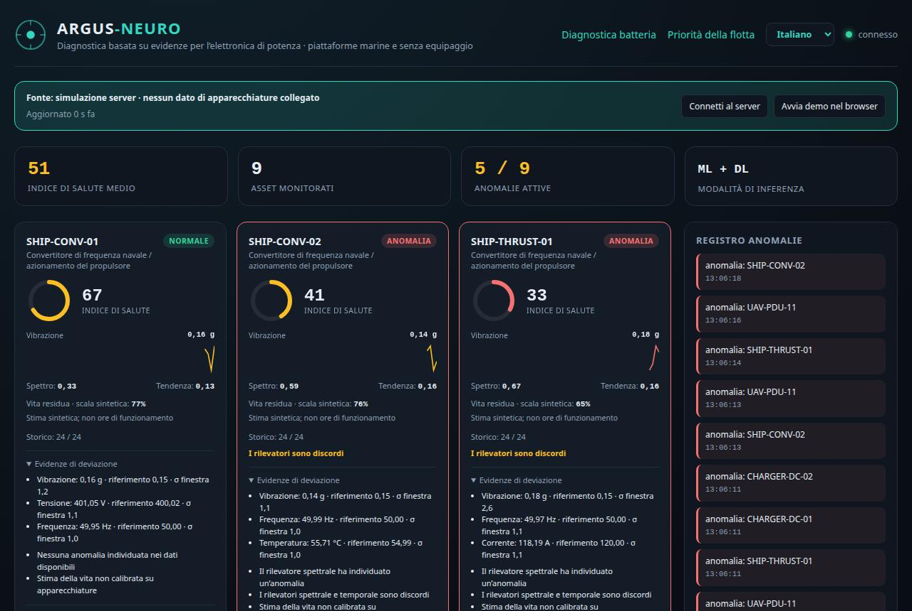
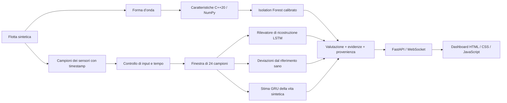

# ARGUS-NEURO

**Stato delle batterie e diagnostica dell’elettronica di potenza: C++20, Python, ML/DL e interfaccia web funzionante.**

[English](README.en.md) · [Русский](README.md) · [中文](README.zh.md) · [हिन्दी](README.hi.md) · [Español](README.es.md) · [Français](README.fr.md) · [Deutsch](README.de.md) · [日本語](README.ja.md) · **Italiano**

[Contratto diagnostico (in inglese)](docs/RELIABILITY.md) · [Note di valutazione (in inglese)](experiments/2026-09-30_reliability/notes.md)

ARGUS-NEURO combina l’analisi della capacità delle batterie con la ricerca sulla diagnostica dell’elettronica di potenza. La pagina principale usa prove controllate e misure pubblicate di celle NASA; `/equipment.html` monitora nove unità sintetiche. La vita della batteria è una proiezione condizionata della tendenza; l’impiego sul campo richiede una validazione separata.

## Analisi della batteria e rapporto spiegabile

- SOH della capacità e SOC attuale sono distinti. Un SOC sconosciuto non viene inventato.
- Importazione CSV di prove complete in Ah in condizioni confrontabili, rapporti locali ed esportazione JSON.
- Senza dati propri: quattro celle NASA, B0005, B0006, B0007 e B0018, per 636 prove di scarica. Le fonti restano nella cache locale dopo la preparazione.
- Proiezione condizionata fino a una soglia configurabile. Storico breve, tendenza instabile o allarme BMS possono impedire una previsione numerica.
- Consigli basati sui limiti del costruttore e sulle condizioni dichiarate di ricarica e stoccaggio. Nessuna connessione OBD/CAN o comando di ricarica.

[Metodo e API, inglese](docs/BATTERY.md) · [Fonte NASA e preparazione, inglese](docs/PUBLIC_BATTERY_DATA.md) · [Esempio C++/NumPy, russo](docs/SIGNAL_DEMO.md).

[Backtest su 108 celle, inglese](docs/BACKTEST.md) · [Indicatori delle curve di tensione in C++, inglese](docs/CURVES.md) · [Metodologia, inglese](docs/METHODOLOGY.md)

### Risultati di ricerca su 108 celle di laboratorio

> **Avviso (30 ottobre 2026).** La versione precedente di questa sezione usava un passo di sottocampionamento di ceil(N/600) cicli, che dipende da quanto vive la cella e rivela la risposta. Il backtest degli intervalli qui sotto è stato **rifatto con un passo fisico fisso di 5 cicli**. I vantaggi precedenti dei modelli appresi e degli indicatori di curva sono ritirati; vedi [SAMPLING_AUDIT.md](docs/SAMPLING_AUDIT.md) e la sezione sulle prove più sotto.

Dati: NASA PCoE (4 celle), CALB (28 celle NCM) e HUST (77 celle LFP), 3 713 punti di previsione. Ogni previsione vede solo il proprio passato osservato. Dettagli e comandi di riproduzione: [BACKTEST.md](docs/BACKTEST.md) (inglese).

- **L’intervallo semplice era troppo sicuro di sé.** L’intervallo bootstrap 5–95 % ha coperto la vita residua reale solo nel **9 %** delle previsioni contro un 90 % nominale.
- **L’intervallo calibrato regge in media, non su ogni fonte.** Un raggio conforme di 0,65 con lo stesso peso per dataset copre il **96 %** delle previsioni su celle mai viste e il **95 %** escludendo un intero dataset, ma solo l’**83 %** per CALB e il **73 %** per NASA (HUST 100 %). L’intervallo mediano è circa 1,6 volte la vita residua. Una nuova chimica o un nuovo protocollo possono risultare sotto-coperti.
- **A passo fisso le curve ora battono la retta** (errore medio 61 contro 83 cicli). Il predefinito resta la retta finché la scelta non è confermata su un protocollo fissato in anticipo.
- **I vantaggi precedenti dei modelli appresi e degli indicatori di curva sono ritirati.** Nella pipeline corretta l’insieme con indicatori di curva è più accurato dell’11–15 % rispetto alla migliore base solo-capacità sulle celle di sviluppo HUST, ma su 15 celle bloccate la differenza non è confermata statisticamente (vedi la sezione sulle prove).
- Tutto ciò riguarda celle di laboratorio, non pacchi di veicoli. I rapporti dei pacchi mantengono l’intervallo non calibrato e lo dichiarano.
- **Verifica:** la CI compila il C++ con avvisi come errori, esegue `clang-tidy`, i test Python con soglia di copertura del 70 % e la coerenza dei README. In locale (30 ottobre 2026): 171 test Python (150 superati e 21 saltati senza estensione nativa), 18 test dell’interfaccia, copertura 70 %.

## Casi d’uso

Cinque situazioni pongono la stessa domanda sull’usura, con priorità diverse. [Dettagli e stato di validazione](docs/USE_CASES.md) (inglese).

- **Veicoli elettrici:** tendenza di capacità, intervallo calibrato per celle di laboratorio e consigli secondo i limiti del costruttore che fornite.
- **Stazioni di ricarica:** un armadio di ricarica rapida DC è un asset monitorato nella pagina delle apparecchiature (simulato; ancora senza dati reali né adattatore OCPP).
- **Droni di soccorso e medici:** una soglia prudente e l’avviso «verificare prima di assegnarla a missioni urgenti». Supporto alla decisione, non valutazione di aeronavigabilità.
- **Monopattini condivisi e power bank a noleggio:** la **Priorità della flotta** ordina centinaia di batterie da un CSV: intervenire ora, pianificare, monitorare, dati insufficienti.
- Nessun caso ha dati di campo; le soglie sono scelte dall’operatore.

## Avvio rapido: batteria

Nuova installazione Ubuntu, dalla radice del repository:

```bash
bash scripts/setup_env.sh
PYTHONPATH="$PWD/python" .venv/bin/python -m argus.battery.public_data --download
bash scripts/run_dashboard.sh
```

Aprire [http://127.0.0.1:8000](http://127.0.0.1:8000), scegliere **B0018**, **40** osservazioni e **Load measured NASA history**. L’inglese è predefinito; selezionare l’italiano in alto. Questo percorso non richiede addestramento. Per la diagnostica ML/DL delle apparecchiature eseguire separatamente `bash scripts/train_all.sh` e aprire `/equipment.html`.

## Eseguire in Docker su qualsiasi macchina

Bastano Docker Engine o Docker Desktop con Compose v2: l’immagine compila da sola il nucleo C++ e i suoi test, funziona su CPU e occupa circa 2 GB su disco. Provato su Linux x86-64; lo stesso Dockerfile si costruisce anche per arm64 (per esempio Apple Silicon), cosa non provata qui.

```bash
docker compose up --build -d
docker compose exec argus bash scripts/train_all.sh
docker compose exec argus python -m argus.battery.public_data --download
docker compose restart argus
bash scripts/docker_smoke.sh
```

1. Il primo comando costruisce l’immagine (alcuni minuti) e avvia il server.
2. Il secondo addestra una volta i modelli delle apparecchiature (circa un minuto). Senza di esso la pagina apparecchiature funziona in modalità di base e segnala che i modelli non sono disponibili; la pagina batteria non ne ha bisogno.
3. Il terzo scarica una volta le quattro celle NASA pubblicate (circa 200 MB). Non sono incluse nell’immagine perché il catalogo non indica una licenza e i dati non vengono ridistribuiti.
4. Il quarto riavvia il server perché carichi i modelli addestrati; il quinto verifica il contenitore in esecuzione (stato, tre pagine, rapporto di esempio).

Aprite [http://127.0.0.1:8000](http://127.0.0.1:8000). La porta è legata solo a localhost perché l’API non ha autenticazione; si cambia con `ARGUS_PORT`. Il volume `argus-data` conserva modelli, dati NASA e rapporti salvati: `docker compose down` lo mantiene, `docker compose down -v` lo elimina. Il contenitore gira come utente non root con il file system radice in sola lettura.

Requisiti hardware per la produzione (cosa è stato misurato, cosa è solo una raccomandazione e cosa va aggiunto fuori dal software): [docs/HARDWARE_REQUIREMENTS.md](docs/HARDWARE_REQUIREMENTS.md) (in inglese).

## Come funziona il progetto

ARGUS-NEURO trasforma le misure in un rapporto che dice cosa è noto, cosa è stimato e cosa viene rifiutato.

1. **Input.** Controlli di capacità da un CSV (Ah per ciclo equivalente, stesse condizioni di prova) o una delle quattro celle NASA pubblicate (636 scariche controllate). Se lo storico è troppo breve o incoerente, il programma lo dice invece di prevedere.
2. **Stato attuale.** L’SOH è la capacità misurata divisa per la capacità di riferimento. L’SOC compare solo se lo fornite.
3. **Tendenza e intervallo.** Una tendenza lineare sugli ultimi controlli confrontabili dà un numero condizionale di scariche controllate fino alla vostra soglia; un bootstrap e, per le celle di laboratorio, un raggio conformal calibrato lo trasformano in un intervallo. La previsione è trattenuta se lo storico è breve, la tendenza instabile o c’è un allarme BMS.
4. **Consigli.** Le raccomandazioni usano solo i limiti del produttore e le condizioni di carica e conservazione che inserite. Nessun collegamento OBD/CAN e nessun controllo della carica.
5. **Triage della flotta.** Un CSV con molte batterie viene ordinato in intervenire ora, pianificare, monitorare o dati insufficienti, con un preset per caso d’uso (monopattini, power bank, droni di soccorso, EV).
6. **Diagnostica delle apparecchiature.** 11 caratteristiche statistiche e spettrali calcolate in C++ (il ripiego NumPy dà lo stesso risultato) alimentano una base spettrale, un autoencoder LSTM, un canale di scostamento dal riferimento sano e un modello di vita GRU; la pagina dichiara che la fonte dei dati è una simulazione.

### A che punto sono le prove (30 ottobre 2026)

- Un audit ha rilevato che il passo di sottocampionamento precedente dipendeva da quanto viveva la cella e suggeriva la risposta ai modelli. Tutte le cifre di accuratezza precedenti sugli storici di capacità sono state ritirate ([audit del campionamento](docs/SAMPLING_AUDIT.md)); la calibrazione degli intervalli fornita col programma è stata ricalcolata a passo fisso il 30 ottobre 2026 (raggio 0,65; copertura 96 % e 95 %, ma 83 % per CALB e 73 % per NASA in caso di esclusione).
- Con passo fisso su 77 celle LFP di HUST, la migliore linea di base con la sola capacità (un processo gaussiano) sbaglia in media di circa 92–113 cicli. Un insieme con indicatori della curva di carica è migliore dell’11–15 %, ma su 15 celle riservate la differenza non è stabilita statisticamente ([esperimento](experiments/2026-10-30_method_hust/notes.md)).
- Rifiutare la previsione quando due modelli discordano non ha ridotto l’errore, quindi il programma non lo afferma. Nessun caso d’uso è sostenuto da dati sul campo.

## Schermate dell’applicazione in funzione

Acquisite il 30 ottobre 2026 dal programma in esecuzione in locale, una serie per ogni lingua dell’interfaccia. Le pagine batteria usano la cella NASA B0018 (prime 40 scariche controllate, soglia del 70 %), la pagina flotta l’esempio integrato di 13 batterie con il preset monopattino e la pagina apparecchiature la simulazione del server. È una cella di laboratorio con dati sintetici, non un veicolo.

### 1. Iniziare senza dati propri



**Cosa succede:** La pagina offre quattro celle NASA pubblicate e il numero di prove osservate. Al calcolo viene inviato solo l’inizio scelto della serie, mai le misure successive.

**Conclusione per l’utente:** Potete provare l’intero percorso senza alcun file. Il risultato descrive una cella di laboratorio, non il vostro veicolo.

### 2. Rapporto della cella misurata B0018



**Cosa succede:** Dalle prime 40 scariche il programma mostra SOH 83,8 %, SOC sconosciuto (nessuno lo ha fornito) e una stima condizionale di 11,3–64,2 scariche controllate in più prima della soglia del 70 %. La fonte dei dati e la nota di licenza stanno sopra le schede.

**Conclusione per l’utente:** La cella ha mantenuto circa l’84 % della capacità. L’intervallo è ampio perché lo storico è breve; leggetelo come uno scenario, non come una garanzia. Un SOC sconosciuto è mostrato come tale, e la sola capacità non dice se la batteria è sicura.

### 3. Storico di capacità e incertezza



**Cosa succede:** La linea continua è la capacità misurata nelle prove 1–40, la tratteggiata la soglia del 70 %, la punteggiata la proiezione e l’area ombreggiata l’intervallo di incertezza. La didascalia riporta una variazione di −6,8 punti nelle prove 11–40, il tratto usato dalla tendenza attuale.

**Conclusione per l’utente:** Pianificate con tutta l’area ombreggiata, non con la sola linea punteggiata: la soglia può essere raggiunta molto prima o molto dopo. Una linea in discesa è la tendenza di questa cella, e l’SOH non è un verdetto di sicurezza.

### 4. Triage della flotta



**Cosa succede:** L’esempio integrato di 13 batterie è ordinato con il preset monopattino: 2 da intervenire ora, 3 da pianificare, 8 da monitorare, nessuna con dati insufficienti. La tabella riporta SOH, margine dalla soglia in punti, intervallo di cicli residui e motivo; un asterisco indica un intervallo a livello di pacco non calibrato.

**Conclusione per l’utente:** Partite dalle prime righe: SCOOTER-09 e SCOOTER-08 sono già sotto il limite di servizio (63,3 % e 63,8 %). Gli intervalli con asterisco sono indicazioni approssimative. Il campione è sintetico: mostra come funziona la pagina, non lo stato di una flotta reale.

### 5. Diagnostica delle apparecchiature



**Cosa succede:** Nove asset simulati (convertitori navali, unità di potenza UAV, armadi di ricarica rapida DC) sono valutati da modelli ML e DL: indice di salute, caratteristiche di vibrazione e spettro, registro delle anomalie. Il banner indica che la fonte è una simulazione del server e che nessuna apparecchiatura è collegata.

**Conclusione per l’utente:** Questo mostra il percorso diagnostico, non lo stato di apparecchiature reali. I valori di vita residua sono su una scala sintetica. In uso reale inviate la vostra telemetria tramite l’API e verificate che il banner indichi una fonte reale.


## Funzionalità implementate

- **Passaporti della decisione.** Ogni valutazione include un ID derivato dal contenuto, un’impronta del pacchetto di modelli, evidenze dai sensori e spiegazioni. Identificano il contenuto e i modelli valutati; non sono firme digitali né prove della causa di un guasto.
- **Astensione esplicita.** Letture mancanti o non finite, forme d’onda non valide, discontinuità temporali, modelli incompatibili e storico insufficiente producono stati espliciti invece di previsioni inventate.
- **Diagnostica rispetto ai riferimenti dei sensori.** Riferimenti sani di addestramento, specifici per tipo di apparecchiatura, rilevano deviazioni persistenti e alternate. I riferimenti restano fissi durante l’inferenza, così un asset che si degrada non viene appreso silenziosamente come normale.
- **Disaccordo tra rilevatori.** La dashboard mostra quando i rilevatori spettrale, di ricostruzione e basato sui riferimenti sono in disaccordo. Un solo rilevatore positivo può generare un allarme senza voto a maggioranza.
- **Caratteristiche coerenti tra codice nativo e NumPy.** Le 11 caratteristiche statistiche e spettrali usano un contratto FFT comune con riempimento di zeri. L’estensione pybind11 supporta array con passo e invertiti e rilascia il GIL dopo aver copiato l’input.
- **Monitoraggio consapevole della connessione.** La dashboard segnala i flussi disconnessi o obsoleti, conserva l’ultima istantanea e ritenta la connessione. La telemetria generata nel browser parte solo con un’azione dimostrativa esplicita e ha un’etichetta di origine separata.
- **Interfaccia in nove lingue.** Inglese (principale), russo (secondo), cinese, hindi, spagnolo, francese, tedesco, giapponese e italiano; la scelta viene salvata.

Si tratta di scelte di prodotto implementate, non di affermazioni di novità mondiale o di prestazioni industriali convalidate.

## Architettura



I sei canali dei sensori sono `voltage_v`, `current_a`, `temperature_c`, `vibration_g`, `frequency_hz` e `load_factor`, in quest’ordine. Il simulatore supporta surriscaldamento, usura dei cuscinetti, abbassamento di tensione, deriva di frequenza e degrado dell’isolamento. La flotta dal vivo mostra quattro scenari di guasto e due asset sani.

## Requisiti

Il progetto è stato provato su Ubuntu/Linux con CPython 3.12, GCC 13, CMake 3.28 e Node.js 22. La compilazione dell’estensione nativa richiede un compilatore C++20 e gli header di sviluppo di Python. Python deve poter creare ambienti virtuali. Node serve solo per i test della dashboard, non per eseguire l’applicazione.

Le versioni delle dipendenze Python dirette sono fissate in [python/requirements.txt](python/requirements.txt); [python/requirements-dev.txt](python/requirements-dev.txt) installa in aggiunta Ruff. Non è un blocco completo delle dipendenze transitive. L’addestramento registra le versioni delle principali librerie numeriche nei report del pacchetto.

## Prima installazione su Ubuntu

La configurazione completa seguente addestra anche i modelli delle apparecchiature. Per la sola analisi delle batterie, utilizzare l’avvio rapido sopra.

Eseguire dalla radice del repository:

```bash
bash scripts/setup_env.sh
bash scripts/train_all.sh
bash scripts/run_dashboard.sh
```

1. L’installazione crea `.venv` se necessario, installa le dipendenze e compila l’estensione nativa.
2. L’addestramento crea e convalida un nuovo pacchetto di modelli prima di attivarlo.
3. Lo script di avvio usa il `.venv` del progetto, se presente, e avvia Uvicorn sull’indirizzo locale.

Aprite [http://127.0.0.1:8000](http://127.0.0.1:8000). Tenete aperto il terminale; arrestate il server con **Ctrl+C**. Lo script di avvio si sposta da solo nella directory del repository, quindi funziona anche con un percorso assoluto da un’altra directory.

Per una copia già configurata basta lo script di avvio:

```bash
bash scripts/run_dashboard.sh
```

Non serve riaddestrare a ogni avvio. Dopo l’aggiornamento dai pesi dimostrativi storici, eseguite l’addestramento una volta: quei pesi non hanno i metadati del pacchetto attuale e il nuovo caricatore non li accetta.

### Cosa appare dopo l’avvio

Il server fa avanzare la telemetria simulata circa ogni **1,5 secondi più il tempo di calcolo**. Ogni campione simulato rappresenta **5 secondi** di funzionamento dell’apparecchiatura. I modelli hanno bisogno di 24 campioni consecutivi; partendo da un buffer vuoto, il riscaldamento richiede circa 35–40 secondi sulla macchina provata, a seconda del tempo di elaborazione.

Il primo allarme sulla forma d’onda può comparire prima della fine del riscaldamento. La salute basata sul trend e la stima della vita restano non disponibili finché lo storico non è sufficiente. Ogni scenario si ripete dopo 400 campioni; a quel limite il suo storico viene azzerato.

### Configurazione

| Variabile | Valore predefinito | Scopo |
|---|---|---|
| `ARGUS_HOST` | `127.0.0.1` | Indirizzo di ascolto di Uvicorn |
| `ARGUS_PORT` | `8000` | Porta HTTP e WebSocket |
| `ARGUS_ARTIFACTS_DIR` | Pacchetto locale attivo, altrimenti `artifacts/` | Seleziona esplicitamente una directory di modelli attendibile; si consiglia un percorso assoluto |
| `ARGUS_PYTHON` | `.venv/bin/python` del progetto, altrimenti `python3` | Interprete usato dagli script di compilazione, addestramento e avvio; per sostituirlo indicate il percorso di un eseguibile. Nell’installazione iniziale l’ambiente virtuale viene creato di default con `python3`. |
| `OMP_NUM_THREADS`, `MKL_NUM_THREADS` | `1` negli script di addestramento e avvio | Limiti dei thread CPU; i valori già impostati vengono mantenuti |

Ad esempio, per usare un’altra porta locale:

```bash
ARGUS_PORT=8001 bash scripts/run_dashboard.sh
```

La demo non ha autenticazione né isolamento tra tenant. Cambiare l’indirizzo di ascolto non la rende adatta a un’installazione pubblica.

## Contratto diagnostico

| Stato della valutazione | Significato |
|---|---|
| `warming_up` | Input validi, ma sono disponibili meno di 24 campioni |
| `ready` | Il percorso diagnostico completo è stato eseguito con un riferimento dei sensori corrispondente |
| `invalid_data` | Valori dei sensori, forma d’onda o tempi di misura non hanno superato la convalida |
| `degraded` | Modelli o dati di riferimento non disponibili, oppure un modello ha restituito un output non valido |

`ready` descrive la prontezza all’esecuzione, non un’accuratezza dimostrata su apparecchiature reali. `is_anomaly` può essere `null`, che significa sconosciuto e non normale. Durante il riscaldamento un allarme spettrale può già impostarlo a `true`.

Un input di sensore non valido o una discontinuità nei timestamp forniti cancella lo storico dell’asset. L’acquisizione valida successiva deve ricostruire la finestra. I controlli sui timestamp richiedono che il chiamante passi `sample_time_s`; la demo lo fa.

Ogni valutazione include inoltre:

- `data_quality`: problemi rilevati e numero di campioni raccolti/richiesti;
- `evidence`: le tre maggiori deviazioni dei sensori, le ultime letture e le medie del riferimento sano;
- `explanation` e `detector_disagreement`: motivi della diagnosi e decisioni contrastanti dei rilevatori;
- `assessment_id` e `model_version`: impronte del contenuto e del pacchetto;
- `source` e `rul_basis`: provenienza delle misure e della stima della vita.

Il canale di riferimento misura la deviazione standardizzata RMS della finestra rispetto ai dati di addestramento sani. La sua soglia di 6 deviazioni standard è un’euristica esplicita che richiede una calibrazione sul campo. Conserva le deviazioni alternate che si annullerebbero in una media aritmetica. Le evidenze dei sensori non sono una diagnosi causale.

L’indice di salute è un punteggio euristico di visualizzazione, non una probabilità di guasto. La dashboard mostra la vita residua come **percentuale di un orizzonte sintetico**. Il campo API `rul_hours` usa l’orizzonte registrato durante l’addestramento ed è disponibile solo per le sorgenti simulate; non è una stima delle ore di servizio reali. `rul_interval_normalized` si basa sui residui di convalida tenuti da parte e non ha copertura garantita nel mondo reale.

## API HTTP e WebSocket

| Endpoint | Comportamento |
|---|---|
| `GET /` | Pagina batteria; apparecchiature: `/equipment.html`. Nove lingue, EN predefinito. |
| `GET /api/health` | Stato del generatore, età dell’istantanea, indicatore dei modelli caricati, numero di client ed errore del generatore |
| `GET /api/fleet` | Ultima istantanea completa della flotta; restituisce 503 prima della prima istantanea |
| `WS /ws/telemetry` | Istantanea iniziale se disponibile, seguita dagli aggiornamenti della flotta |
| `GET /docs` | Documentazione dell’API HTTP generata da FastAPI |

`/api/health` restituisce 200 quando il generatore è in esecuzione e la sua ultima istantanea ha al massimo 10 secondi; altrimenti restituisce 503. **Controllate `model_backed` separatamente:** un trasporto sano può comunque consegnare valutazioni con i modelli non disponibili. Dopo un guasto del generatore `/api/fleet` può restituire un’istantanea vecchia, perciò i client devono controllare timestamp e stato invece di interpretare HTTP 200 come telemetria aggiornata.

L’inferenza viene eseguita in un thread di lavoro con un unico generatore sequenziale. Ogni client WebSocket ha un proprio mittente, un timeout di invio di tre secondi e una coda con al massimo un’istantanea in attesa. I client lenti possono perdere istantanee intermedie: è un flusso di monitoraggio, non un registro di eventi persistente.

## Addestramento, artefatti e ONNX

Le traiettorie sintetiche complete vengono stratificate per tipo di asset e guasto **prima** della normalizzazione e della creazione di finestre sovrapposte. L’autoencoder e il modello RUL hanno normalizzatori propri, adattati su esecuzioni di addestramento sane. La calibrazione usa i dati di convalida; le metriche finali, dati di test indipendenti. Il rilevatore spettrale usa analogamente seed di forma d’onda distinti per addestramento, calibrazione e test.

`bash scripts/train_all.sh` esegue i seguenti passi:

1. Crea una nuova directory `artifacts/run-*`.
2. Addestra il rilevatore spettrale di base e l’autoencoder LSTM, inclusi i riferimenti dei sensori.
3. Addestra la GRU e registra la sua scala temporale sintetica e l’intervallo dei residui.
4. Esporta entrambi i modelli profondi in ONNX, ne verifica la struttura e confronta gli output con PyTorch.
5. Verifica il caricamento del nuovo pacchetto e aggiorna `artifacts/active.json` in modo atomico.

Un addestramento o una convalida non riusciti lasciano intatto il puntatore attivo precedente. I pesi esistenti e le directory delle esecuzioni fallite vengono conservati. Riavviate il server in esecuzione per caricare un pacchetto appena attivato. Un `ARGUS_ARTIFACTS_DIR` esplicito ha la precedenza sul puntatore attivo; rimuovetelo per seguire i pacchetti appena attivati.

I pacchetti contengono i pesi dei modelli, entrambi i normalizzatori, i riferimenti sani, i metadati, i report di addestramento, i file ONNX e un report di convalida ONNX. Il caricatore verifica versione dello schema, ordine dei sensori, lunghezza della finestra, intervallo di campionamento, checksum e compatibilità della deserializzazione sklearn. Usate solo pacchetti attendibili: joblib non è un formato di scambio sicuro per file di modelli non attendibili.

L’input ONNX fisso è `(1, 24, 6)`. La verifica numerica usa **ONNX ReferenceEvaluator** su tre scale di input. Un ponte di inferenza ONNX Runtime in C++ e la convalida sull’hardware di bordo di destinazione non sono implementati.

I pacchetti generati e `active.json` sono ignorati da Git. Sono risultati locali; una copia nuova richiede un proprio addestramento o un pacchetto compatibile fornito esplicitamente.

## Compilazione e test

Dopo l’installazione, eseguire dalla radice del repository:

```bash
source .venv/bin/activate
bash scripts/build_cpp_core.sh
ctest --test-dir build --output-on-failure

# Estensione nativa e contratti Python
PYTHONPATH="$PWD/python:$PWD/build/cpp_core" OMP_NUM_THREADS=1 MKL_NUM_THREADS=1 \
  python -m pytest python/tests -q

# Modalità di ripiego senza la directory di build nel percorso dei moduli Python
PYTHONPATH="$PWD/python" OMP_NUM_THREADS=1 MKL_NUM_THREADS=1 \
  python -m pytest python/tests -q

ruff check python
ruff format --check python
node --check web/dashboard/app.js
node --test web/dashboard/tests/*.test.cjs
```

I test nativi restano attivi nella build Release. I test Python coprono la parità delle caratteristiche e i casi limite, i modelli, la suddivisione indipendente delle esecuzioni, la provenienza e l’astensione, e il comportamento WebSocket in caso di guasto. I test solo nativi vengono saltati se l’estensione non è disponibile. Il controllo della modalità di ripiego presuppone che `argus_core` non sia installato anche nell’ambiente Python.

La [CI](.github/workflows/ci.yml) usa Python 3.12 e Node 22, compila l’estensione, esegue entrambe le modalità Python, controlla formattazione e logica della dashboard e convalida l’intero flusso a fasi di addestramento ed esportazione.

### Valutazione registrata

L’[esperimento del 30/09/2026](experiments/2026-09-30_reliability/notes.md) registra:

| Controllo o metrica | Risultato registrato |
|---|---|
| CTest nativo | 1 eseguibile di test superato |
| Python con estensione nativa | 65 superati |
| Python con ripiego NumPy | 50 superati, 15 test solo nativi saltati |
| Logica della dashboard | 3 test Node superati |
| F1 / recall dell’autoencoder | 0,6690 / 0,5851 su esecuzioni sintetiche tenute da parte |
| MAE normalizzato RUL sul test | 0,1875; baseline mediana 0,2880 sullo stesso set di test |
| Differenza assoluta massima ONNX | Inferiore a 0,000001 per entrambi i modelli nei controlli registrati |
| Demo di 401 passi | All’ultimo passo dello scenario tutti e quattro gli asset guasti erano segnalati e i due sani no; il ciclo successivo è tornato al riscaldamento |

Sono risultati datati, non risultati promessi per altri ambienti o per apparecchiature reali. Il controllo dell’ultimo passo della demo non è uno studio di sensibilità o di falsi allarmi. Le metriche di ML originali e riviste usano partizioni diverse e non vanno interpretate come un miglioramento controllato dell’accuratezza. Il controllo visivo nel browser non era disponibile; la logica del DOM e il trasporto HTTP/WebSocket sono stati verificati in modo programmatico.

## Risoluzione dei problemi

- **`GET /favicon.ico 404`:** non viene fornita alcuna favicon. Non influisce su diagnostica e telemetria.
- **I valori di vita/salute mostrano un trattino:** controllate lo stato. Durante il riscaldamento e con modelli non disponibili le previsioni vengono trattenute di proposito.
- **`models_unavailable`:** eseguite l’addestramento, verificate il pacchetto selezionato e riavviate. I pesi dimostrativi storici nella radice non rispettano il nuovo schema.
- **Indirizzo già in uso:** arrestate con Ctrl+C il server avviato oppure scegliete un altro `ARGUS_PORT`.
- **Flusso disconnesso/obsoleto:** l’interfaccia conserva l’ultima istantanea e ritenta. Il pulsante della demo nel browser genera illustrazioni senza modelli addestrati; non ricollega la telemetria reale.
- **Apertura diretta di `index.html`:** la pagina può eseguire la demo nel browser, ma per la diagnostica basata sui modelli usate l’URL del server.
- **Incompatibilità di dipendenze o serializzazione:** usate l’ambiente virtuale del progetto e riaddestrate con le dipendenze fissate. Non riutilizzate silenziosamente un pacchetto incompatibile.

## Struttura del repository

| Percorso | Contenuto |
|---|---|
| `cpp_core/` | Estrazione delle caratteristiche, FFT radix-2, binding pybind11, test nativi |
| `python/argus/simulator/` | Generazione di telemetria sintetica e forme d’onda |
| `python/argus/features/`, `models/` | Interfaccia nativa/NumPy e definizioni dei modelli |
| `python/argus/training/` | Suddivisione delle esecuzioni, normalizzatori, addestramento, strumenti di riproducibilità |
| `python/argus/inference/`, `python/argus/artifacts.py` | Valutazioni e risoluzione del pacchetto attivo |
| `python/argus/api/`, `python/argus/export/` | Servizio FastAPI ed esportazione ONNX verificata |
| `python/argus/battery/` | Valutazione della capacità, calibrazione, backtest, indicatori di curva, caricatori di dataset, seconda opinione appresa, archivio dei rapporti |
| `python/tests/` | Test di regressione Python |
| `web/dashboard/` | Console multilingue HTML/CSS/JS e test Node; nessun sistema di build frontend |
| `artifacts/` | File dimostrativi storici e pacchetti generati localmente |
| `scripts/` | Configurazione dell’ambiente, compilazione, addestramento a fasi, avvio locale |
| `experiments/` | Configurazioni, metriche, istantanee delle modifiche e note di valutazione |
| `docs/RELIABILITY.md` | Decisioni diagnostiche, comportamento in caso di guasto e limiti di impiego |
| `docs/BATTERY.md`, `METHODOLOGY.md`, `BACKTEST.md`, `CURVES.md` | Metodo e API della batteria, formule e ipotesi, evidenze del backtest, indicatori della curva di tensione |

## Limiti attuali e prossimi passi

Per le batterie: nessun risultato è validato su pacchi di veicoli o sul campo; la calibrazione si trasferisce in modo disomogeneo tra fonti (NASA 73 %, CALB 83 %); l’intervallo è ampio; gli indicatori della curva di tensione richiedono curve di carica registrate e non sono ancora usati nei rapporti; la seconda opinione appresa copre solo chimica e protocollo di addestramento. Il passo successivo: più celle con registrazioni di tensione e temperatura e dati a livello di pacco.

Adattatori per telemetria reale, storico persistente della telemetria delle apparecchiature, autenticazione, isolamento tra tenant e un ponte di inferenza ONNX Runtime in C++ restano lavoro futuro. Le priorità per la convalida sul campo sono l’acquisizione con timestamp, guasti etichettati dall’ingegneria, asset fisici indipendenti per i test, tassi di falsi allarmi accettabili e la misura del tempo di preavviso. Prima dell’esercizio industriale servono inoltre il monitoraggio della deriva e test di lunga durata sui guasti di rete e dei dispositivi.

## Autore e licenza

Sergeev Anton Valentinovič (Сергеев Антон Валентинович, Anton Valentinovich Sergeev). Distribuito con licenza MIT; vedere [LICENSE](LICENSE).
