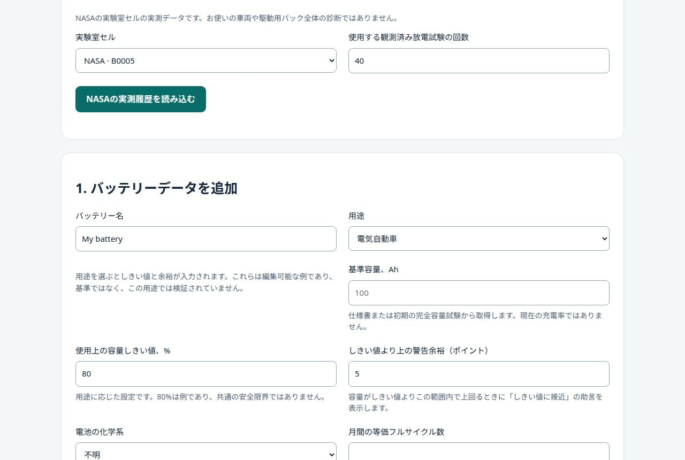
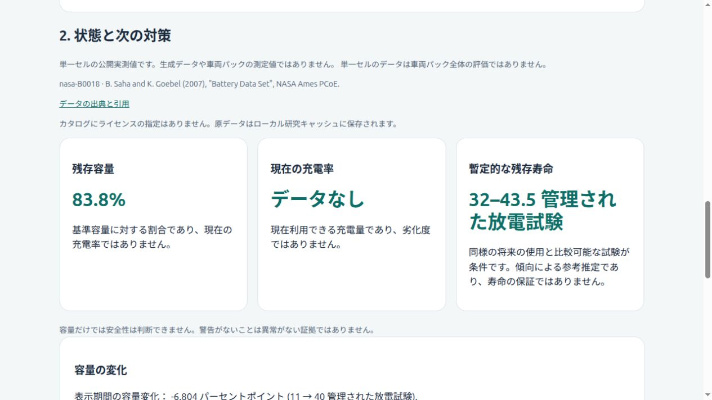
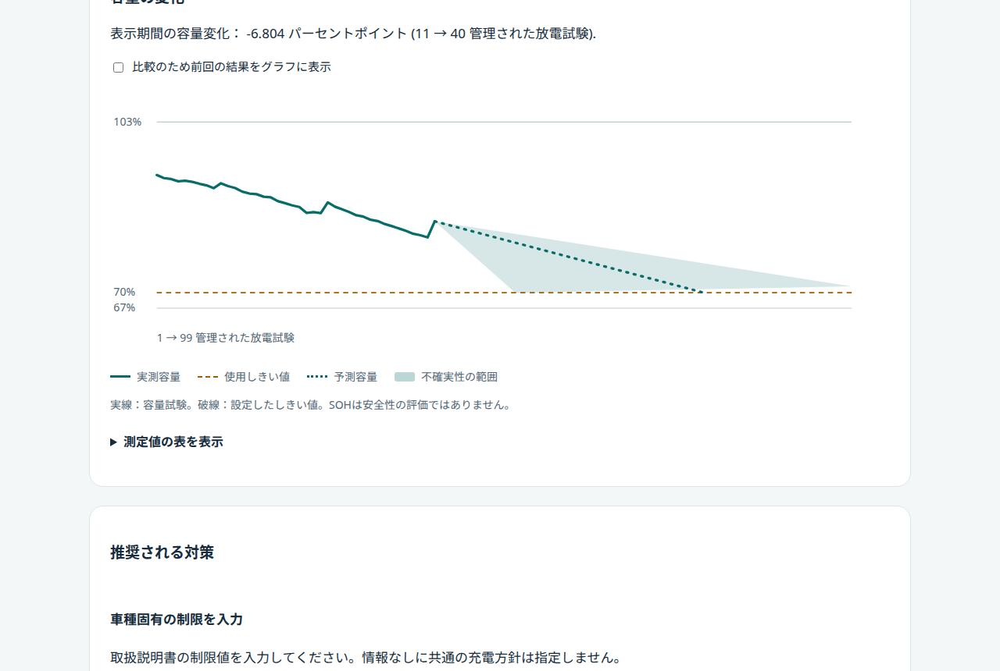
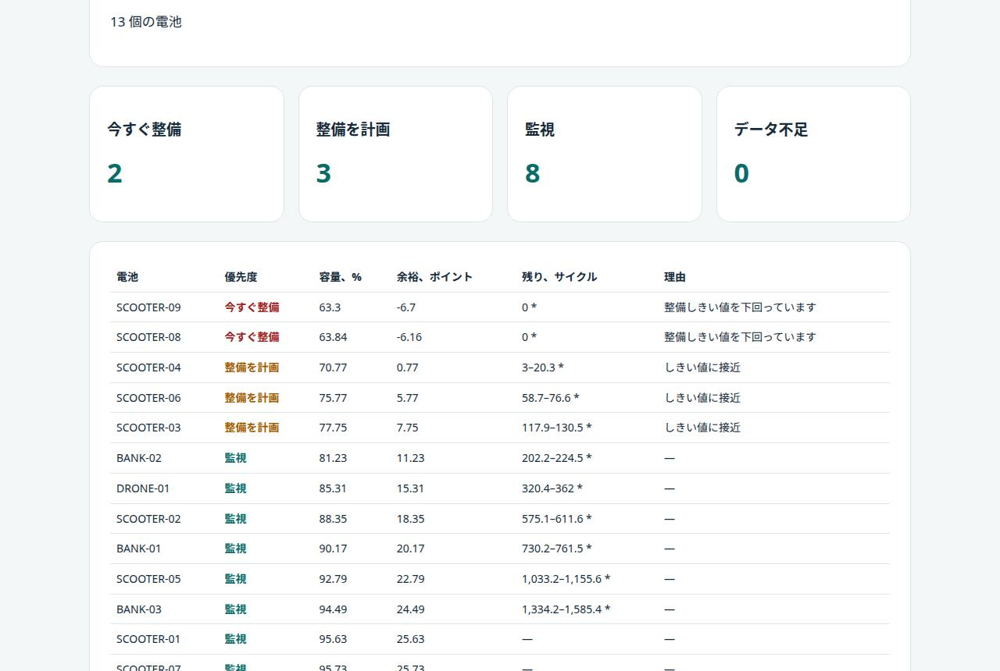
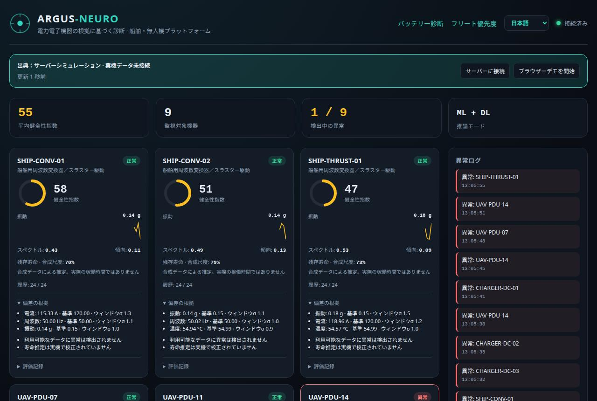
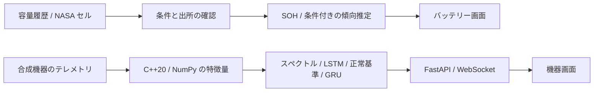

# ARGUS-NEURO

**バッテリー状態分析と電力電子診断：C++20、Python、ML/DL、動作する Web インターフェース。**

[English](README.en.md) · [Русский](README.md) · [中文](README.zh.md) · [हिन्दी](README.hi.md) · [Español](README.es.md) · [Français](README.fr.md) · [Deutsch](README.de.md) · **日本語** · [Italiano](README.it.md)

ARGUS-NEURO は、バッテリー容量分析と電力電子機器の診断研究を統合したプロトタイプです。ホーム画面は管理された容量試験と NASA の公開セル実測値を扱い、`/equipment.html` は6台の合成機器を監視します。バッテリー寿命は条件付きの傾向推定であり、実機での使用には別途検証が必要です。

## 測定値から説明可能なバッテリーレポートへ

- 容量に基づく SOH と現在の充電率 SOC を分離します。未知の SOC は推測で埋めません。
- 比較可能な条件で行った完全容量試験を Ah 単位の CSV から読み込み、ローカル保存や JSON 出力ができます。
- 自分の測定値がなくても、NASA の B0005、B0006、B0007、B0018 の4セル、計636回の放電試験を使用できます。原データは一度準備すると本機のキャッシュに残ります。
- 設定した容量しきい値までの寿命を条件付きの範囲として表示します。履歴不足、不安定な傾向、BMS 警報では数値の提示を見送ります。
- 助言は入力されたメーカー制限と申告された充電・保管条件に基づきます。OBD/CAN 接続や充電制御はありません。

[方法と API（英語）](docs/BATTERY.md) · [NASA 出典・チェックサム・準備（英語）](docs/PUBLIC_BATTERY_DATA.md) · [C++/NumPy の例（ロシア語）](docs/SIGNAL_DEMO.md)。

[108 セルでのバックテスト（英語）](docs/BACKTEST.md) · [C++ による電圧曲線指標（英語）](docs/CURVES.md) · [方法論（英語）](docs/METHODOLOGY.md)

### 108 個の実験室セルでの研究結果

> **注意（2026年10月30日）。** この節の以前の版は、セルの寿命に依存して答えを漏らす ceil(N/600) サイクルの間引きステップを使っていました。以下の区間バックテストは**固定の物理ステップ 5 サイクルでやり直しました**。学習モデルと曲線指標の以前の改善は撤回します。[SAMPLING_AUDIT.md](docs/SAMPLING_AUDIT.md) と下の根拠の節を参照してください。

データ：NASA PCoE（4 セル）、CALB（28 個の NCM セル）、HUST（77 個の LFP セル）、予測点 3,713。各予測は観測済みの過去だけを見ます。詳細と再現コマンド：[BACKTEST.md](docs/BACKTEST.md)（英語）。

- **単純な区間は自信過剰でした。** ブートストラップ 5–95 % 区間が実際の残存寿命を含んだのは、名目 90 % に対し予測の **9 %** だけでした。
- **較正した区間は平均では成り立ちますが、すべてのデータ源で成り立つわけではありません。** データ源ごとに同じ重みの conformal 半径 0.65 は、未見のセルで **96 %**、データセットを丸ごと除いた場合 **95 %** を覆いますが、CALB は **83 %**、NASA は **73 %** にとどまります（HUST は 100 %）。区間幅の中央値は残存寿命の約 1.6 倍です。新しい化学系やプロトコルでは覆いきれない可能性があります。
- **曲線あてはめは HUST では直線を上回りますが、どこでもそうとは限りません。** 共通の予測でセルごとに対にすると、平均誤差は 53 対 82 サイクルで、108 セルでの改善幅の 95 % 区間は 23〜35 サイクルです。ただし HUST の 77 セル中 75 セルで改善する一方、CALB は 5 サイクル悪化し、NASA は変わりません。この分析は事前登録されていないため、既定は直線のままです。
- **学習モデルと曲線指標の以前の改善は撤回します。** 修正後のパイプラインでは、曲線指標を使うアンサンブルは HUST の開発用セルで容量のみの最強ベースラインより 11–15 % 正確ですが、ロックした 15 セルでは差が統計的に確認できていません（根拠の節を参照）。
- 以上は実験室セルの結果で、EV パックではありません。パックのレポートは未較正の区間のままで、その旨を表示します。
- **検証：** CI は C++ の警告をエラー扱いでビルドし、`clang-tidy`、カバレッジ下限 70 % の Python テスト、README の整合性チェックを実行します。ローカル（2026 年 10 月 30 日）：Python テスト 217 件（ネイティブ拡張なしでは 196 件成功・21 件スキップ）、画面テスト 18 件、カバレッジ 73 %。

## 利用シーン

5 つの場面が、それぞれ異なる優先度で同じ劣化の問いに向き合います。[詳細と検証状況](docs/USE_CASES.md)（英語）。

- **電気自動車：** 容量トレンド、実験室セル向けの較正済み範囲、入力したメーカー上限に基づく手入れの助言。
- **充電ステーション：** DC 急速充電盤は機器画面で監視される資産です（シミュレーション。実機データと OCPP アダプターはまだありません）。
- **救助・救急ドローン：** 保守的なしきい値の初期値と「緊急任務に割り当てる前に確認」の助言。意思決定の補助であり、耐空性の評価ではありません。
- **シェア電動スクーターとレンタル用モバイルバッテリー：** **フリート優先度**が 1 つの CSV から数百本の電池を順位付けします：今すぐ整備、整備を計画、監視、データ不足。
- いずれの場面にも現場データの裏付けはなく、しきい値は事業者が決めます。

## バッテリー画面のクイックスタート

Ubuntu の新規環境で、リポジトリのルートから実行します。

```bash
bash scripts/setup_env.sh
PYTHONPATH="$PWD/python" .venv/bin/python -m argus.battery.public_data --download
bash scripts/run_dashboard.sh
```

[http://127.0.0.1:8000](http://127.0.0.1:8000) を開き、**B0018**、**40**回の観測、**Load measured NASA history** を選択します。初期言語は英語です。上部で日本語に切り替えられます。この処理にモデル学習は不要です。機器の ML/DL 診断には別途 `bash scripts/train_all.sh` を実行し、`/equipment.html` を開いてください。

## どのマシンでも Docker で実行

必要なのは Docker Engine、または Compose v2 付きの Docker Desktop だけです。イメージは C++ コアとそのテストを自分でビルドし、CPU で動作し、ディスクを約 2 GB 使います。CI は Linux x86-64 と arm64（例：Apple Silicon や ARM サーバー）でイメージをネイティブにビルドして検証しており、本番スタックも含みます。Windows と macOS では Docker Desktop が同じ Linux イメージを実行し、`docker compose` コマンドは PowerShell で動作します。補助スクリプト `bash scripts/...` だけは WSL2 か Git Bash が必要です。64 ビット CPU とビルド用に約 4 GB のメモリが必要で、32 ビットプロセッサは非対応です。

```bash
docker compose up --build -d
docker compose exec argus bash scripts/train_all.sh
docker compose exec argus python -m argus.battery.public_data --download
docker compose restart argus
bash scripts/docker_smoke.sh
```

1. 1 つ目のコマンドがイメージをビルド（数分）してサーバーを起動します。
2. 2 つ目が機器モデルを一度だけ学習します（約 1 分）。実行しないと機器ページはベースラインモードで動き、モデルが利用できないと表示します。電池ページには不要です。
3. 3 つ目が公開済み NASA セル 4 種（約 200 MB）を一度だけダウンロードします。カタログにライセンス表記がなく、データは再配布しないため、イメージには含めていません。
4. 4 つ目が学習済みモデルを読み込むためにサーバーを再起動し、5 つ目が起動中のコンテナ（状態、3 ページ、サンプルレポート）を確認します。

[http://127.0.0.1:8000](http://127.0.0.1:8000) を開きます。API に認証がないため、ポートはローカルホストのみに公開されます。変更は `ARGUS_PORT` で行います。ボリューム `argus-data` にモデル、NASA データ、保存したレポートが残ります。`docker compose down` では残り、`docker compose down -v` で削除されます。コンテナは非 root ユーザーで、読み取り専用のルートファイルシステムで動作します。

本番運用のハードウェア要件（実測した値、推奨にすぎない値、ソフトウェアの外で用意すべきもの）：[docs/HARDWARE_REQUIREMENTS.md](docs/HARDWARE_REQUIREMENTS.md)（英語）。

TLS・ログイン・監視・バックアップを備えた本番デプロイと利用の限界：[docs/PRODUCTION.md](docs/PRODUCTION.md)（英語）。

## プロジェクトの仕組み

ARGUS-NEURO は測定値を、何が分かっていて、何が推定で、何を控えるのかを示すレポートに変えます。

1. **入力。** CSV の容量チェック（等価サイクルごとの Ah、同一の試験条件）、または公開済み NASA セル 4 種のいずれか（管理放電 636 回）。履歴が短すぎる、または不整合な場合は、予測せずその旨を表示します。
2. **現在の状態。** SOH は実測容量を基準容量で割った値です。SOC は入力した場合だけ表示します。
3. **傾向と範囲。** 直近の比較可能なチェックに対する線形トレンドから、しきい値までの管理放電回数の条件付き推定を出し、ブートストラップと（実験室セルでは）較正済み conformal 半径で範囲にします。履歴が短い、傾向が不安定、または BMS 警報がある場合は予測を出しません。
4. **アドバイス。** 入力したメーカー制限と充電・保管条件だけに基づきます。OBD/CAN 接続や充電制御はありません。
5. **フリート優先度。** 多数の電池を含む 1 つの CSV を、今すぐ整備・整備計画・経過観察・データ不足に分類します。用途別プリセット（電動スクーター、モバイルバッテリー、救助ドローン、EV）があります。
6. **機器診断。** C++ で計算する 11 個の統計・スペクトル特徴量（NumPy 代替も同じ結果）が、スペクトルのベースライン、LSTM オートエンコーダ、健全基準からの偏差チャネル、GRU 寿命モデルに入力されます。ページはデータ源がシミュレーションであることを明示します。

### 根拠の現状（2026 年 10 月 30 日）

- 監査で、以前の間引きステップがセルの寿命に依存し、モデルに答えを示唆していたことが分かりました。容量履歴に関する以前の精度の数値はすべて撤回しました（[サンプリング監査](docs/SAMPLING_AUDIT.md)）。プログラムに付属する区間の較正は 2026 年 10 月 30 日に固定ステップで再計算しました（半径 0.65、被覆率 96 % と 95 %、ただしデータセットを除いた場合は CALB 83 %、NASA 73 %）。
- HUST の LFP セル 77 個で固定ステップにすると、容量だけの最強ベースライン（ガウス過程）の平均誤差は約 92〜113 サイクルです。充電曲線の指標を加えたアンサンブルは 11〜15 % 良いものの、確保した 15 セルでは差は統計的に確立していません（[実験](experiments/2026-10-30_method_hust/notes.md)）。
- 2 つのモデルが食い違うときに予測を拒否しても誤差は減らなかったため、プログラムはそれを主張しません。どの用途も現場データでは裏付けられていません。

## 動作中アプリケーションのスクリーンショット

2026 年 10 月 30 日に、ローカルで動作中のプログラムから画面言語ごとに撮影しました。電池ページは NASA セル B0018（最初の管理放電 40 回、しきい値 70 %）、フリートページは電動スクーター・プリセットの内蔵 13 台サンプル、機器ページはサーバーシミュレーションを使っています。実験室セルと合成データであり、車両ではありません。

### 1. 自分のデータなしで開始



**何が起きているか：** ページは公開済みの NASA セル 4 種と観測した試験回数を選ばせます。計算には選んだ系列の先頭部分だけを送り、それ以降の測定値は使いません。

**利用者への結論：** ファイルなしで全体の流れを試せます。結果は実験室のセルについてのもので、ご自身の車両についてではありません。

### 2. 測定済みセル B0018 のレポート



**何が起きているか：** 最初の 40 回の放電から、SOH 83.8 %、SOC 不明（入力されていません）、70 % のしきい値までさらに管理放電 11.3〜64.2 回という条件付き推定を表示します。データ源とライセンスの注記はカードの上にあります。

**利用者への結論：** このセルは容量の約 84 % を保っています。履歴が短いため範囲は広く、保証ではなくシナリオとして読んでください。SOC 不明は不明のまま表示され、容量だけでは電池が安全かどうかは分かりません。

### 3. 容量の履歴と不確実性



**何が起きているか：** 実線は試験 1〜40 の実測容量、破線は 70 % のしきい値、点線は予測、網掛けは不確実性の範囲です。キャプションは、現在のトレンドが使う試験 11〜40 の区間で −6.8 ポイントの変化を示しています。

**利用者への結論：** 点線 1 本ではなく網掛け全体を見て計画してください。しきい値に達するのはかなり早くも遅くもなり得ます。下がる線はこのセルの傾向であり、SOH は安全性の判定ではありません。

### 4. フリート優先度



**何が起きているか：** 内蔵の 13 台のサンプルを電動スクーター・プリセットで順位付けしました：今すぐ整備 2、計画 3、経過観察 8、データ不足 0。表には SOH、しきい値までの余裕（ポイント）、残りサイクルの範囲、理由が並びます。アスタリスクは較正されていないパック単位の範囲を示します。

**利用者への結論：** 上の行から確認してください。SCOOTER-09 と SCOOTER-08 はすでに整備基準を下回っています（63.3 % と 63.8 %）。アスタリスク付きの範囲は大まかな目安です。サンプルは合成なので、ページの動作を示すもので、実際のフリートの状態ではありません。

### 5. 機器診断



**何が起きているか：** 9 つの模擬資産（船舶用変換器、UAV 電源ユニット、DC 急速充電キャビネット）を ML と DL のモデルが評価します：健康指数、振動・スペクトル特徴量、異常ログ。バナーは、データ源がサーバーシミュレーションで機器は接続されていないことを示します。

**利用者への結論：** これは診断の流れを示すもので、実機の状態ではありません。残存寿命の数値は合成スケールです。実運用では自分のテレメトリを API で送り、バナーが実際のデータ源を示していることを確認してください。


## 機器診断の実装

- **C++20 / NumPy の同じ11特徴量。** FFT のゼロ埋め、正規化、DC 除外を共通化しています。pybind11 はストライド付き配列と逆順配列に対応します。
- **複数の診断経路。** スペクトルの Isolation Forest、LSTM 再構成、正常時のセンサー基準、合成データで学習した GRU の寿命推定を利用します。
- **根拠と識別情報。** 評価 ID、モデル版、センサー偏差、検出器の不一致、データ品質を返します。ID は電子署名や故障原因の証明ではありません。
- **無理な予測を避ける状態。** 履歴不足、欠損、非有限値、時刻の逆転、測定間隔の欠落、モデル不整合を区別します。
- **接続状態の監視。** 切断と古いデータを表示し、最後のスナップショットを保持して再接続します。ブラウザーデモは明示操作で開始します。
- **9言語。** 英語、ロシア語、中国語、ヒンディー語、スペイン語、フランス語、ドイツ語、日本語、イタリア語。初期言語は英語、ロシア語は2番目で、両画面が同じ選択を保存します。

## 構成とデータの範囲



バッテリー経路は容量の傾向推定であり、機器経路の GRU を EV パック用に流用していません。NASA の単一セル測定と合成機器データを混合せず、出所を表示します。

機器経路の6チャネルは `voltage_v`、`current_a`、`temperature_c`、`vibration_g`、`frequency_hz`、`load_factor` の順です。24回の連続測定が必要で、サーバー更新は約1.5秒と処理時間、模擬測定間隔は5秒です。400測定の周期境界で履歴をリセットします。これらは実機の寿命尺度ではありません。

## 要件・モデル学習

検証環境：Linux/Ubuntu、CPython 3.12、GCC 13、CMake 3.28。ネイティブ拡張には C++20 と Python 開発用ヘッダーが必要です。Node.js は画面テストでのみ使用し、通常実行には不要です。直接依存は [requirements.txt](python/requirements.txt)、開発依存は [requirements-dev.txt](python/requirements-dev.txt) で固定されています。

```bash
bash scripts/setup_env.sh
bash scripts/train_all.sh
bash scripts/run_dashboard.sh
```

上記は機器の ML/DL 経路を含むセットアップです。学習は新しいローカルバンドルを作り、モデル、正規化、正常基準、ONNX の構造と数値一致を検証してから有効にします。失敗時には以前の有効バンドルを維持します。新しいモデルを利用するにはサーバーを再起動します。信頼できるモデルファイルのみを読み込んでください。

学習・検証・テストは、窓生成と正規化より前に軌跡単位で分けます。スケーラーは学習データ、閾値は検証データ、最終指標は独立テストから得ます。保存済みの数値やベースラインは [評価記録](experiments/2026-09-30_reliability/notes.md) を参照してください。単一の合成実験は実機精度の証明ではありません。

| 設定 | 初期値 / 用途 |
|---|---|
| `ARGUS_HOST` | `127.0.0.1`、待ち受けアドレス |
| `ARGUS_PORT` | `8000`、HTTP/WebSocket ポート |
| `ARGUS_PYTHON` | プロジェクトの `.venv/bin/python`、なければ `python3` |
| `ARGUS_ARTIFACTS_DIR` | 指定した信頼済みモデルディレクトリを優先 |
| `OMP_NUM_THREADS`, `MKL_NUM_THREADS` | 学習・起動スクリプトでは未指定時に `1` |

認証や利用者間の分離は実装していません。ホストの変更だけで公開サービスにできるわけではありません。

## 状態と API

| 機器評価の状態 | 意味 |
|---|---|
| `warming_up` | 入力は有効ですが24測定に達していません |
| `ready` | 対応するモデルと基準で診断経路を実行済み |
| `invalid_data` | 測定値、波形、時刻が入力検証に失敗 |
| `degraded` | モデルまたは基準が利用できない、あるいは出力が不正 |

`ready` は実機精度の保証ではありません。`is_anomaly=null` は未知であり、正常という意味ではありません。誤った測定値や時刻の欠落は機器履歴をリセットします。センサー偏差は原因診断ではなく、健全性指数も故障確率ではありません。

| ルート | 用途 |
|---|---|
| `GET /` | バッテリー画面 |
| `GET /equipment.html` | 合成機器の監視画面 |
| `GET /api/battery/datasets` | 公開データの固定カタログとローカル可用性 |
| `GET /api/battery/datasets/{dataset_id}?observations=40` | 観測済み履歴の先頭部分と出所 |
| `GET /api/battery/example` | 明示的に選ぶ合成 EV 例 |
| `POST /api/battery/import-csv` | CSV の検証と読み込み |
| `POST /api/battery/analyze` | SOH、傾向、条件付き寿命、助言 |
| `POST /api/battery/save` | 明示的なローカル保存 |
| `GET /api/battery/history/{battery_id}` | 当該バッテリーの保存済みレポート、最大50件 |
| `GET /api/battery/history/{battery_id}/changes` | 直近2件の保存レポート間の容量・残存寿命の変化（安全性の判定ではありません） |
| `GET /api/health` | 生成処理とスナップショットの鮮度。異常時503 |
| `GET /api/fleet` | 最新の完了済み機器スナップショット。未生成時503 |
| `WS /ws/telemetry` | 初期スナップショットと更新ストリーム |
| `GET /docs` | HTTP API の対話的ドキュメント |

通信正常とモデル利用可能性は別です。`model_backed`、時刻、評価状態を確認してください。遅い WebSocket クライアントにはタイムアウトと1件の待機キューを用い、中間更新を省略することがあります。永続イベントログではありません。

## 検証コマンド

```bash
source .venv/bin/activate
bash scripts/build_cpp_core.sh
ctest --test-dir build --output-on-failure
PYTHONPATH="$PWD/python:$PWD/build/cpp_core" OMP_NUM_THREADS=1 MKL_NUM_THREADS=1 python -m pytest python/tests -q
PYTHONPATH="$PWD/python" OMP_NUM_THREADS=1 MKL_NUM_THREADS=1 python -m pytest python/tests -q
ruff check python
ruff format --check python
node --test web/dashboard/tests/*.test.cjs
```

C++/NumPy の数値一致、入力拒否、バッテリーの条件付き予測、CSV、ローカル保存、公開データの整合性、翻訳辞書と接続状態を検査します。

## 制約とライセンス

バッテリーについて：どの結果も EV パックや現場では検証されていません。較正はデータ源間で均一には移転しません（NASA 73 %, CALB 83 %）。区間は広く、電圧曲線指標は記録された充電曲線が必要でレポートではまだ使われていません。学習モデルのセカンドオピニオンは学習した化学系とプロトコルに限られます。次の段階は、電圧・温度記録つきのセルを増やすことと、パックレベルのデータです。

バッテリー SOH だけで安全性を判定できません。容量閾値は用途ごとの設定であり、80%は共通の安全・保証限界ではありません。NASA の原データはローカル研究キャッシュに置き、コード配布には含めません。カタログではライセンスが指定されていないため、ソフトウェアのライセンスをデータへ適用しません。

機器診断の精度と寿命尺度は合成データに基づきます。公開セルの傾向推定は車両パックの検証済み寿命予測ではありません。現場導入には対象機器の独立データでの校正と検証が必要です。

ソフトウェアのライセンスは [LICENSE](LICENSE) を参照してください。
