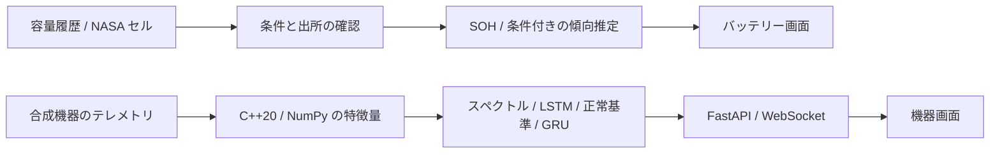

# ARGUS-NEURO

**バッテリー状態分析と電力電子診断：C++20、Python、ML/DL、動作する Web インターフェース。**

[English](README.en.md) · [Русский](README.md) · [中文](README.zh.md) · [हिन्दी](README.hi.md) · [Español](README.es.md) · [Français](README.fr.md) · [Deutsch](README.de.md) · **日本語** · [Italiano](README.it.md)

ARGUS-NEURO は、バッテリー容量分析と電力電子機器の診断研究を統合したプロトタイプです。ホーム画面は管理された容量試験と NASA の公開セル実測値を扱い、`/equipment.html` は6台の合成機器を監視します。バッテリー寿命は条件付きの傾向推定であり、実機での使用には別途検証が必要です。

## 測定値から説明可能なバッテリーレポートへ

- 容量に基づく SOH と現在の充電率 SOC を分離します。未知の SOC は推測で埋めません。
- 比較可能な条件で行った完全容量試験を Ah 単位の CSV から読み込み、ローカル保存や JSON 出力ができます。
- 自分の測定値がなくても、NASA の B0005、B0006、B0007、B0018 の4セル、計636回の放電試験を使用できます。原データは一度準備すると本機のキャッシュに残ります。
- 設定した容量しきい値までの寿命を条件付きの範囲として表示します。履歴不足、不安定な傾向、BMS 警報では数値の提示を見送ります。
- 助言は入力されたメーカー制限と申告された充電・保管条件に基づきます。OBD/CAN 接続や充電制御はありません。

[方法と API（英語）](docs/BATTERY.md) · [NASA 出典・チェックサム・準備（英語）](docs/PUBLIC_BATTERY_DATA.md) · [C++/NumPy の例（ロシア語）](docs/SIGNAL_DEMO.md)。

[108 セルでのバックテスト（英語）](docs/BACKTEST.md) · [C++ による電圧曲線指標（英語）](docs/CURVES.md) · [方法論（英語）](docs/METHODOLOGY.md)

### 108 個の実験室セルでの研究結果

データ：NASA PCoE（4 セル）、CALB（28 個の NCM セル）、HUST（77 個の LFP セル）、予測点 3,723。各予測は観測済みの過去だけを見ます。詳細と再現コマンド：[BACKTEST.md](docs/BACKTEST.md)（英語）。

- **単純な区間は自信過剰でした。** ブートストラップ 5–95 % 区間が真の残存寿命を含んだのは、名目 90 % に対し予測の **12 %** だけでした。
- **較正した区間は未知のデータでも成り立ちます。** データ源ごとに等しい重みの conformal 半径は、未見のセルで **97 %**、データセット全体を除外しても **96 %**（CALB 90 %、HUST 100 %、**NASA 67 %**）を満たします。代償は幅で、中央値の区間は残存寿命の約 1.6 倍です。新しい化学系やプロトコルでは不足する可能性があります。
- **曲線あてはめは効果がなかった**ため、既定は直線トレンドのままです。
- **学習モデルは直線の誤差を半分にします**（2 つの化学系：CALB 47 対 96 サイクル、HUST 77 対 156）。適用範囲チェック付きの任意の「セカンドオピニオン」としてのみ提供し、学習済みの重みはリポジトリに含めません。
- **電圧曲線の指標で誤差が 24 % 減少**（HUST で 68.6 → 52.4 サイクル、5 回中 5 回で改善）しますが、記録された充電曲線が必要なため、まだレポートには使っていません。
- 以上は実験室セルの結果で、EV パックではありません。パックのレポートは未較正の区間のままで、その旨を表示します。
- **検証：** CI は C++ の警告をエラー扱いでビルドし、`clang-tidy`、カバレッジ下限 70 % の Python テスト、README の整合性チェックを実行します。ローカル（2026 年 10 月 29 日）：Python テスト 153 件（ネイティブ拡張なしでは 124 件成功・21 件スキップ）、画面テスト 18 件、カバレッジ 74 %。

## 利用シーン

5 つの場面が、それぞれ異なる優先度で同じ劣化の問いに向き合います。[詳細と検証状況](docs/USE_CASES.md)（英語）。

- **電気自動車：** 容量トレンド、実験室セル向けの較正済み範囲、入力したメーカー上限に基づく手入れの助言。
- **充電ステーション：** DC 急速充電盤は機器画面で監視される資産です（シミュレーション。実機データと OCPP アダプターはまだありません）。
- **救助・救急ドローン：** 保守的なしきい値の初期値と「緊急任務に割り当てる前に確認」の助言。意思決定の補助であり、耐空性の評価ではありません。
- **シェア電動スクーターとレンタル用モバイルバッテリー：** **フリート優先度**が 1 つの CSV から数百本の電池を順位付けします：今すぐ整備、整備を計画、監視、データ不足。
- いずれの場面にも現場データの裏付けはなく、しきい値は事業者が決めます。

## バッテリー画面のクイックスタート

Ubuntu の新規環境で、リポジトリのルートから実行します。

```bash
bash scripts/setup_env.sh
PYTHONPATH="$PWD/python" .venv/bin/python -m argus.battery.public_data --download
bash scripts/run_dashboard.sh
```

[http://127.0.0.1:8000](http://127.0.0.1:8000) を開き、**B0018**、**40**回の観測、**Load measured NASA history** を選択します。初期言語は英語です。上部で日本語に切り替えられます。この処理にモデル学習は不要です。機器の ML/DL 診断には別途 `bash scripts/train_all.sh` を実行し、`/equipment.html` を開いてください。

## 動作中のアプリケーション画面

2026年10月28日（バッテリー画面は10月29日に更新）にローカル実行中の画面を撮影しました。モックアップではありません。バッテリーレポートは日本語、共通の選択・推移・機器画面は英語です。

### 1. 個人の CSV がなくても開始


セルと観測履歴の先頭部分を選択します。それより後の測定値は評価に渡されません。

### 2. B0018 の実測レポート


最初の40回：**SOH 83.8%**、SOC は不明、70%容量しきい値まで**追加11.3–64.2回の管理された放電試験**という条件付き推定です。カードの上に出典と制約があります。実験室の単一セルであり、試験番号を自動車の使用月数に換算しません。

### 3. 容量の推移


緑線は最初の40測定、破線は70%のしきい値です。上の文章は直近の傾向で使う試験11–40の変化を示します。SOH は安全性の評価ではありません。

### 4. 機器のライブ監視


6台の模擬機器、**ML + DL**、特徴量、偏差の根拠、異常ログを表示します。**Source: server simulation** がデータの由来です。残存寿命は合成尺度であり、実際の稼働時間ではありません。

## 機器診断の実装

- **C++20 / NumPy の同じ11特徴量。** FFT のゼロ埋め、正規化、DC 除外を共通化しています。pybind11 はストライド付き配列と逆順配列に対応します。
- **複数の診断経路。** スペクトルの Isolation Forest、LSTM 再構成、正常時のセンサー基準、合成データで学習した GRU の寿命推定を利用します。
- **根拠と識別情報。** 評価 ID、モデル版、センサー偏差、検出器の不一致、データ品質を返します。ID は電子署名や故障原因の証明ではありません。
- **無理な予測を避ける状態。** 履歴不足、欠損、非有限値、時刻の逆転、測定間隔の欠落、モデル不整合を区別します。
- **接続状態の監視。** 切断と古いデータを表示し、最後のスナップショットを保持して再接続します。ブラウザーデモは明示操作で開始します。
- **9言語。** 英語、ロシア語、中国語、ヒンディー語、スペイン語、フランス語、ドイツ語、日本語、イタリア語。初期言語は英語、ロシア語は2番目で、両画面が同じ選択を保存します。

## 構成とデータの範囲



バッテリー経路は容量の傾向推定であり、機器経路の GRU を EV パック用に流用していません。NASA の単一セル測定と合成機器データを混合せず、出所を表示します。

機器経路の6チャネルは `voltage_v`、`current_a`、`temperature_c`、`vibration_g`、`frequency_hz`、`load_factor` の順です。24回の連続測定が必要で、サーバー更新は約1.5秒と処理時間、模擬測定間隔は5秒です。400測定の周期境界で履歴をリセットします。これらは実機の寿命尺度ではありません。

## 要件・モデル学習

検証環境：Linux/Ubuntu、CPython 3.12、GCC 13、CMake 3.28。ネイティブ拡張には C++20 と Python 開発用ヘッダーが必要です。Node.js は画面テストでのみ使用し、通常実行には不要です。直接依存は [requirements.txt](python/requirements.txt)、開発依存は [requirements-dev.txt](python/requirements-dev.txt) で固定されています。

```bash
bash scripts/setup_env.sh
bash scripts/train_all.sh
bash scripts/run_dashboard.sh
```

上記は機器の ML/DL 経路を含むセットアップです。学習は新しいローカルバンドルを作り、モデル、正規化、正常基準、ONNX の構造と数値一致を検証してから有効にします。失敗時には以前の有効バンドルを維持します。新しいモデルを利用するにはサーバーを再起動します。信頼できるモデルファイルのみを読み込んでください。

学習・検証・テストは、窓生成と正規化より前に軌跡単位で分けます。スケーラーは学習データ、閾値は検証データ、最終指標は独立テストから得ます。保存済みの数値やベースラインは [評価記録](experiments/2026-09-30_reliability/notes.md) を参照してください。単一の合成実験は実機精度の証明ではありません。

| 設定 | 初期値 / 用途 |
|---|---|
| `ARGUS_HOST` | `127.0.0.1`、待ち受けアドレス |
| `ARGUS_PORT` | `8000`、HTTP/WebSocket ポート |
| `ARGUS_PYTHON` | プロジェクトの `.venv/bin/python`、なければ `python3` |
| `ARGUS_ARTIFACTS_DIR` | 指定した信頼済みモデルディレクトリを優先 |
| `OMP_NUM_THREADS`, `MKL_NUM_THREADS` | 学習・起動スクリプトでは未指定時に `1` |

認証や利用者間の分離は実装していません。ホストの変更だけで公開サービスにできるわけではありません。

## 状態と API

| 機器評価の状態 | 意味 |
|---|---|
| `warming_up` | 入力は有効ですが24測定に達していません |
| `ready` | 対応するモデルと基準で診断経路を実行済み |
| `invalid_data` | 測定値、波形、時刻が入力検証に失敗 |
| `degraded` | モデルまたは基準が利用できない、あるいは出力が不正 |

`ready` は実機精度の保証ではありません。`is_anomaly=null` は未知であり、正常という意味ではありません。誤った測定値や時刻の欠落は機器履歴をリセットします。センサー偏差は原因診断ではなく、健全性指数も故障確率ではありません。

| ルート | 用途 |
|---|---|
| `GET /` | バッテリー画面 |
| `GET /equipment.html` | 合成機器の監視画面 |
| `GET /api/battery/datasets` | 公開データの固定カタログとローカル可用性 |
| `GET /api/battery/datasets/{dataset_id}?observations=40` | 観測済み履歴の先頭部分と出所 |
| `GET /api/battery/example` | 明示的に選ぶ合成 EV 例 |
| `POST /api/battery/import-csv` | CSV の検証と読み込み |
| `POST /api/battery/analyze` | SOH、傾向、条件付き寿命、助言 |
| `POST /api/battery/save` | 明示的なローカル保存 |
| `GET /api/battery/history/{battery_id}` | 当該バッテリーの保存済みレポート、最大50件 |
| `GET /api/battery/history/{battery_id}/changes` | 直近2件の保存レポート間の容量・残存寿命の変化（安全性の判定ではありません） |
| `GET /api/health` | 生成処理とスナップショットの鮮度。異常時503 |
| `GET /api/fleet` | 最新の完了済み機器スナップショット。未生成時503 |
| `WS /ws/telemetry` | 初期スナップショットと更新ストリーム |
| `GET /docs` | HTTP API の対話的ドキュメント |

通信正常とモデル利用可能性は別です。`model_backed`、時刻、評価状態を確認してください。遅い WebSocket クライアントにはタイムアウトと1件の待機キューを用い、中間更新を省略することがあります。永続イベントログではありません。

## 検証コマンド

```bash
source .venv/bin/activate
bash scripts/build_cpp_core.sh
ctest --test-dir build --output-on-failure
PYTHONPATH="$PWD/python:$PWD/build/cpp_core" OMP_NUM_THREADS=1 MKL_NUM_THREADS=1 python -m pytest python/tests -q
PYTHONPATH="$PWD/python" OMP_NUM_THREADS=1 MKL_NUM_THREADS=1 python -m pytest python/tests -q
ruff check python
ruff format --check python
node --test web/dashboard/tests/*.test.cjs
```

C++/NumPy の数値一致、入力拒否、バッテリーの条件付き予測、CSV、ローカル保存、公開データの整合性、翻訳辞書と接続状態を検査します。

## 制約とライセンス

バッテリーについて：どの結果も EV パックや現場では検証されていません。較正はデータ源間で均一には移転しません（NASA 67 %）。区間は広く、電圧曲線指標は記録された充電曲線が必要でレポートではまだ使われていません。学習モデルのセカンドオピニオンは学習した化学系とプロトコルに限られます。次の段階は、電圧・温度記録つきのセルを増やすことと、パックレベルのデータです。

バッテリー SOH だけで安全性を判定できません。容量閾値は用途ごとの設定であり、80%は共通の安全・保証限界ではありません。NASA の原データはローカル研究キャッシュに置き、コード配布には含めません。カタログではライセンスが指定されていないため、ソフトウェアのライセンスをデータへ適用しません。

機器診断の精度と寿命尺度は合成データに基づきます。公開セルの傾向推定は車両パックの検証済み寿命予測ではありません。現場導入には対象機器の独立データでの校正と検証が必要です。

ソフトウェアのライセンスは [LICENSE](LICENSE) を参照してください。
