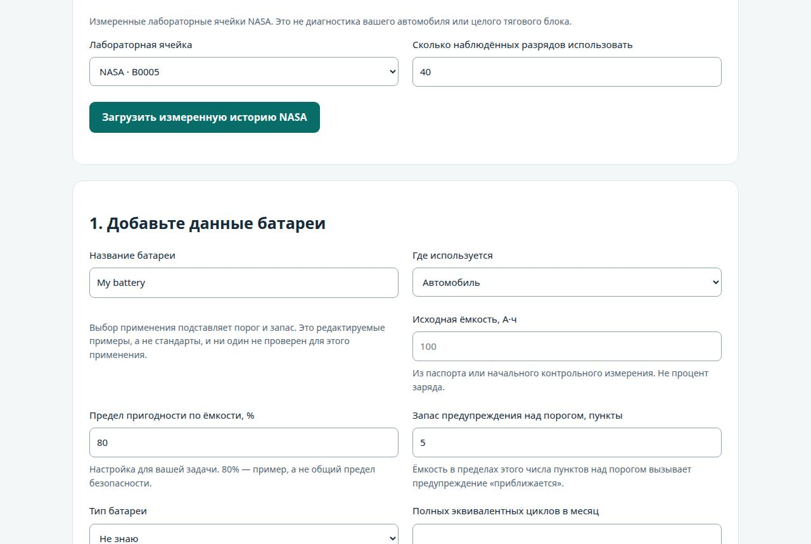
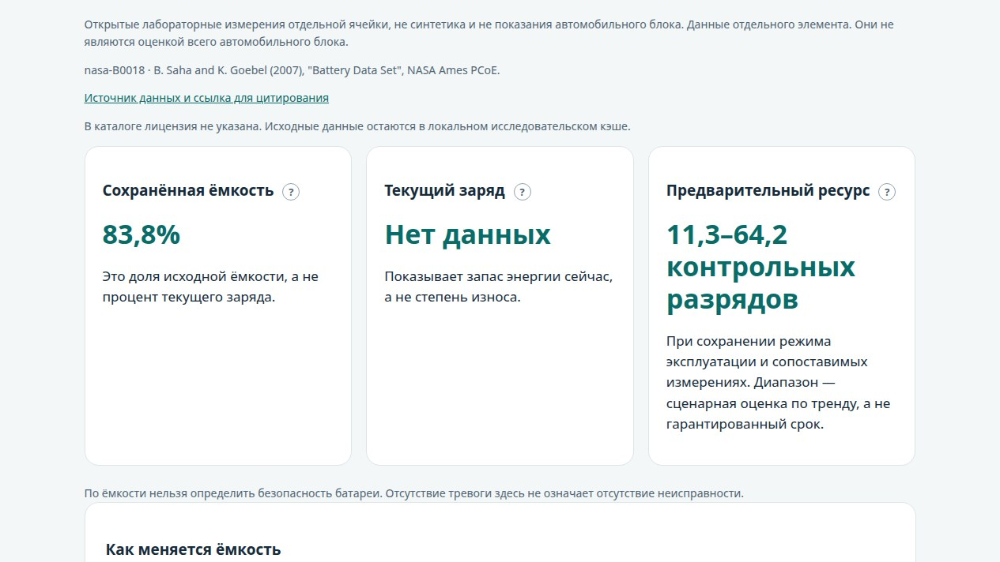
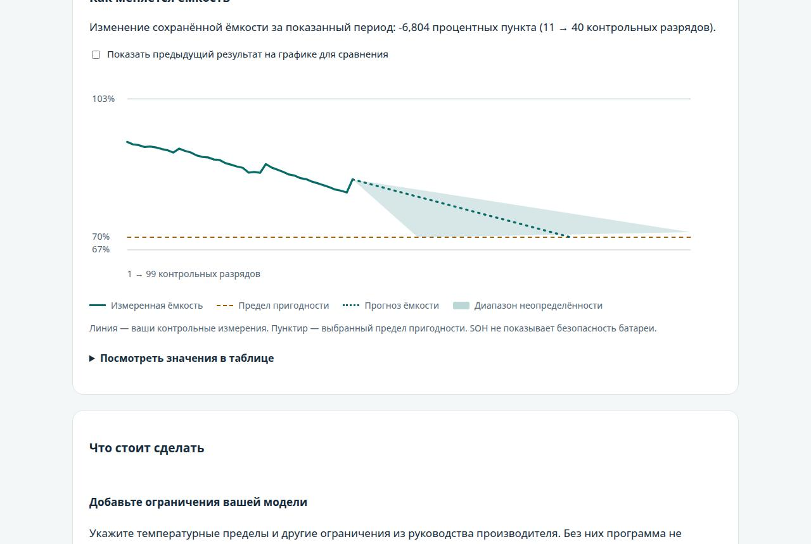
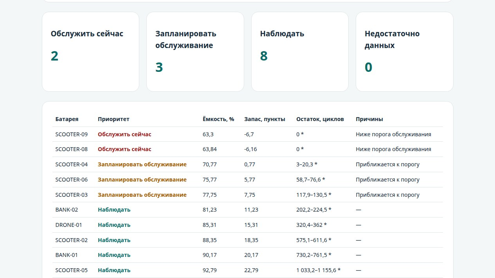
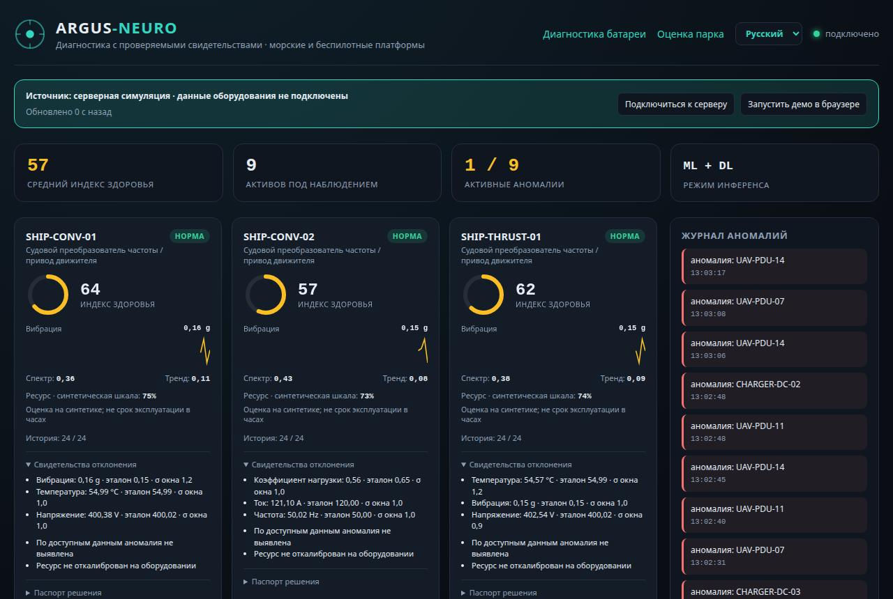
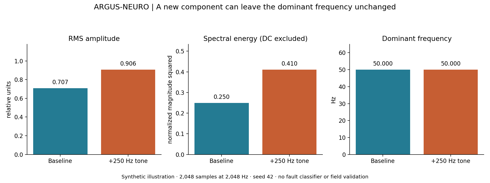
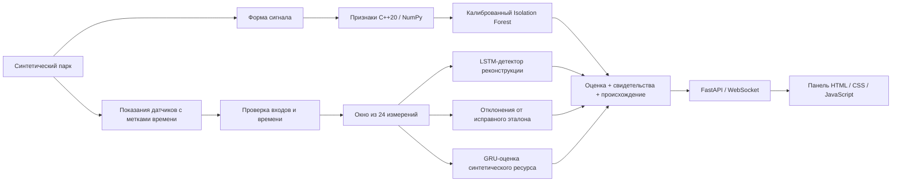

# ARGUS-NEURO

**Анализ состояния батарей и диагностика силовой электроники: C++20, Python, ML/DL и работающий веб-интерфейс.**

[English](README.en.md) · **Русский** · [中文](README.zh.md) · [हिन्दी](README.hi.md) · [Español](README.es.md) · [Français](README.fr.md) · [Deutsch](README.de.md) · [日本語](README.ja.md) · [Italiano](README.it.md)

[Контракт диагностики](docs/RELIABILITY.md) · [Заметки об оценке](experiments/2026-09-30_reliability/notes.md)

ARGUS-NEURO объединяет анализ ёмкости аккумуляторов и исследовательскую диагностику силовой электроники. Главная страница работает с контрольными измерениями батареи и опубликованными лабораторными данными NASA; `/equipment.html` показывает синтетический парк из девяти активов. Прогноз батареи — условная проекция тренда, а оценка оборудования требует отдельной проверки на реальных объектах.

## Батарея: от измерений к понятному отчёту

- SOH показывает долю исходной ёмкости, SOC — текущий заряд. Если SOC неизвестен, программа не придумывает его.
- CSV принимается с полными контрольными измерениями в А·ч; учитываются одинаковые условия теста. Есть сохранение отчёта локально и экспорт JSON.
- Без собственных данных доступны четыре измеренные ячейки NASA: B0005, B0006, B0007 и B0018, всего 636 контрольных разрядов. Загрузка однократная, исходные файлы остаются в локальном кэше.
- Ресурс оценивается до выбранного порога ёмкости с диапазоном и ограничениями. При недостаточной истории, нестабильном тренде или тревоге BMS численный прогноз не выдаётся.
- Рекомендации учитывают введённые ограничения производителя и сообщённые условия зарядки и хранения. Подключения к OBD/CAN и управления зарядкой нет.

[Методика батарейного анализа](docs/BATTERY.ru.md) · [Источник, контрольные суммы и установка NASA](docs/PUBLIC_BATTERY_DATA.md) · [Короткий пример C++/NumPy](docs/SIGNAL_DEMO.md).

[Результаты проверки на 108 ячейках](docs/BACKTEST.md) · [Признаки кривых напряжения (C++)](docs/CURVES.md) · [Методология](docs/METHODOLOGY.md)

### Результаты исследования на 108 лабораторных ячейках

> **Важно (30 октября 2026).** Прежняя версия этого раздела использовала шаг прореживания ceil(N/600) циклов: он зависит от длины жизни ячейки и «подсказывает» ответ. Бэктест интервалов ниже **пересчитан при фиксированном физическом шаге 5 циклов**. Прежние выигрыши обученных моделей и индикаторов кривой отозваны; см. [SAMPLING_AUDIT.md](docs/SAMPLING_AUDIT.md) (английский) и раздел о доказательствах ниже.

Данные: NASA PCoE (4 ячейки), CALB (28 NCM-ячеек) и HUST (77 LFP-ячеек), 3 713 точки прогноза. Каждый прогноз видит только прошлое. Подробности и команды воспроизведения: [BACKTEST.md](docs/BACKTEST.md) (английский).

- **Простой интервал был слишком самоуверенным.** Бутстрэп-интервал 5–95 % накрывал реальный остаточный ресурс только в **9 %** прогнозов при заявленных 90 %.
- **Калиброванный интервал работает в среднем, но не на каждом источнике.** Радиус 0,65 по методу conformal с равным весом каждого источника накрывает **96 %** прогнозов на невидимых ячейках и **95 %**, когда целый набор данных исключён, но только **83 %** для CALB и **73 %** для NASA (HUST 100 %). Медианный интервал около 1,6 остаточного ресурса. Для новой химии или протокола покрытие может быть ниже.
- **Кривые деградации точнее прямой на HUST, но не везде.** При парном сравнении по ячейкам на общих прогнозах средняя ошибка 53 против 82 циклов, 95 % интервал выигрыша 23–35 циклов по 108 ячейкам, но улучшились 75 из 77 ячеек HUST, на CALB результат хуже на 5 циклов, на NASA без изменений. Анализ не фиксировался заранее, поэтому по умолчанию остаётся прямая.
- **Прежние выигрыши обученных моделей и индикаторов кривой отозваны.** На исправленном конвейере ансамбль с индикаторами кривой точнее сильнейшего baseline только по ёмкости на 11–15 % на ячейках разработки HUST, но на 15 закрытых ячейках разница статистически не подтверждена (см. раздел о доказательствах).
- Всё это относится к лабораторным ячейкам, а не к EV-пакам. Для пакетов интервал остаётся некалиброванным, и отчёт это указывает.
- **Проверки:** CI собирает C++ с предупреждениями как ошибками, запускает `clang-tidy`, Python-тесты с порогом покрытия 70 % и проверку согласованности README. Локально 30 октября 2026: 216 Python-тестов (195 и 21 пропуск без нативного ядра), 18 тестов интерфейса, покрытие 73 %.

## Сценарии применения

Пять ситуаций задают один вопрос об износе, но с разными приоритетами. [Подробности и статус проверки](docs/USE_CASES.md) (английский).

- **Электромобили:** тренд ёмкости, калиброванный диапазон для лабораторных ячеек, рекомендации по введённым ограничениям производителя.
- **Зарядные станции:** шкаф быстрой DC-зарядки — контролируемый актив на странице оборудования (симуляция; реальных данных станций и адаптера OCPP пока нет).
- **Спасательные и медицинские дроны:** осторожный пресет порога и рекомендация «проверьте перед назначением на срочные задачи». Это поддержка решения, а не оценка лётной годности.
- **Арендные электросамокаты и повербанки:** **Оценка парка** ранжирует сотни батарей по одному CSV: обслужить сейчас, запланировать, наблюдать, недостаточно данных.
- Ни один сценарий не подкреплён полевыми данными; пороги задаёт оператор.

## Быстрый запуск батарейного экрана

Для новой установки на Ubuntu, из корня репозитория:

```bash
bash scripts/setup_env.sh
PYTHONPATH="$PWD/python" .venv/bin/python -m argus.battery.public_data --download
bash scripts/run_dashboard.sh
```

Откройте [http://127.0.0.1:8000](http://127.0.0.1:8000), выберите **B0018**, оставьте **40** измерений и нажмите **Load measured NASA history**. Переключатель языка находится вверху страницы; английский — основной. Для этого режима обучение моделей не требуется. Для ML/DL-диагностики оборудования отдельно выполните `bash scripts/train_all.sh` и откройте `/equipment.html`.

## Запуск в Docker на любой машине

Нужны только Docker Engine или Docker Desktop с Compose v2: образ сам собирает C++-ядро с его тестами, работает на CPU и занимает около 2 ГБ на диске. Проверено на Linux x86-64; тот же Dockerfile собирается и для arm64 (например, Apple Silicon), здесь это не проверялось.

```bash
docker compose up --build -d
docker compose exec argus bash scripts/train_all.sh
docker compose exec argus python -m argus.battery.public_data --download
docker compose restart argus
bash scripts/docker_smoke.sh
```

1. Первая команда собирает образ (несколько минут) и запускает сервер.
2. Вторая один раз обучает модели оборудования (около минуты). Без неё страница оборудования работает в базовом режиме и сообщает, что модели недоступны; батарейной странице это не нужно.
3. Третья один раз скачивает четыре опубликованные ячейки NASA (около 200 МБ). В образ они не включены: в каталоге не указана лицензия, и данные не распространяются.
4. Четвёртая перезапускает сервер, чтобы он загрузил обученные модели; пятая проверяет запущенный контейнер (состояние, три страницы, пример отчёта).

Откройте [http://127.0.0.1:8000](http://127.0.0.1:8000). Порт привязан только к localhost, потому что у API нет аутентификации; изменить его можно переменной `ARGUS_PORT`. Том `argus-data` хранит модели, данные NASA и сохранённые отчёты: `docker compose down` его сохраняет, `docker compose down -v` удаляет. Контейнер работает от обычного пользователя с корневой файловой системой только для чтения.

Требования к оборудованию для промышленной эксплуатации (что измерено, что только рекомендация и что нужно добавить вне ПО): [docs/HARDWARE_REQUIREMENTS.ru.md](docs/HARDWARE_REQUIREMENTS.ru.md).

## Как работает проект

ARGUS-NEURO превращает измерения в отчёт, где видно, что известно, что оценено и от чего программа отказывается.

1. **Вход.** Контрольные измерения ёмкости из CSV (А·ч по эквивалентным циклам, одинаковые условия теста) или одна из четырёх опубликованных ячеек NASA (636 контрольных разрядов). Если история короткая или несогласованная, программа говорит об этом и не строит прогноз.
2. **Состояние сейчас.** SOH — измеренная ёмкость, делённая на исходную. SOC показывается только если вы его ввели.
3. **Тренд и диапазон.** Линейный тренд по последним сопоставимым измерениям даёт условное число дальнейших контрольных разрядов до вашего порога; бутстрэп и, для лабораторных ячеек, калиброванный conformal-радиус превращают его в диапазон. Прогноз не выдаётся при короткой истории, нестабильном тренде или тревоге BMS.
4. **Рекомендации.** Опираются только на введённые вами ограничения производителя и условия зарядки и хранения. Подключения к OBD/CAN и управления зарядкой нет.
5. **Оценка парка.** Один CSV с множеством батарей ранжируется: обслужить сейчас, запланировать, наблюдать или недостаточно данных; есть пресеты под сценарий (самокаты, повербанки, спасательные дроны, EV).
6. **Диагностика оборудования.** 11 статистических и спектральных признаков, посчитанных в C++ (запасной вариант на NumPy даёт тот же результат), питают спектральный эталон, LSTM-автокодировщик, канал отклонения от эталона исправного состояния и GRU-модель ресурса; страница прямо указывает, что источник данных — симуляция.

### На чём стоят доказательства (30 октября 2026)

- Аудит показал, что прежний шаг прореживания зависел от длины жизни ячейки и подсказывал моделям ответ. Все прежние цифры точности по историям ёмкости отозваны ([аудит выборки](docs/SAMPLING_AUDIT.md)); поставляемая калибровка интервалов пересчитана при фиксированном шаге 30 октября 2026 (радиус 0,65; покрытие 96 % и 95 %, но 83 % для CALB и 73 % для NASA при исключении набора).
- При фиксированном шаге на 77 ячейках HUST (LFP) сильнейший baseline только по ёмкости (гауссов процесс) ошибается в среднем на 92–113 циклов. Ансамбль с индикаторами кривой заряда точнее на 11–15 %, но на 15 закрытых ячейках разница статистически не подтверждена ([эксперимент](experiments/2026-10-30_method_hust/notes.md)).
- Отказ от прогноза при расхождении двух моделей не снизил ошибку, поэтому программа этого не заявляет. Ни один сценарий не подкреплён полевыми данными.

## Снимки работающего приложения

Сняты 30 октября 2026 года из локально запущенной программы, по одному набору на каждый язык интерфейса. Батарейные страницы показывают ячейку NASA B0018 (первые 40 контрольных разрядов, порог 70 %), страница парка — встроенный пример из 13 батарей с пресетом самоката, страница оборудования — серверную симуляцию. Это лабораторная ячейка и синтетические данные, а не автомобиль.

### 1. Начало работы без своих данных



**Что происходит:** Страница предлагает четыре опубликованные ячейки NASA и число наблюдённых испытаний. Для расчёта передаётся только выбранное начало ряда, без более поздних измерений.

**Вывод для пользователя:** Весь путь можно попробовать без файлов. Результат описывает лабораторную ячейку, а не ваш автомобиль.

### 2. Отчёт по измеренной ячейке B0018



**Что происходит:** По первым 40 разрядам программа показывает SOH 83,8 %, SOC неизвестен (его никто не вводил) и условную оценку 11,3–64,2 дополнительных контрольных разряда до порога 70 %. Источник данных и примечание о лицензии стоят над карточками.

**Вывод для пользователя:** Ячейка сохранила около 84 % ёмкости. Диапазон широкий, потому что история короткая; читайте его как сценарий, а не гарантию. Неизвестный SOC показан как неизвестный, а по одной ёмкости нельзя судить о безопасности батареи.

### 3. История ёмкости и неопределённость



**Что происходит:** Сплошная линия — измеренная ёмкость по испытаниям 1–40, пунктир — порог 70 %, точечная линия — проекция, заливка — диапазон неопределённости. Подпись сообщает об изменении на −6,8 пункта за испытания 11–40, то есть за интервал, который использует текущий тренд.

**Вывод для пользователя:** Планируйте по всей заливке, а не по одной точечной линии: порог может быть достигнут заметно раньше или позже. Падающая линия — тренд именно этой ячейки, а SOH — не вердикт о безопасности.

### 4. Оценка парка



**Что происходит:** Встроенный пример из 13 батарей ранжирован с пресетом электросамоката: 2 — обслужить сейчас, 3 — запланировать, 8 — наблюдать, недостаточно данных нет. Таблица даёт SOH, запас до порога в пунктах, диапазон оставшихся циклов и причину; звёздочка отмечает диапазон для батарейного блока, который не откалиброван.

**Вывод для пользователя:** Начните с верхних строк: SCOOTER-09 и SCOOTER-08 уже ниже границы обслуживания (63,3 % и 63,8 %). Диапазоны со звёздочкой — грубый ориентир. Пример синтетический: он показывает работу страницы, а не состояние реального парка.

### 5. Диагностика оборудования



**Что происходит:** Девять симулированных активов (судовые преобразователи, силовые блоки БПЛА, шкафы DC-быстрой зарядки) оцениваются ML- и DL-моделями: индекс состояния, признаки вибрации и спектра, журнал аномалий. Плашка сообщает, что источник — серверная симуляция и оборудование не подключено.

**Вывод для пользователя:** Это демонстрация процесса диагностики, а не состояние реального оборудования. Цифры ресурса даны в синтетической шкале. Для реальной работы подайте свою телеметрию через API и проверьте, что плашка называет реальный источник.


## Начните с короткого примера

**[Почему основной частоты недостаточно: пример на C++ и Python](docs/SIGNAL_DEMO.md)** — два синтетических окна, 11 признаков, проверка совпадения C++ и NumPy. Можно запустить без обучения моделей и сервера.

[](docs/SIGNAL_DEMO.md)

## Реализованные возможности

- **Паспорта решений.** Каждая оценка содержит идентификатор, вычисленный по содержимому, отпечаток набора моделей, свидетельства датчиков и пояснения. Они идентифицируют оценённые данные и модели; это не цифровая подпись и не доказательство причины неисправности.
- **Явный отказ от прогноза.** Отсутствующие или нечисловые показания, некорректная форма сигнала, разрывы во времени, несовместимые модели и недостаточная история дают явные статусы вместо выдуманных прогнозов.
- **Диагностика относительно эталона датчиков.** Эталоны исправного состояния, свои для каждого типа оборудования, выявляют устойчивые и знакопеременные отклонения. Во время инференса эталоны не меняются, поэтому деградирующий актив не начинает незаметно считаться нормой.
- **Расхождение детекторов.** Панель показывает, когда спектральный, реконструкционный и эталонный детекторы расходятся. Тревогу может поднять один сработавший детектор, без голосования большинством.
- **Согласованные признаки в C++ и NumPy.** 11 статистических и спектральных признаков используют общий контракт БПФ с дополнением нулями. Расширение pybind11 поддерживает массивы с шагом и в обратном порядке и освобождает GIL после копирования входа.
- **Мониторинг с учётом связи.** Панель помечает отключённые и устаревшие потоки, сохраняет последний снимок и повторяет подключение. Телеметрия, сгенерированная в браузере, запускается только явным действием и имеет отдельную метку источника.
- **Интерфейс на девяти языках.** Английский (основной), русский (второй), китайский, хинди, испанский, французский, немецкий, японский и итальянский; выбор сохраняется в браузере.

Это реализованные проектные решения, а не заявления о мировой новизне или подтверждённой промышленной эффективности.

## Архитектура



Шесть каналов датчиков — `voltage_v`, `current_a`, `temperature_c`, `vibration_g`, `frequency_hz` и `load_factor`, именно в этом порядке. Симулятор поддерживает перегрев, износ подшипников, просадку напряжения, дрейф частоты и деградацию изоляции. Живой парк демонстрирует четыре сценария неисправностей и два исправных актива.

## Требования

Проект проверен на Ubuntu/Linux с CPython 3.12, GCC 13, CMake 3.28 и Node.js 22. Для сборки нативного расширения нужен компилятор C++20 и заголовочные файлы Python для разработки. Python должен уметь создавать виртуальные окружения. Node нужен только для тестов панели, а не для работы приложения.

Версии прямых Python-зависимостей закреплены в [python/requirements.txt](python/requirements.txt); [python/requirements-dev.txt](python/requirements-dev.txt) дополнительно устанавливает Ruff. Это не полная фиксация транзитивных зависимостей. Обучение записывает версии основных вычислительных библиотек в отчёты набора моделей.

## Первая установка на Ubuntu

Полная установка ниже включает обучение моделей оборудования. Для работы только с батареями используйте быстрый запуск выше.

Выполните из корня репозитория:

```bash
bash scripts/setup_env.sh
bash scripts/train_all.sh
bash scripts/run_dashboard.sh
```

1. Установка при необходимости создаёт `.venv`, устанавливает зависимости и собирает нативное расширение.
2. Обучение создаёт и проверяет новый набор моделей и только затем активирует его.
3. Скрипт запуска использует `.venv` проекта, если оно есть, и запускает Uvicorn на локальном адресе.

Откройте [http://127.0.0.1:8000](http://127.0.0.1:8000). Не закрывайте терминал; сервер останавливается сочетанием **Ctrl+C**. Скрипт запуска сам переходит в каталог репозитория, поэтому его можно вызывать по абсолютному пути из любого каталога.

Для уже настроенной копии нужен только скрипт запуска:

```bash
bash scripts/run_dashboard.sh
```

Переобучать модели при каждом запуске не нужно. После обновления со старых демонстрационных весов выполните обучение один раз: в этих весах нет метаданных текущего формата, и новый загрузчик их не принимает.

### Что видно после запуска

Сервер продвигает симулированную телеметрию примерно каждые **1,5 секунды плюс время вычислений**. Каждое симулированное измерение соответствует **5 секундам** работы оборудования. Моделям нужно 24 последовательных измерения; с пустого буфера прогрев занимает примерно 35–40 секунд на проверенной машине, в зависимости от скорости обработки.

Первая тревога по форме сигнала может появиться ещё до окончания прогрева. Индекс здоровья по тренду и оценка ресурса недоступны, пока не накоплена достаточная история. Каждый сценарий повторяется через 400 измерений; на этой границе его история сбрасывается.

### Настройка

| Переменная | По умолчанию | Назначение |
|---|---|---|
| `ARGUS_HOST` | `127.0.0.1` | Адрес, на котором слушает Uvicorn |
| `ARGUS_PORT` | `8000` | Порт HTTP и WebSocket |
| `ARGUS_ARTIFACTS_DIR` | Активный локальный набор, иначе `artifacts/` | Явный выбор доверенного каталога моделей; рекомендуется абсолютный путь |
| `ARGUS_PYTHON` | `.venv/bin/python` проекта, иначе `python3` | Интерпретатор для скриптов сборки, обучения и запуска; для замены укажите путь к исполняемому файлу. При первой установке виртуальное окружение по умолчанию создаётся через `python3`. |
| `OMP_NUM_THREADS`, `MKL_NUM_THREADS` | `1` в скриптах обучения и запуска | Ограничение потоков CPU; уже заданные значения сохраняются |

Например, чтобы использовать другой локальный порт:

```bash
ARGUS_PORT=8001 bash scripts/run_dashboard.sh
```

В демонстрации нет аутентификации и изоляции арендаторов. Смена адреса прослушивания не делает её пригодной для публичного развёртывания.

## Контракт диагностики

| Статус оценки | Значение |
|---|---|
| `warming_up` | Входы корректны, но доступно меньше 24 измерений |
| `ready` | Полный диагностический путь выполнен с подходящим эталоном датчиков |
| `invalid_data` | Значения датчиков, форма сигнала или время измерений не прошли проверку |
| `degraded` | Модели или эталонные данные недоступны, либо модель вернула некорректный результат |

`ready` означает готовность к выполнению, а не доказанную точность на реальном оборудовании. `is_anomaly` может быть `null` — это «неизвестно», а не «норма». Во время прогрева спектральная тревога уже может установить значение `true`.

Некорректные показания датчиков или разрыв в переданных метках времени очищают историю актива. Следующее корректное измерение начинает заполнять окно заново. Для проверки времени вызывающая сторона должна передавать `sample_time_s`; демонстрация это делает.

Каждая оценка также содержит:

- `data_quality`: обнаруженные проблемы и число собранных и требуемых измерений;
- `evidence`: три наибольших отклонения датчиков, последние показания и средние значения исправного эталона;
- `explanation` и `detector_disagreement`: причины диагноза и противоречащие решения детекторов;
- `assessment_id` и `model_version`: отпечатки содержимого и набора моделей;
- `source` и `rul_basis`: происхождение измерений и оценки ресурса.

Эталонный канал измеряет среднеквадратичное стандартизированное отклонение окна от исправных обучающих данных. Порог в 6 стандартных отклонений — явная эвристика, требующая калибровки в полевых условиях. Знакопеременные отклонения при этом не гасят друг друга, как при арифметическом усреднении. Свидетельства датчиков не являются причинным диагнозом.

Индекс здоровья — эвристическая оценка для отображения, а не вероятность отказа. Панель показывает остаточный ресурс как **процент синтетического горизонта**. Поле API `rul_hours` использует горизонт, записанный при обучении, и доступно только для симулированных источников; это не оценка реальных часов эксплуатации. `rul_interval_normalized` основан на остатках отложенной валидационной выборки и не гарантирует покрытия на реальном оборудовании.

## HTTP и WebSocket API

| Адрес | Поведение |
|---|---|
| `GET /` | Главная страница батареи; оборудование: `/equipment.html`. Девять языков, EN по умолчанию. |
| `GET /api/health` | Состояние генератора, возраст снимка, признак загруженных моделей, число клиентов и ошибка генератора |
| `GET /api/fleet` | Последний завершённый снимок парка; до первого снимка возвращает 503 |
| `WS /ws/telemetry` | Начальный снимок, если он есть, затем обновления парка |
| `GET /docs` | Автоматическая документация HTTP API от FastAPI |

`/api/health` возвращает 200, когда генератор работает, а последний снимок не старше 10 секунд; иначе — 503. **Проверяйте `model_backed` отдельно:** исправный транспорт может доставлять оценки и при недоступных моделях. После сбоя генератора `/api/fleet` может вернуть старый снимок, поэтому клиентам следует смотреть на метки времени и состояние, а не считать HTTP 200 признаком свежей телеметрии.

Инференс выполняется в рабочем потоке с одним последовательным генератором. У каждого WebSocket-клиента свой отправитель, тайм-аут отправки три секунды и очередь не более чем из одного ожидающего снимка. Медленные клиенты могут пропускать промежуточные снимки: это поток мониторинга, а не надёжный журнал событий.

## Обучение, артефакты и ONNX

Целые синтетические траектории стратифицируются по типу актива и неисправности **до** масштабирования и построения перекрывающихся окон. У автоэнкодера и модели ресурса свои нормализаторы, обученные на исправных обучающих прогонах. Калибровка использует валидационные данные, итоговые метрики — независимые тестовые. Спектральный детектор аналогично использует отдельные seed форм сигнала для обучения, калибровки и теста.

`bash scripts/train_all.sh` выполняет следующие шаги:

1. Создаёт новый каталог `artifacts/run-*`.
2. Обучает спектральный базовый детектор и LSTM-автоэнкодер, включая эталоны датчиков.
3. Обучает GRU и записывает его синтетическую шкалу времени и интервал по остаткам.
4. Экспортирует обе глубокие модели в ONNX, проверяет их структуру и сравнивает выходы с PyTorch.
5. Проверяет загрузку нового набора и атомарно обновляет `artifacts/active.json`.

Неудачное обучение или проверка оставляет прежний активный указатель нетронутым. Существующие веса и каталоги неудачных запусков сохраняются. Чтобы загрузить новый активированный набор, перезапустите работающий сервер. Явно заданная `ARGUS_ARTIFACTS_DIR` имеет приоритет над активным указателем; уберите её, чтобы автоматически использовать новые наборы.

Набор содержит веса моделей, оба нормализатора, исправные эталоны, метаданные, отчёты обучения, файлы ONNX и отчёт о проверке ONNX. Загрузчик проверяет версию схемы, порядок датчиков, длину окна, интервал измерений, контрольные суммы и совместимость десериализации sklearn. Используйте только доверенные наборы: joblib не является безопасным форматом обмена для недоверенных файлов моделей.

Фиксированный вход ONNX — `(1, 24, 6)`. Численная проверка использует **ONNX ReferenceEvaluator** на трёх масштабах входа. Мост инференса ONNX Runtime на C++ и проверка на целевом бортовом оборудовании не реализованы.

Сгенерированные наборы и `active.json` игнорируются Git. Это локальные результаты; новой копии репозитория нужен собственный запуск обучения или явно переданный совместимый набор.

## Сборка и тесты

После установки выполните из корня репозитория:

```bash
source .venv/bin/activate
bash scripts/build_cpp_core.sh
ctest --test-dir build --output-on-failure

# Нативное расширение и контракты Python
PYTHONPATH="$PWD/python:$PWD/build/cpp_core" OMP_NUM_THREADS=1 MKL_NUM_THREADS=1 \
  python -m pytest python/tests -q

# Резервный режим без каталога сборки в пути модулей Python
PYTHONPATH="$PWD/python" OMP_NUM_THREADS=1 MKL_NUM_THREADS=1 \
  python -m pytest python/tests -q

ruff check python
ruff format --check python
node --check web/dashboard/app.js
node --test web/dashboard/tests/*.test.cjs
```

Нативные тесты остаются активными в сборке Release. Тесты Python покрывают совпадение признаков и граничные случаи, модели, независимое разбиение прогонов, происхождение и отказ от прогноза, а также поведение WebSocket при сбоях. Тесты только для нативного расширения пропускаются, если оно недоступно. Проверка резервного режима предполагает, что `argus_core` не установлен в окружение Python отдельно.

[CI](.github/workflows/ci.yml) использует Python 3.12 и Node 22, собирает расширение, запускает оба режима Python, проверяет форматирование и логику панели и прогоняет весь поэтапный процесс обучения и экспорта.

### Зафиксированная оценка

[Эксперимент от 30.09.2026](experiments/2026-09-30_reliability/notes.md) зафиксировал:

| Проверка или метрика | Зафиксированный результат |
|---|---|
| Нативный CTest | 1 исполняемый тест пройден |
| Python с нативным расширением | 65 пройдено |
| Python с резервным NumPy | 50 пройдено, 15 нативных тестов пропущено |
| Логика панели | 3 теста Node пройдено |
| F1 / полнота автоэнкодера | 0,6690 / 0,5851 на отложенных синтетических прогонах |
| Нормированная MAE ресурса на тесте | 0,1875; базовый прогноз медианой — 0,2880 на той же выборке |
| Максимальная абсолютная разница ONNX | Меньше 0,000001 для обеих моделей в зафиксированных проверках |
| Демонстрация на 401 шаг | На последнем шаге сценария отмечены все четыре неисправных актива, оба исправных не отмечены; следующий цикл вернулся к прогреву |

Это датированные результаты, а не обещание таких же итогов в других окружениях или на реальном оборудовании. Проверка последнего шага демонстрации не является исследованием чувствительности или ложных тревог. Исходные и пересмотренные ML-метрики получены на разных разбиениях и не должны трактоваться как контролируемое улучшение точности. Визуальная проверка в браузере в тот момент была недоступна; логика DOM и транспорт HTTP/WebSocket проверены программно.

## Устранение неполадок

- **`GET /favicon.ico 404`:** значок сайта не поставляется. На диагностику и телеметрию это не влияет.
- **Вместо ресурса или здоровья прочерк:** посмотрите на статус. Во время прогрева и при недоступных моделях прогнозы намеренно не выдаются.
- **`models_unavailable`:** запустите обучение, проверьте выбранный набор и перезапустите сервер. Старые демонстрационные веса в корне `artifacts/` не соответствуют новой схеме.
- **Адрес уже занят:** остановите ранее запущенный сервер сочетанием Ctrl+C или выберите другой `ARGUS_PORT`.
- **Связь потеряна / данные устарели:** интерфейс сохраняет последний снимок и повторяет подключение. Кнопка демонстрации в браузере генерирует иллюстрацию без обученных моделей; она не восстанавливает реальную телеметрию.
- **Открытие `index.html` напрямую:** страница может запустить демонстрацию в браузере, но для диагностики с моделями используйте адрес сервера.
- **Несовпадение зависимостей или сериализации:** используйте виртуальное окружение проекта и переобучите модели с закреплёнными зависимостями. Не используйте несовместимый набор моделей.

## Структура репозитория

| Путь | Содержимое |
|---|---|
| `cpp_core/` | Извлечение признаков, БПФ radix-2, привязки pybind11, нативные тесты |
| `python/argus/simulator/` | Генерация синтетической телеметрии и форм сигнала |
| `python/argus/features/`, `models/` | Интерфейс C++/NumPy и определения моделей |
| `python/argus/training/` | Разбиение прогонов, нормализаторы, обучение, средства воспроизводимости |
| `python/argus/inference/`, `python/argus/artifacts.py` | Оценки и выбор активного набора моделей |
| `python/argus/api/`, `python/argus/export/` | Сервис FastAPI и проверенный экспорт в ONNX |
| `python/argus/battery/` | Оценка ёмкости, калибровка, бэктест, индикаторы кривых, загрузчики наборов данных, «второе мнение» модели, хранение отчётов |
| `python/tests/` | Регрессионные тесты Python |
| `web/dashboard/` | Многоязычная консоль HTML/CSS/JS и тесты Node; без сборщика фронтенда |
| `artifacts/` | Исторические демонстрационные файлы и локально созданные наборы |
| `scripts/` | Настройка окружения, сборка, поэтапное обучение, локальный запуск |
| `experiments/` | Конфигурации, метрики, снимки изменений и заметки об оценке |
| `docs/RELIABILITY.md` | Диагностические решения, поведение при сбоях и границы применения |
| `docs/BATTERY.md`, `METHODOLOGY.md`, `BACKTEST.md`, `CURVES.md` | Методика и API батареи, формулы и допущения, результаты бэктеста, индикаторы кривых напряжения |

## Текущие границы и дальнейшие шаги

Для батарей: ни один результат не проверен на EV-пакетах или в эксплуатации; калибровка переносится между источниками неравномерно (NASA 73 %, CALB 83 %); интервал широкий; индикаторы кривых напряжения требуют записанных кривых заряда и пока не используются в отчётах; «второе мнение» охватывает только химию и протокол, на которых обучено. Следующий шаг — больше ячеек с записями напряжения и температуры и данные уровня пакета.

Адаптеры реальной телеметрии, постоянное хранение телеметрической истории оборудования, аутентификация, изоляция арендаторов и мост инференса ONNX Runtime на C++ остаются задачами на будущее. Приоритеты полевой валидации: сбор данных с метками времени, неисправности с инженерной разметкой, независимые физические активы для тестирования, допустимая частота ложных тревог и измерение времени упреждения. До промышленной эксплуатации также нужны мониторинг дрейфа и длительные испытания на сбои сети и устройств.

## Автор и лицензия

Сергеев Антон Валентинович. Лицензия MIT — см. [LICENSE](LICENSE).
