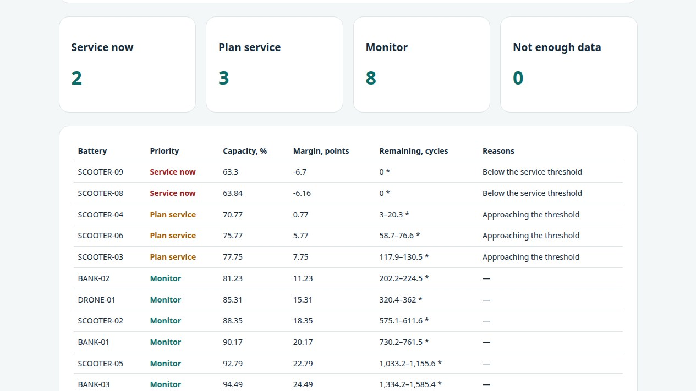

# Use cases

ARGUS-NEURO started from one question: how worn is this battery, and when should I act? Five common situations ask it, each with different priorities. This page states, for each one, what the software does today, what has been validated and what has not. **Numbers on this page that come from laboratory backtests are superseded; see [SAMPLING_AUDIT.md](SAMPLING_AUDIT.md). No field data from vehicles, chargers, scooters, rental power banks or drones were used anywhere in this project**; everything measured comes from laboratory cells (NASA, CALB, HUST) and everything about chargers is simulated.

| Use case | Where in the product | Starting values | Validated | Missing |
|---|---|---|---|---|
| Electric vehicle | Battery page, application "Vehicle" | threshold 80%, margin 5 points | Arithmetic on laboratory cells | Pack data, vehicle OBD/CAN link |
| Charging station | Equipment page, asset type `EV_CHARGER` | – | Pipeline on a synthetic simulator | Real charger telemetry, OCPP adapter |
| Rescue / medical drone | Battery page "Rescue / medical drone", Fleet triage | threshold 85%, margin 8 points | Arithmetic on laboratory cells | Flight data, aviation certification |
| Shared e-scooter | Battery page "Shared e-scooter", Fleet triage | threshold 70%, margin 8 points | Arithmetic on laboratory cells | Scooter data, swap-station tests |
| Rental power bank | Battery page "Rental power bank", Fleet triage | threshold 80%, margin 5 points | Arithmetic on laboratory cells | Rental-network data |

The starting values are editable examples that only pre-fill a form (`GET /api/battery/use-cases`). A service threshold is the operator's decision.

## Electric vehicles

Capacity-based state of health from controlled capacity tests, a conditional remaining-life range, and care advice from the manufacturer limits the user supplies (charging temperature, cell spread, reported hot storage, frequent DC fast charging). No OBD/CAN connection and no charging control. The calibrated interval of the backtest applies to laboratory cells only; a vehicle pack keeps the uncalibrated interval and is labelled that way.

## Charging stations

A DC fast-charging cabinet is a monitored asset (`EV_CHARGER`) next to the shipboard converters and UAV power units. The six sensor channels map to: DC bus voltage, output current, cabinet or connector temperature, cooling-fan vibration, mains frequency and load factor. The demo fleet has three chargers: one healthy, one with cooling or connector degradation (heat and extra current) and one with insulation leakage (current rise, warm cabinet, sub-harmonic content). In a full run the healthy charger is never flagged and both faulty ones are. This is a **synthetic** demonstration: the operating point is illustrative, not a vendor model, and there is no adapter for real charger telemetry (OCPP, vendor APIs). Connecting real data and measuring false alarms is the necessary next step.

## Rescue and medical drones

Select **Rescue / medical drone** for a conservative example threshold and a wider warning margin. When capacity is at or near the threshold the report adds a *review before assigning to time-critical missions* advisory that points to the operator's own procedure and the manufacturer's manual. It is decision support for a dispatcher, not an airworthiness or flight-safety assessment; capacity says nothing about electrical, thermal or crash safety. A reported BMS alarm still produces the urgent advisory and withholds the numeric forecast. The UAV power distribution unit is also available as a simulated asset on the equipment page.

## Shared e-scooters and rental power banks

These fleets have hundreds of small packs and little time per pack, so the page that matters is **Fleet triage**: upload one CSV with one row per capacity test (`battery_id, equivalent_cycles, capacity_ah, reference_capacity_ah`, optional `condition_id, chemistry, temperature_c, service_threshold_pct`) and receive a ranking:

| Priority | Meaning |
|---|---|
| Service now | Below the service threshold, or a battery-management-system alarm was reported |
| Plan service | Within the warning margin above the threshold, the forecast falls within your planning horizon, or the cell voltage spread is above your limit |
| Monitor | Nothing found in the data supplied |
| Not enough data | No comparable measurement |

A sample table is on the page. Up to 300 batteries and 2 MB per upload; the result can be downloaded as CSV, with spreadsheet-formula characters neutralized. Forecast ranges in this table belong to battery packs and are **not calibrated**: in laboratory tests such ranges were far too narrow, so the table marks them with an asterisk.

### Where the capacity measurements come from

A full discharge into a known load at a swap or return station, or the BMS's own full-cycle capacity estimate, recorded together with the cumulative equivalent full cycles. Partial discharges do not measure capacity. Measurements under different conditions (temperature, discharge rate) must carry different `condition_id` values; only the reference condition is compared.

## What would make this field-ready

1. Capacity histories and failures from a real fleet of each kind, with the service decisions that were actually taken.
2. A backtest like [BACKTEST.md](BACKTEST.md) on those packs and a calibration that is valid for them.
3. Recorded charge curves, whose benefit is being re-measured after a sampling leak was found ([SAMPLING_AUDIT.md](SAMPLING_AUDIT.md)).
4. For chargers: real telemetry, an adapter, labelled faults and an accepted false-alarm rate.
5. For drones: the operator's regulatory requirements, which this project does not address.
